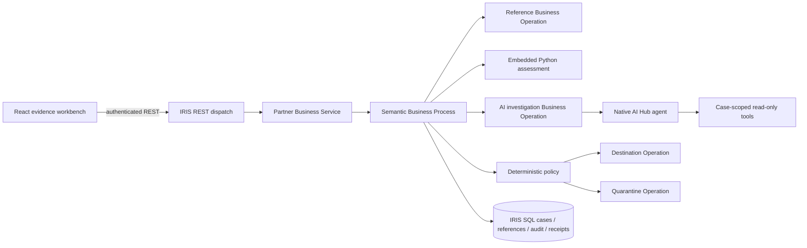

# Native semantic integrity pipeline

## Ownership and contracts

IRIS owns ingestion, durable case records, independent reference snapshots, agent invocation, policy, reviews and delivery. The browser is a client, never the source of decisions. Python is a small pure semantic library called **inside IRIS Embedded Python**. Its host-side tests prove local functions, not interoperability.

`SilentShift.Production` wires Partner, Semantic, References, Investigator, Destination and Quarantine hosts. The request envelope carries a server case ID; the original event lives immutably in the case record. The Business Process retrieves references through an Operation, then calls the pure Python assessment, the native agent Operation with a request deadline, and policy. A late model response has no routing authority. Operations recheck persisted authorization before side effects.

## Persistence and consistency

Persistent classes expose SQL case/reference/audit/delivery data. Event source + event ID is a unique ingestion key. Original content fingerprints detect reuse with changed payload. A lock plus transaction protects key creation. Delivery receipts have a unique case ID and destination; a repeat operation returns the existing receipt. This provides at-most-once effects in the included **IRIS destination simulator**, not atomic delivery to an external ERP. External connectors would require an outbox and destination idempotency protocol.

Cases have a monotonically increasing version and append-only audit rows. Reviews use the expected version, reviewer permission, reason and idempotency key. No endpoint accepts a partner's replacement reference data. Fixtures seed a separate approved-reference catalog. Each case stores the selected reference snapshot so later catalog changes cannot rewrite an investigation's evidence.

Unfinished cases remain visibly processing/held after failures. Recovery re-runs bounded policy/routing only under an explicit safe recovery operation; never retries unknown external side effects. The included restart check must confirm persisted records and receipts before release readiness.

## Agent trust boundary

The native `%AI.Agent` uses only verified SDK patterns pinned in `docs/NATIVE_AI_HUB.md`. Tools bind CaseId on the server, retrieve bounded records, and expose no arbitrary SQL, shell, URLs or mutations. Message notes are untrusted data. The recommendation JSON uses an exact schema and known evidence IDs. The policy checks all release evidence and authoritative contradictions independently of model prose. Agent failure produces a held/review decision, never a hidden successful fallback.

Iteration/token caps bound model work. The enclosing synchronous Operation timeout bounds the Business Process wait; it does not prove provider-side cancellation. Record this limitation and test late results on154. Provider usage/cost remains null unless the actual runtime exposes and records it. No spending is authorized by the presence of a key.

## Authentication and deployment

IRIS password authentication protects the REST web application; a viewer resource controls reads/ingestion and an additional reviewer resource controls review mutations. Credentials are kept in browser memory only and sent over the local same-origin API; remote use requires TLS. The default Docker ports bind to loopback. Source may be public; EAP archives/runtime images may not be redistributed. Docker loads the officially downloaded build154 image locally, then mounts/copies source for compilation. No public runtime image pull or registry push is part of setup.

Build154 uses a separate Web Gateway (NoPWS packaging). The gateway sidecar and authenticated HTTP API have been exercised against the official ARM64 kit, and all21core native classes compile. A fresh manager volume started with zero cases/evaluations and repeated all five expected native outcomes. Subsequent integration changes need their own verification.

## Evidence and failure behavior

Keep raw original JSON, normalized message, received/occurred timestamps, correlation and trace IDs, references, findings, native tool events, model response, policy checks, route receipt and reviewer audit. Redact provider errors to stable codes; never persist credentials. Synthetic fixtures are not customer data. An unavailable runtime yields a disconnected UI and no case counts, agent availability or benchmark claims.
