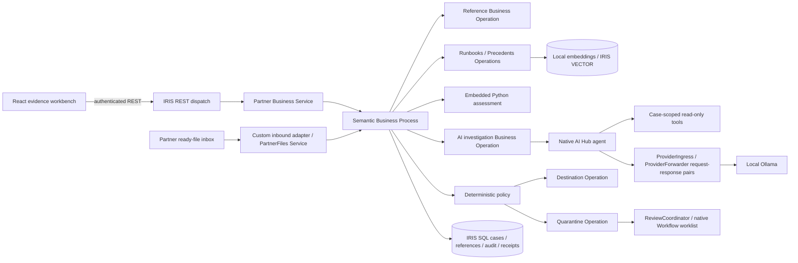

# Native semantic integrity pipeline

## Ownership and contracts

IRIS owns ingestion, durable case records, independent reference snapshots, agent invocation, policy, reviews and delivery. The browser is a client, never the source of decisions. Python is a small pure semantic library called **inside IRIS Embedded Python**. Its host-side tests prove local functions, not interoperability.

`SilentShift.Production` wires REST and file Services, Semantic, reference/retrieval/AI Operations, provider transport, Workflow, Destination and Quarantine. The request envelope carries a server case ID; the original event lives immutably in the case record. Retrieval Operations return context; Semantic owns case persistence before invoking the agent. Four read-only tools expose the current message, approved contracts, related records and a bound precedent snapshot. A late model or retrieval response has no routing authority. Operations recheck persisted authorization before side effects.

## Persistence and consistency

Persistent classes expose SQL case/reference/audit/delivery data. Event source + event ID is a unique ingestion key. Original content fingerprints detect reuse with changed payload. A lock plus transaction protects key creation. Delivery receipts have a unique case ID and destination; a repeat operation returns the existing receipt. This provides at-most-once effects in the included **IRIS destination simulator**, not atomic delivery to an external ERP. External connectors would require an outbox and destination idempotency protocol.

Cases have a monotonically increasing version and append-only audit rows. Reviews use the expected version, reviewer permission, reason and idempotency key. No endpoint accepts a partner's replacement reference data. Fixtures seed a separate approved-reference catalog. Each case stores the selected reference snapshot so later catalog changes cannot rewrite an investigation's evidence.

Unfinished cases remain visibly processing/held after failures. Recovery re-runs bounded policy/routing only under an explicit safe recovery operation; never retries unknown external side effects. The included restart check must confirm persisted records and receipts before release readiness.

## Agent trust boundary

The native `%AI.Agent` uses only verified SDK patterns pinned in `docs/NATIVE_AI_HUB.md`. Tools bind CaseId on the server, retrieve bounded records, and expose no arbitrary SQL, shell, URLs or mutations. Message notes are untrusted data. The recommendation JSON uses an exact schema and known evidence IDs. The policy checks all release evidence and authoritative contradictions independently of model prose. Agent failure produces a held/review decision, never a hidden successful fallback.

Iteration/token caps bound model work. The enclosing synchronous Operation timeout bounds the Business Process wait; it does not prove provider-side cancellation. Each actual provider HTTP call receives native request/response messages in the original case session. Unknown usage, provider retries and billing cost remain null. The released local transport accepts the configured model and known local Ollama hosts. The unpublished provider-configurable source additionally permits explicitly configured HTTPS OpenAI-compatible endpoints; case content cannot select them. Configuration and local protocol tests do not establish live compatibility with external services. See [AI tracing](docs/AI_TRACING.md) for metadata and temporary transport limits.

## Authentication and deployment

IRIS password authentication protects the REST web application; a viewer resource controls reads/ingestion and an additional reviewer resource controls review mutations. Credentials are kept in browser memory only and sent over the local same-origin API; remote use requires TLS. The default Docker ports bind to loopback. Source may be public; EAP archives/runtime images may not be redistributed. Docker loads the officially downloaded build154 image locally, then mounts/copies source for compilation. No public runtime image pull or registry push is part of setup.

Build 154 uses a separate Web Gateway (NoPWS packaging). The gateway and authenticated API run against the official ARM64 kit. Public native IPM 0.3.0 includes the CSV class and shared Python parser; the React workbench remains separately built from source. The provider-configurable source and multi-page interface on `push/top3` are not a new registry release. See the [provider guide](docs/PROVIDERS.md) and [current verification](docs/BUILD_STATUS.md) for their tested boundaries. A fresh manager volume repeated the core five scenarios. Each sponsor extension has its own gate in [BONUS_EVIDENCE.md](docs/BONUS_EVIDENCE.md); source compilation alone does not establish execution.

The CSV UI sends the two original CSV texts to native preview/commit endpoints. Embedded Python uses the same bounded mapping as the CLI. Preview reads existing event identities without writes; commit requires SSImport, revalidates the preview fingerprint and confirmation, then atomically persists immutable references, exact source texts and an import receipt. Raw sources stay in the local application database, separate from the metadata response and agent evidence tools. SSImporter inherits viewer access but is granted only by explicit administrator action. The browser submits lines through the existing Partner service and polls persisted cases. Reference import is atomic; the batch's per-line simulator effects are not a whole-order transaction. Neither a CSV approver name nor the agent can grant reference authority.

## Evidence and failure behavior

Keep raw original JSON, normalized message, received/occurred timestamps, correlation and trace IDs, references, findings, native tool events, model response, policy checks, route receipt and reviewer audit. Redact provider errors to stable codes; never persist credentials. Synthetic fixtures are not customer data. An unavailable runtime yields a disconnected UI and no case counts, agent availability or benchmark claims.
