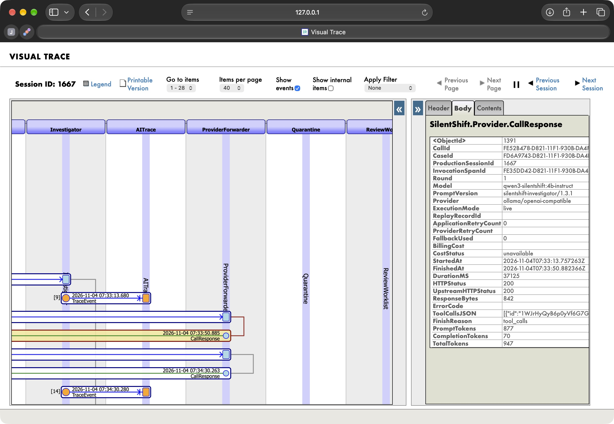
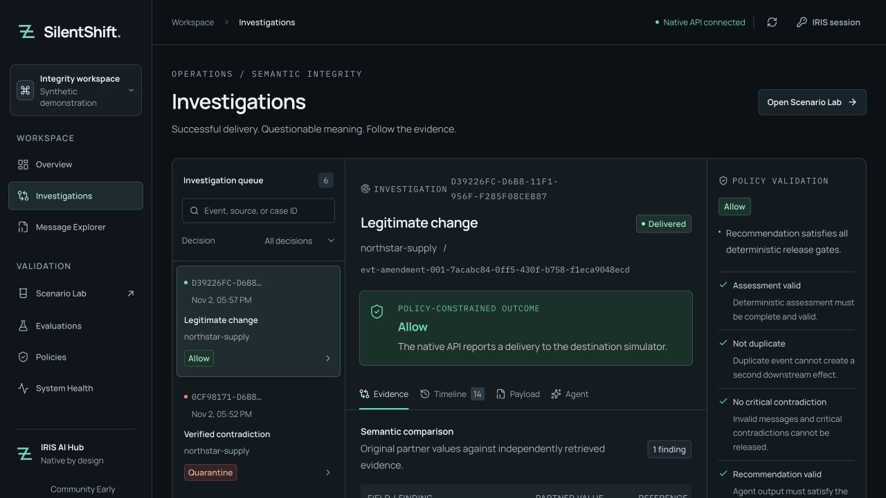
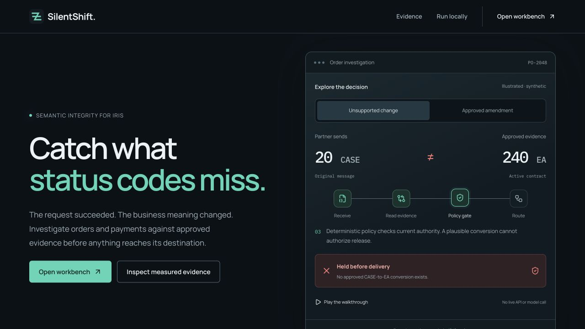

# SilentShift

**Catch wrong business meaning before delivery.**

An order arrives as `20 CASE`. Its approved contract says `240 EA`. The JSON is valid, but no approved conversion explains the change. SilentShift holds the order before the included destination simulator accepts it, then gives the integration operator the message, contract and reason in one investigation.

The same incoming value can be legitimate: an effective approved amendment authorizing `20 CASE` lets the order proceed. SilentShift gives the operator a way to distinguish an unsupported change from an authorized one, with the evidence and delivery outcome in the same investigation.

| Incoming order | Approved evidence at event time | Observed outcome |
| --- | --- | --- |
| `20 CASE` | Contract requires `240 EA`; no authorized conversion | Held; zero simulator deliveries |
| `20 CASE` | An effective approved amendment authorizes the change | Delivered to the simulator |

An IRIS AI Hub agent gathers evidence through four read-only tools and recommends release, quarantine or review. A release recommendation must satisfy deterministic policy; an unresolved agent concern keeps an otherwise eligible order in review. Operators can follow each model exchange in Visual Trace, compare similar precedents and resolve eligible holds through native Workflow tasks. A critical contradiction cannot be approved away. [Where the agent makes a decision](docs/JUDGE_GUIDE.md#where-the-agent-makes-a-decision).

**[Watch the captioned demo](https://youtu.be/a4dOcqu89EA)** · **[Follow the judge walkthrough](docs/JUDGE_GUIDE.md)** · **[Run the keyless native replay](#see-it-in-visual-trace)** · [Open Exchange](https://openexchange.intersystems.com/package/SilentShift)

**Verified scope:** synthetic orders and payments on **IRIS Community AI Hub 2026.3.0AI.154.0 / 154U, ARM64**, with delivery to an IRIS simulator. App/workbench **0.2.1**; public native IPM **0.2.0**. No hosted demo or external ERP/bank delivery is claimed. [Test results and limits](docs/JUDGE_VERIFICATION.md) · [Contest status and bonus evidence](docs/SUBMISSION_CHECKLIST.md).

## Community Idea DPI-I-689: LLM tracing with Interoperability

SilentShift implements [DPI-I-689](https://ideas.intersystems.com/ideas/DPI-I-689) by turning each admitted AI Hub provider exchange into an actual `CallRequest` / `CallResponse` pair in the original business-case session. A queued Business Operation records the model, provider, prompt version, elapsed operation time, returned tool names, HTTP outcome and available response-token counts. Deterministic policy still authorizes delivery; a trace is evidence of execution, not permission to release an order.

**Inspect the implementation:** [keyless replay](#see-it-in-visual-trace) · [native metadata screenshot](#native-provider-metadata) · [Langfuse comparison](#silentshift-iris-interoperability-vs-langfuse). **Bonus status: Pending, organizer-unconfirmed.** The November 6 signed-out check shows the description link but no dedicated **Ideas to the app** association. Open Exchange support has been contacted; no award is asserted.

### See it in Visual Trace

The no-key example replays one recorded assistant answer through the **same native AI Hub agent, evidence tools, provider ingress and queued operation** used in live mode. Tool envelopes are reconstructed; the four tools execute afresh. It creates only the frozen synthetic `20 CASE` versus `240 EA` case, which must stay held with no delivery. It performs no new inference and never reports the original recording's tokens as current usage.

**Verified from fresh clones of `960b6b6` and `e8e1e60` on November 5:** public native **0.2.0** installed on **154U**, production startup passed, and all **5 native test classes / 12 methods** passed. Each isolated instance passed both API replays **12/12**, using its own sessions **24** and **58**, with zero deliveries. [Exact README commands, output and verification limits](docs/JUDGE_VERIFICATION.md). No provider key, new inference or embedding request was used.

This reference recipe uses **macOS/ARM64, Git, Python 3.11+, uv and an already running Colima profile `silentshift` / Docker context `colima-silentshift`**. The official image must already be loaded as `silentshift-iris:2026.3.0AI.154.0`, with `containers.intersystems.com/intersystems/webgateway:2026.1` available locally. It requires at least **1.8 GiB free on the host and 3 GiB in the Docker VM**. The verifier's storage check uses Colima; other Docker platforms need an adapted harness. Obtain licensed runtime prerequisites through the [native setup](#native-build-154-setup). This recipe does **not** require Ollama, model downloads, a provider API key or frontend installation. Internet access is used for Git, Python dependencies, the pinned IPM installer and the public package registry. **Create the clone under a directory already shared with Colima.** The gateway binds two generated configuration files from the checkout; an unshared checkout can install the backend but cannot start the gateway. The directory check below stops before configuration or container creation if the VM cannot see the clone.

1. Start from a fresh clone. Create only local application credentials; the script refuses to overwrite an existing `.env` and never prints passwords:

   ```sh
   git clone https://github.com/himanshu748/silentshift.git silentshift-judge
   cd silentshift-judge
   colima ssh --profile silentshift -- test -d "$PWD"
   python3 - <<'PYCONFIG'
   import os
   from pathlib import Path
   import secrets

   values = {
       "IRIS_IMAGE": "silentshift-iris:2026.3.0AI.154.0",
       "SILENTSHIFT_IRIS_USERNAME": "ss-judge-reviewer",
       "SILENTSHIFT_VIEWER_USERNAME": "ss-judge-viewer",
       "SILENTSHIFT_IRIS_PASSWORD": secrets.token_urlsafe(24),
       "SILENTSHIFT_VIEWER_PASSWORD": secrets.token_urlsafe(24),
       "SILENTSHIFT_GATEWAY_PASSWORD": secrets.token_urlsafe(24),
       "SILENTSHIFT_PROVIDER_MODE": "recorded-replay",
       "SILENTSHIFT_AGENT_WAIT_SECONDS": "120",
       "SILENTSHIFT_EMBED_BASE_URL": "http://host.lima.internal:11434/v1/",
   }
   lines = Path(".env.example").read_text().splitlines()
   content = "\n".join(
       line.split("=", 1)[0] + "=" + values[line.split("=", 1)[0]]
       if "=" in line and line.split("=", 1)[0] in values else line
       for line in lines
   ) + "\n"
   with os.fdopen(os.open(".env", os.O_WRONLY | os.O_CREAT | os.O_EXCL, 0o600), "w") as out:
       out.write(content)
   print("Created private local replay configuration; no provider keys.")
   PYCONFIG
   uv run python scripts/fetch_ipm.py --output .local/ipm/vendor/zpm-0.10.10.xml
   chmod 644 .local/ipm/vendor/zpm-0.10.10.xml
   uv run python scripts/verify_bonus_release.py --source public-registry --install-latest \
     --execution-mode recorded-replay --container silentshift-bonus-registry-judge \
     --api-port 52843 --execute
   ```

   The `chmod` applies only to the checksum-verified public IPM installer so IRIS can read it after Docker copies it; `.env` remains private at mode `600`. The driver installs the public native package **0.2.0** with literal `zpm "install silentshift"` in a **new build-154 container without mounts**, configures the production, runs all **five native test classes / 12 methods**, then runs the API replay. App/workbench release **0.2.1** is a separate version. No file or credential is copied from a previous checkout. Local endpoint values satisfy setup validation; recorded replay makes no inference or embedding request. Existing container names are refused; choose a new name and free port for another run. Logs and local credentials remain in ignored `.local/` and `.env` files. The created containers are retained for inspection.

2. Repeat the actual API journey and print its own session ID and clean portal URL:

   ```sh
   uv run python scripts/trace_example.py \
     --api http://127.0.0.1:52843/silentshift/api \
     --context colima-silentshift --container silentshift-bonus-registry-judge
   ```

   Expected: `execution_mode=recorded-replay`, `fresh_inference=false`, `provider_pairs=5`, `four_tools=1_each`, `routing=QUARANTINED`, `delivery_count=0`, `checks=12/12; passed=true`. The driver compiles the native test helpers before this command; the metadata inspector reads actual persisted native headers and bodies.

3. Open the printed `EnsPortal.VisualTrace.zen?SESSIONID=...` URL. Sign in with a **local IRIS account** permitted to view native message bodies; an InterSystems website login is separate. The default reviewer can read the graph. Native **Body** access additionally requires administrator-managed `%Ens_MessageContent:USE` and SQL `SELECT` on `Ens.MessageHeader` in `SILENTSHIFT`. [Access details](docs/NATIVE_AI_HUB.md#viewing-native-message-properties). No password change is part of this recipe.
4. Follow `Partner → Semantic` for intake and assessment, the reference/precedent operations for evidence, and `Semantic → Investigator` for native AI Hub. Each `ProviderIngress → ProviderForwarder` **CallRequest** and reciprocal **CallResponse** is a separate exchange in that same case session. Select **Body** to inspect its physical properties. `AITrace` carries actual tool-execution events; `Quarantine` and `ReviewCoordinator → ReviewWorklist` show the enforced hold and human task.

### Native provider metadata

Earlier fresh-source replay: session **24**, five recorded exchanges, four executed tools, zero deliveries. [Replay evidence](docs/evidence/idea-replay-load.json). The screenshot below shows a separate **live** call in session **1667**, selected in the native Visual Trace **Body** panel: model, prompt version, provider, timing, tool-call metadata and returned token counts are physical message properties.



That call returned HTTP **200**, **877** input tokens and **70** output tokens in **37,125 ms** of forwarding-operation time. The quantity contradiction still left the case **QUARANTINED**, with zero deliveries. The [failure Body screenshot](docs/assets/provider-failure-body-safari.png) shows session **1807**, HTTP **400**, `UPSTREAM_HTTP_ERROR` and **160 ms** for the intentional invalid-format diagnostic; it also stayed quarantined. Billing cost remains unknown in both. These are unedited portal captures of retained live records, not replay screenshots. Long IDs/tool JSON are clipped by the native panel; the [capture receipt and complete selected metadata](docs/evidence/provider-body-captures.json) preserve their values and record restoration of both temporary read grants.

**Recorded fields:** case/session/invocation/call IDs; provider, model and prompt **version**; request/response times, operation duration, byte counts, offered tools and returned tool-call IDs/names; finish reason; safe error code and HTTP status; zero application retries and false fallback. Live response token counts are recorded only when returned. Raw prompts, tool arguments and raw provider bodies are omitted. Billing cost, SDK/provider retry count and session-token totals remain unknown. Replay marks `execution_mode=recorded-replay`, keeps upstream status/usage null and records its fixture ID. [Exact field map and failure recipe](docs/NATIVE_AI_HUB.md).

### SilentShift (IRIS Interoperability) vs Langfuse

| Dimension | SilentShift in IRIS | Langfuse |
| --- | --- | --- |
| Where traces live | Native message headers/bodies in the case's interoperability session | LLM traces and observations in Langfuse Cloud or a self-hosted service |
| Per-call data | Metadata-only request/response messages; case evidence stored separately | Instrumented inputs/outputs, model parameters, relationships and metadata |
| Prompt versioning | Version string in source and each message; no prompt registry or content hash | Versioned prompts, labels and prompt-to-trace links |
| Tokens and cost | Actual response usage when present; unknown counts/cost null; replay usage null | Ingested usage/cost, with supported inference from model/token/pricing definitions |
| Latency | Forwarding-operation duration, including validation, I/O and parsing | Observation/trace latency and generation timing when instrumented |
| Tool calls | Returned IDs/names plus distinct native execution events; arguments omitted | Nested tool observations with instrumented content and timing |
| Human review | Native Workflow task creation in the intake trace; later review requests have their own sessions and persisted links | Instrument custom application/review spans and attach scores or annotations |
| Replay and resend | Frozen recorded-provider example, event idempotency and native message navigation; resend permission is not granted to reviewers | Dataset experiments and prompt playground workflows; business-message redelivery needs application integration |
| Retention and audit | Persistent IRIS messages and case audit; operator controls purge/retention. No automatic retention guarantee is asserted | Depends on Cloud plan or self-hosted retention/deletion configuration |
| Setup and dependencies | Licensed AI Hub build 154, interoperability production and local Ollama for live mode; no Langfuse service | SDK/OpenTelemetry integration and Cloud or self-hosted Langfuse infrastructure |
| When to choose it | An IRIS operator needs to connect one model exchange to a held/delivered business transaction | Choose Langfuse for dedicated evals, experiments, dashboards, prompt management and cross-application LLM observability |

Comparison based on Langfuse's [observability](https://langfuse.com/docs/observability/overview), [prompt management](https://langfuse.com/docs/prompt-management/overview), [token/cost tracking](https://langfuse.com/docs/observability/features/token-and-cost-tracking) and [datasets/experiments](https://langfuse.com/docs/evaluation/experiments/datasets) documentation. This is a comparison of implemented scope, not feature parity.

## Follow the evidence to a decision

Open an investigation to compare the original partner payload with its immutable reference snapshot. Inspect what the agent actually read, why policy held or released the message, and whether the simulator recorded a delivery. A trace ID connects that investigation to its native IRIS production session.

The agent proposes through four read-only, case-scoped evidence tools: current message, approved contracts, related records and similar precedents. Server policy owns the route: missing evidence, conflicting authority, malformed answers and timeouts cannot justify automatic delivery. A reviewer can resolve an eligible hold with a reason, version and idempotency key; critical contradictions retain their release veto. Native Workflow preserves the human task, including a recorded decision whose completion needs to be resumed.



The native chain is Business Service → Business Process → reference/AI Operations → Embedded Python policy → destination or quarantine Operation. IRIS persists the payload, references, audit, review state and unique simulator receipt. The workbench provides eight API-backed views, including the native Review queue, raw payload inspection and a Scenario Lab with five labeled synthetic experiments.

**Verified boundary:** the core ran on official ARM64 Community AI Hub `2026.3.0AI.154.0` (`154U`), including a fresh-volume repeat. The destination is an IRIS simulator. The [evidence appendix](docs/JUDGE_GUIDE.md#evidence-appendix) retains passing and failed trials, baseline results and measurement limits. No public deployment or external ERP/bank delivery is claimed.

The five-case demonstration is only the starting point. Separate native checks exercise [misleading precedents, concurrent approvals, interrupted review completion and file retries](docs/JUDGE_GUIDE.md#check-failure-and-recovery-behavior). Each has its own recorded outcome and scope; these checks are not combined into an AI accuracy score.

## Interface walkthrough

Open the root page to explore the unsupported order and effective amendment. The interactive illustration changes the approved evidence and explains each stage; it sends no API request and is clearly labeled synthetic. **Open workbench** leads to the real authenticated application. Use **⌘K / Ctrl+K** to find a view or open a complete case ID. Detail transitions respect reduced motion. [UI study and verification](docs/UI_REVIEW.md).



There is **no hosted live demo**. The displayed EAP agreement restricts the downloaded runtime to internal evaluation and explicitly excludes demonstrations. We did not deploy it or claim the online-demo bonus. [Hosting decision and primary terms](docs/HOSTING_REVIEW.md).

## Local checks without IRIS

Requirements: Python 3.10+ with [uv](https://docs.astral.sh/uv/), Node 22.12+ and npm. The Python runtime library has no dependencies. Development versions are locked by `uv.lock` and `web/package-lock.json`.

```sh
uv sync --locked
uv run pytest -q
PYTHONPATH=python uv run python -m silentshift.evaluation \
  --dataset fixtures/v1/scenarios.json --output evidence/local-policy.json
npm --prefix web ci
npm --prefix web run check
npm --prefix web run build
```

For browser checks, install the locked Playwright Chromium if it is not already installed, then run the suite:

```sh
cd web
npx playwright install chromium
npm run test:e2e
```

The browser suite starts its own loopback Vite server with an intentionally unreachable upstream. It tests genuine failure states at 1440×960 and 390×844, all eight workbench routes, keyboard focus, login failure and reduced motion. It does **not** prove connected cases or native integration. Screenshots are saved under `evidence/browser/`.

With the real native stack and an existing critical case running, opt into the separate read-only browser suite:

```sh
SILENTSHIFT_NATIVE_E2E=1 npm --prefix web run test:e2e:native
```

It authenticates using the private local configuration, checks actual evidence/trace data, reviewer permissions and mobile keyboard scrolling. It sends no scenario or review mutations and uses no network mocks.

Start the workbench separately:

```sh
npm --prefix web run dev -- --port 5173 --strictPort
```

Open `http://127.0.0.1:5173`. Until the native stack is available, records and metrics stay unavailable. The static build requires an API reverse proxy when hosted; Vite's proxy is development-only. Do not publish a disconnected static build as a working native demo.

## Native build 154 setup

**Verified runtime: 2026.3.0AI.154.0 Community, ARM64 (154U).** The build guard requires that exact version. The [November 5 clean-clone run](docs/evidence/judge-clean-clone.json) passed public installation, the full native suite and two 12-check replays: sessions **24** and **58**, five provider pairs and four native tool reads each, with zero deliveries. No newer build is declared compatible or verified. Setup requires an authorized build-154 image already obtained from InterSystems; if it is no longer offered, contact the official program. This repository cannot redistribute the kit.

1. Sign in to the [official AI Hub EAP portal](https://evaluation.intersystems.com/Eval/early-access/AIHub). Download Community **2026.3.0AI.154.0** for the Docker host's architecture. The [official template](https://github.com/intersystems-community/ai-hub-dev-template/tree/37280e3d0252f1034cdd5b32f0eeea55ff34ffa7) documents local image loading. No EAP software is bundled here.
2. Start Docker with a modern Compose CLI and enough host storage for its VM, EAP image and persistent manager volume. Setup detects either `docker compose` or standalone `docker-compose` version 2+. A remote Docker context may be used with a source checkout on that host; ordinary remote Docker bind mounts do not upload the local repository. Do not create a paid host or subscription without authorization.
3. Load the official archive outside this repository:

   ```sh
   docker load -i "/absolute/path/to/official-build154-docker.tar.gz"
   docker images
   ```

4. Copy `.env.example` to `.env` and restrict it with `chmod 600 .env`. Set `IRIS_IMAGE` to the exact loaded tag. Supply distinct viewer/reviewer account names and unique passwords, plus a gateway password. Use literal `KEY=value` entries; single-quote values containing `$` or `#`. Do not add inline comments or shell commands. Existing accounts are preserved by setup; their configured credentials must actually match.
5. Configure the local Ollama model `qwen3-silentshift:4b-instruct` and its IRIS-reachable `SILENTSHIFT_LLM_BASE_URL`. The provider gateway rejects other models and remote routes. It issues a short-lived capability for each native investigation; no external provider key is required.
6. Run:

   ```sh
   uv run --env-file .env python scripts/doctor.py
   uv run --env-file .env python scripts/bootstrap.py
   ```

Bootstrap validates the image and credentials, renders ignored `.local/gateway/CSP.ini`, starts the preloaded IRIS image, creates the `SILENTSHIFT` interoperability namespace, loads/compiles classes, seeds independent references and starts the production and separate Web Gateway. It does not inject cases or invoke a model. The optional Dockerfile is local-only; Compose uses the preloaded image directly. Never push EAP or derived runtime images.

The gateway binds to `127.0.0.1:52773`; native 1972 is internal. The IRIS manager volume retains SQL state. **Do not run `docker compose down -v` on retained evidence.** Use ordinary stop/start for recovery testing. Read `.local/bootstrap.log` locally after a bootstrap failure; do not publish diagnostics containing secrets.

### Local Ollama configuration

The verified local option preserves Qwen3's tool template with an explicit 8192-token context and temperature 0.2. The base 4B instruct model is about 2.5 GB. These commands download weights and create an alias; they do not invoke inference or a paid provider:

```sh
ollama pull qwen3:4b-instruct
ollama create qwen3-silentshift:4b-instruct -f config/Ollama.4b.Modelfile
```

Set `SILENTSHIFT_MODEL=qwen3-silentshift:4b-instruct` and, for Colima, `SILENTSHIFT_LLM_BASE_URL=http://host.lima.internal:11434/v1/`. Verify reachability from the IRIS container; this address reaches the existing host loopback service. For Docker Desktop use its documented host address. The model adapter uses build 154's `extra_params` for `reasoning_effort=none`; strict parsing never repairs a model answer. The live transport accepts only this local model and known local Ollama hostnames. The earlier 1.7B configuration is retained for reproducing failed trials and is not the verified default.

The native process wait defaults to 60 seconds. Set `SILENTSHIFT_AGENT_WAIT_SECONDS=120` before bootstrap for the tested resource-constrained local 4B configuration; only integers from 10 through 120 are accepted. One later adapter investigation took 117.491 seconds and completed within that explicit 120-second wait. Earlier 60-second attempts timed out and stayed held. A longer wait changes the local request deadline, not release policy, and a timeout does not establish provider cancellation.

## Prove the native journey

Use the reviewer account for the complete safety gate. The following command invokes five native investigations, plus idempotent retries that must reuse the same case/receipt. This command invokes the configured local model:

```sh
uv run --env-file .env python scripts/verify_native.py --allow-model-calls
```

It checks actual build 154/production status, anonymous denial, all four native evidence reads, nonempty trace IDs, expected policy/routing, one or zero simulator receipts, safe replay, critical reviewer-release denial and persisted evaluation agreement. Evidence goes to ignored `evidence/native/latest.json`. The Evaluations view reads the server-persisted report. A viewer-only execution cannot pass the critical reviewer-policy gate.

Inspect Visual Trace in IRIS using the recorded session ID and an appropriately privileged portal account. Actual checks also cover viewer denial, critical-release veto, typed/blank review reasons, rejection resolution, concurrent approval with one receipt, and restart/recreation persistence. Reference-limit integration tests invoke no model and preserve their isolated synthetic rows:

```sh
uv run --env-file .env python scripts/verify_native_boundaries.py
```

Use `--context`/`--container` when your Docker naming differs. Network-loss recovery, provider cancellation, real external delivery and broader stochastic trials remain unverified; a process timeout does not prove provider cancellation.

Every local provider HTTP call produces typed interoperability request and response messages in the original case session. The retained approved-amendment case in session 374 made four calls (headers 381–388), then delivered once. The explicit SDK failure probe in session 316 recorded a real Ollama HTTP 400 and stayed quarantined with zero deliveries. Current four-tool runs made two exchanges per case. [Successful trace](docs/assets/provider-success-visual-trace.png) · [failure trace](docs/assets/provider-failure-visual-trace.png).

```sh
uv run python scripts/verify_native_provider.py --inspect-case CASE_ID
```

The [native AI Hub guide](docs/NATIVE_AI_HUB.md) maps each field, reproduces the failure and compares the scope with Langfuse. Unknown provider retries and billing cost stay null; actual HTTP response usage is distinct from session totals. Historical invocation/tool evidence remains in [AI_TRACING.md](docs/AI_TRACING.md). [DPI-I-689](https://ideas.intersystems.com/ideas/DPI-I-689) is the implemented idea; organizer acceptance is unconfirmed.

Held transactions now enter a native IRIS Workflow worklist. Connect as the configured reviewer and open **Review** to inspect pending tasks, their original case evidence and policy. A critical contradiction permits rejection; approval remains blocked. Completed tasks leave the pending worklist, while the case keeps the reason, original version, idempotency key and native task receipt. Historical holds are readable and require a new investigation before a new review decision.

```sh
uv run python scripts/verify_native_review_queue.py --allow-new-synthetic-cases
```

The [54-check receipt](docs/evidence/review-queue.json) includes reviewer-only task listing, rejection, two concurrent identical approvals, one review receipt, one native completion response and one simulator delivery. The workbench also completed [actual approve and reject actions](docs/evidence/review-ui.json), shown in the [native worklist](docs/assets/review-native-worklist.png). These isolated synthetic cases skip LLM inference at the evidence-budget guard; existing procedural retrieval can use local embeddings. They do not alter the five evaluation cases.

The earlier controlled postcommit HTTP 503 recovery remains documented in [the Workflow receipt](docs/evidence/workflow.json) and [engineering story](docs/articles/engineering.md). Resume the original recorded request after an uncertain outcome; changing its reason, version or key creates a different decision and is rejected.

## Optional local intake and procedural guidance

### Accept partner JSON from a ready-file inbox

The custom native inbound adapter is dormant by default. Set `SILENTSHIFT_PARTNER_FILES_ENABLED=1` before bootstrap to opt in. Bootstrap creates `.local/partner-inbox` with mode `0700`; Compose mounts it at the adapter's fixed `/var/opt/silentshift/partner-inbox` path. Keep it owned for the trusted operator and container `irisowner`; partner payloads cannot choose a directory.

Write the raw UTF-8 partner **message** JSON to `<name>.json.part`, close it, then atomically rename it to `<name>.json.ready` on the same filesystem. Do not wrap it in a Scenario Lab request. Names contain 1–80 ASCII letters, digits, hyphens or underscores and begin with a letter or digit. The same server validation and reference authority apply as at `POST /messages`.

The adapter claims `.work`, retains the exact input bytes in `.done` or `.hold`, and writes `<name>.json.ack.json` from the persisted outcome. The acknowledgment includes its input SHA-256, case/trace IDs, policy result and simulator receipt. It preserves the first observed outcome: a later review decision changes the case, while its earlier held acknowledgement stays unchanged. Inspect the acknowledgement's timestamp and delivery count, then follow the case for current state. Uncertain dispatches and exhausted retries need operator inspection. Keep fewer than 256 active files per suffix and plan retention explicitly; the adapter deletes no input or archive.

The [file walkthrough](docs/PARTNER_INBOX.md) shows actual ready-file delivery and critical quarantine, with native Visual Trace screenshots. All 82 adapter assertions passed, including acknowledgement recovery and replay without another receipt. The [verification driver](scripts/verify_native_adapter.py) documents activation, bounded test calls and read-only `--inspect-file` use. Earlier failed attempts remain retained separately.

### Retrieve procedures without changing contract authority

Optional procedural retrieval embeds five synthetic runbooks using local `all-minilm:22m` and searches their real 384-dimensional IRIS vectors with `VECTOR_COSINE`. Set `SILENTSHIFT_EMBED_BASE_URL` to the IRIS-reachable local Ollama base address, for example `http://host.lima.internal:11434` with Colima, and `SILENTSHIFT_EMBED_MODEL=all-minilm:22m`. Only the explicit local Ollama port 11434 route is accepted. Ensure the model is installed locally before opting in; bootstrap does not download it or seed embeddings.

Seed the procedures and run six authored retrieval probes explicitly:

```sh
uv run python scripts/verify_native_runbooks.py --allow-local-embedding-calls
```

This performs local embedding calls but creates no LLM investigation. The workbench preserves the top two retrieved procedures; the current prompt passes at most one 400-character excerpt through `GetRelatedRecords`. Procedures guide investigation and never authorize a conversion, amendment or release. This is procedural guidance, not a verified search over previous investigations or a relevance benchmark.

### Find a precedent without borrowing its authority

The **Similar precedents** panel shows up to three real resolved cases or approved amendments with source IDs, outcomes and cosine scores. Local `all-minilm:22m` produces 384-dimensional embeddings stored in a native IRIS `VECTOR` column. The production retrieves them before the native agent's fourth read-only tool, `find_similar_precedents`. Current contracts and deterministic policy remain the release authority.

```sh
uv run python scripts/verify_native_precedents.py --seed --allow-local-embedding-calls
```

The first seed indexed 15 actual resolved demo cases and one approved amendment. New completed cases are indexed through the production. The November 4 live five-case run passed 5/5 with all four reads; a retrieved past delivery could not release a critical current order. See [the precedent walkthrough](docs/PRECEDENTS.md) for commands, screenshots, the misleading-history test and exact runtime limits. The successful repeat used a warmed local model and serialized execution; cold or loaded attempts that timed out are retained separately.

### Package the native backend with IPM

Install the public **silentshift 0.2.0** backend in a prepared interoperability-enabled SILENTSHIFT namespace with IPM 0.10.10 or newer:

```objectscript
zpm "install silentshift"
```

The [verified public-registry test](docs/evidence/bonus-020-registry-install.json) used `install PublicCommunity/silentshift 0.2.0 -synchronous` in a fresh official ARM64 build-154 container without source mounts. All 55 runtime/package files (44 classes, ten assets and the manifest) matched the released source. After explicit setup, all five native test classes / 12 methods and the no-key API replay passed; replay session **24** contained five provider pairs and zero deliveries. The [IPM guide](docs/IPM.md) provides prerequisites, hooks, exact commands and publication details.

Installation alone configures no credentials, starts no production and calls no model. The earlier 0.1.0 clean install also ran all five live scenarios; the current 0.2.0 live regression is separately [verified on the retained runtime](docs/evidence/bonus-020-live.json).

## API and data boundaries

All endpoints are under `/silentshift/api`, protected by IRIS password authentication plus `SSView`. Reviews require `SSReview`. Browser credentials live only in memory. Use TLS outside loopback. `SSApplication` grants database permissions during the REST application only; end-user roles have no permanent database write privilege.

| Endpoint | Behavior |
| --- | --- |
| `GET /health`, `/overview`, `/cases`, `/cases/:id` | Actual production/configuration, counts and evidence; bounded pagination |
| `GET /reviews` | Reviewer-only pending native Workflow tasks, case versions and recorded completion recovery |
| `POST /messages` | Strict partner JSON only; server selects reference authority; exact decimal strings or integers for business numbers |
| `GET /scenarios`, `POST /scenarios/:id/run` | Synthetic fixed-clock replay; required stable UUID `run_id` |
| `POST /cases/:id/review` | `APPROVE`/`REJECT`, reason, expected version and idempotency key; critical contradictions cannot be bypassed |
| `GET /policies` | Current enforced policy rules/version |
| `GET /evaluations`, `POST /evaluations` | Measured reports reconstructed from five persisted native case IDs; capture never invokes a model |

Unknown references, malformed agent output, evidence gaps and dependency failures hold the message. No auto-repair transformation is applied. Source/event IDs deduplicate ingestion; changed content under the same key conflicts. Transactions and unique receipts protect only the included IRIS simulator; an external destination would need its own idempotency protocol.

## Developer Community articles

Both technical articles are publicly readable and link back to the Open Exchange application:

- [Catching semantic failures in an IRIS interoperability production](https://community.intersystems.com/post/catching-semantic-failures-iris-interoperability-production)
- [Recoverable human review in IRIS: from approval to one delivery](https://community.intersystems.com/post/recoverable-human-review-iris-approval-one-delivery)

The articles describe their recorded experiments; those historical counts are separate from later verification runs.

## Documentation and submission

[PRD](PRD.md) · [Design](DESIGN.md) · [Architecture](ARCHITECTURE.md) · [Native SDK evidence](docs/NATIVE_AI_HUB.md) · [Test plan](docs/TEST_PLAN.md) · [Security](SECURITY.md) · [Contest compliance](docs/CONTEST_COMPLIANCE.md) · [Submission ledger](docs/SUBMISSION_CHECKLIST.md) · [Open Exchange copy](docs/OPEN_EXCHANGE_COPY.md) · [Demo script](docs/DEMO_SCRIPT.md)

The verified deadline is November 8 at 23:59:59 EST / November 9 at 10:29:59 IST. The demo is public on YouTube, SilentShift appears in contest 49, and the dedicated DPI-I-689 link and Package Manager option are saved in Open Exchange. Both Developer Community articles are publicly readable and link the application. The questionnaire already has a submitted receipt. Current release and registry-install results are in the [submission checklist](docs/SUBMISSION_CHECKLIST.md); no organizer award is claimed.

## License and attribution

SilentShift source is [MIT](LICENSE). The proprietary InterSystems EAP runtime is separately licensed and excluded. Native patterns derive from the MIT-licensed official AI Hub development template and community interoperability examples; gateway configuration derives from [webgateway-examples](https://github.com/intersystems-community/webgateway-examples/tree/923316d36da1b7ee8382f7faaf145139996f243d/demo-compose). Manrope and IBM Plex Mono font license notices ship in `web/public/licenses/`; Lucide icons use ISC licensing. Product branding is original to this source implementation; no claim of market novelty or production readiness is made.
