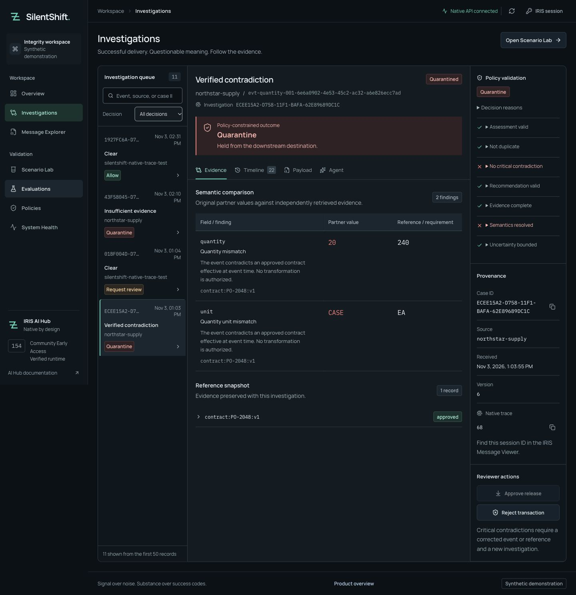
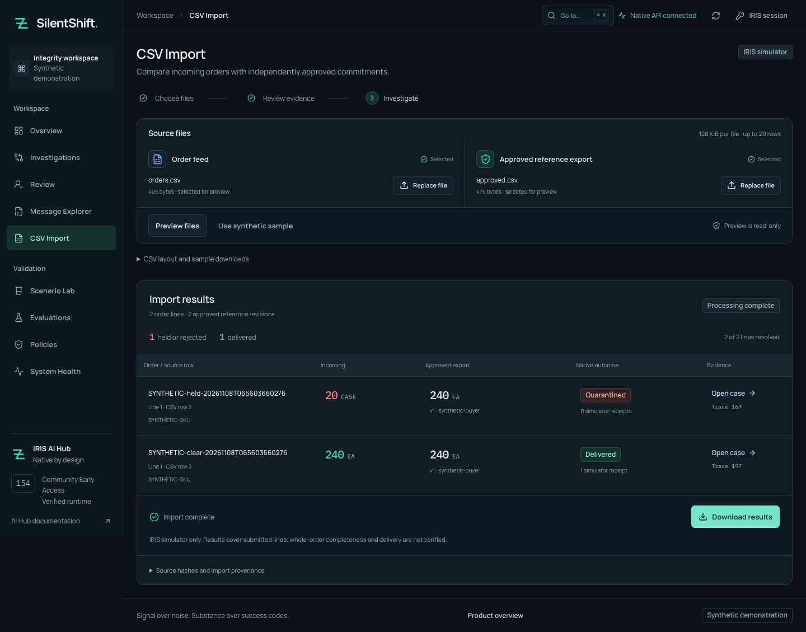
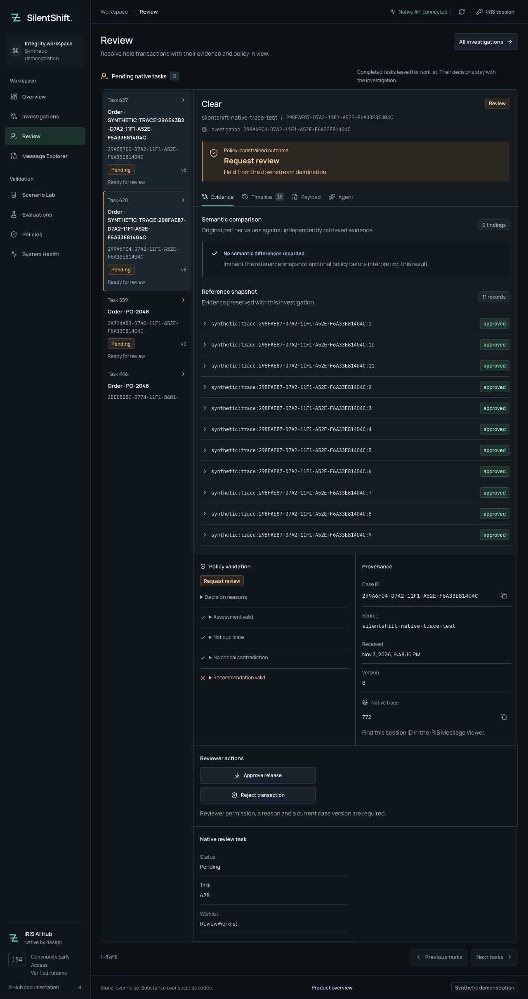

# SilentShift

**Catch orders that are valid JSON but mean the wrong thing, before they're delivered.**

A B2B order arrives as `20 CASE`. The approved contract says `240 EA`. Every transport and schema check passes, yet the business meaning has changed and nothing approved that change. SilentShift is an IRIS Interoperability production that holds that order. An IRIS AI Hub agent investigates it, and the operator sees why it was held.

If an approved amendment *does* allow `20 CASE`, the same order goes through. **The difference between those two outcomes is the authority behind the order, and that's the decision the AI Hub agent helps make.**

**[Watch the captioned demo](https://youtu.be/a4dOcqu89EA)** · [Download MP4](https://raw.githubusercontent.com/himanshu748/silentshift/main/evidence/video/silentshift-demo.mp4) · [Open Exchange](https://openexchange.intersystems.com/package/SilentShift) · [Full install guide](INSTALL.md)

[Preview the separate source workbench home page](evidence/browser/top3-multipage/home-light-desktop.png). This is a recorded source-branch capture, not a hosted app.

<a id="native-build-154-setup"></a>
<a id="installation"></a>

## For judges: two minutes, no installation

1. **Watch the first 90 seconds of the [captioned demo](https://youtu.be/a4dOcqu89EA).** Start with the unsupported `20 CASE` hold and the approved amendment. The full recording is 2:30 and predates CSV and the newer source interface.
2. **[Inspect the captured workflow below](#inspect-the-workflow-without-installing).** Compare the order and approved reference, see a native Workflow task, then open the actual Visual Trace message properties. These are recorded local synthetic cases; they require no login and are not an online demo.
3. **[Check one bonus at a time](#contest-bonuses).** Each row links to execution or publication evidence and separates it from organizer qualification.

To execute the workflow yourself, use the [keyless replay](#keyless-replay-no-model-no-api-key) after obtaining the official image, or follow [INSTALL.md](INSTALL.md) for fresh local Ollama inference. The recorded route should be `QUARANTINED`, `delivery_count=0`, with `checks=12/12; passed=true`.

## Who uses it

SilentShift is for integration operations teams handling partner order feeds. It puts the incoming value, independently approved commitment, recommendation and permitted next action in one case, reducing the need to reconstruct that comparison across payloads, contracts and logs. The `20 CASE` / `240 EA` example illustrates that task; no customer time or money savings have been measured.

## Inspect the workflow without installing

**1 — Compare the business values, not just the JSON.** The captured quantity/unit findings point to the approved contract; the critical case is held and its approve action is disabled. [Case walkthrough](docs/JUDGE_GUIDE.md).



<details>
<summary>2 — CSV intake: a held line and a legitimate line use the same native path</summary>

The operator provides two separate sources: an incoming order feed and an approved-reference export. In this November 8 source-run capture, the unsupported line has no simulator receipt; the matching line delivered once. Native 0.3.0 contains the backend/parser; the web bundle is built separately. [Executed CSV receipt](docs/evidence/csv-isolated-nov8.json).



</details>

<details>
<summary>3 — Human review: inspect the native task and permitted action</summary>

The worklist is read from IRIS Workflow. The operator sees its task/case association and policy checks. A reason and current version are required for a decision; critical contradictions cannot be approved. [Actual approve/reject evidence](docs/evidence/review-ui.json).



</details>

<details>
<summary>4 — Visual Trace: inspect one provider exchange in its business session</summary>

This is the native portal's persisted message body, with model/provider, prompt version, duration, tool-call metadata and available usage. It is a historical live call, not a new inference from viewing this README. Replay explicitly marks its mode and leaves current usage unknown. [Metadata and restoration receipt](docs/evidence/provider-body-captures.json).


</details>

<a id="local-checks-without-iris"></a>
<a id="prove-the-native-journey"></a>
<a id="optional-local-intake-and-procedural-guidance"></a>

### Published package and this branch

Public native IPM and Open Exchange remain **0.3.0**; the separate React package remains **0.2.1**. The new multi-page workbench, configurable providers and bounded demo gateway are on **`push/top3`**, not a newly published package. Use that source checkout for these changes. Earlier native-source receipts cover their recorded replay/local-Ollama snapshots; the public-package check below does not renew verification of all unpublished runtime changes. OpenAI, Gemini and OpenRouter are configuration/protocol-tested only, not verified against their services. [Source verification](docs/evidence/top3-quality.json) · [Provider configuration](docs/PROVIDERS.md).

### Run it locally

Use the numbered [INSTALL.md](INSTALL.md) checklist for prerequisites, the separately licensed **154U ARM64** image, model setup, accounts and the browser workbench. It is the single full installation guide. The local keyless check below needs Git, Python/uv, a running Colima Docker profile and the already-loaded IRIS/Web Gateway images; it needs no Node build, model or application `.env`.

### Keyless replay (no model, no API key)

After starting the documented Colima profile and loading the official build-154 ARM64 and Web Gateway images:

```sh
uv run python scripts/judge_replay.py
```

The launcher creates new isolated test containers and private local test credentials, installs **public native IPM 0.3.0**, starts the production, runs release-matched native tests and performs two recorded replays. It prints their session IDs and Visual Trace URLs. It fetches pinned verification source and the official IPM installer; it never downloads an IRIS image or calls a model. **This verifies the public package, not unpublished source runtime changes.** No `.env` editing is needed for this replay. [Prerequisites, output and troubleshooting](INSTALL.md#optional-check-without-a-model).

The [fresh-main check](docs/evidence/voting-week-nov10/judge-main-nov10.json) passed native **5 classes / 12 methods**, both **12/12** replays and **207 Python tests** on the declared build. Its exact clone and scope are recorded separately from the launcher check. For a port already in use, pass `--api-port 52983`; never replace an existing container or lower disk limits.

## How the decision works

Business Service → Business Process → **IRIS AI Hub agent with scoped read-only tools** → Embedded Python policy → routing Operations.

- The agent returns `ALLOW`, `QUARANTINE` or `REQUEST_REVIEW` with evidence IDs, an explanation and an uncertainty score. Its tools can only read the current case's evidence.
- **The agent proposes; policy decides.** Automatic delivery needs a valid `ALLOW`, complete evidence citations and uncertainty of 0.35 or less. A critical contradiction is held even if the agent says `ALLOW`.
- Eligible holds become native IRIS Workflow review tasks. A reviewer can't approve a critical contradiction.
- Missing, malformed or made-up answers never cause delivery.

[Judge walkthrough](docs/JUDGE_GUIDE.md) · [Features and API](docs/FEATURES.md) · [Architecture](ARCHITECTURE.md) · [CSV order import](docs/CSV_IMPORT.md)

## Community Idea DPI-I-689: LLM tracing with Interoperability

<a id="see-it-in-visual-trace"></a>
<a id="native-provider-metadata"></a>
<a id="silentshift-iris-interoperability-vs-langfuse"></a>

Each AI Hub provider exchange is saved as a native request/response pair in the business session. It records model, provider, prompt version, timing, tool names, outcome and response-token usage when the provider reports it. Unknown cost stays null, and replay never counts recorded tokens as new usage. [How to read the trace](docs/FEATURES.md#see-it-in-visual-trace) · [Native Body capture](docs/assets/provider-success-body-safari.png) · [Field map](docs/FEATURES.md#native-provider-metadata) · [vs Langfuse](docs/FEATURES.md#silentshift-iris-interoperability-vs-langfuse)

The dedicated Open Exchange idea association is now publicly visible; organizer qualification remains **unconfirmed**. [Anonymous readback and scope](docs/evidence/top3-public-review.json).

## What the held-out comparison showed

This is the completed v2 comparison before later source-branch pipeline changes. The newer sealed evaluation is incomplete; no sealed-set result or post-tuning improvement is claimed here.

- On **48 frozen synthetic orders**, rules-only produced **33/48** correct routes; agent + policy produced **33/48, 33/48 and 30/48** across three trials.
- Rules recommended releasing **6/23** release-ineligible orders. The shipped arm made **2/23, 3/23 and 3/23 actual wrong simulator deliveries**, with more false holds: **9/25, 9/25 and 12/25**, versus the baseline's **9/25**.
- **Agent + policy did not improve correct routing in the unstructured split: 1/16 for both in every trial.** Five failed agent attempts remain counted. This does not establish an overall AI accuracy improvement.

[Every result, failure, timing and rules win](docs/EVAL_HELDOUT.md) · [Frozen labels and protocol](fixtures/v2-heldout/FROZEN.md) · [Raw native observations](evidence/heldout/summary.json). Baseline releases are counterfactual choices; only the shipped arm executed simulator deliveries. The same cases repeat across trials and are not independent production orders.

## Honest limits

- All orders are synthetic and deliver only to an IRIS simulator. There's no hosted demo and no real ERP or bank connection.
- Only **2026.3.0AI.154.0 Community / 154U ARM64** is qualified locally. Other builds and platforms are not claimed tested.
- The held-out result above does not establish an overall accuracy improvement or better unstructured routing. The version used in that comparison missed genuine prose-authority cases; every failure remains in the report. Later pipeline changes are not evidence of a measured improvement.

## Contest bonuses

**Verified** means observed behavior or publication in the linked receipt, not awarded points. Every organizer qualification/award remains unconfirmed. [Full ledger and limits](docs/SUBMISSION_CHECKLIST.md).

| Bonus | Status | One evidence link |
| --- | --- | --- |
| Native Workflow | Verified | [Queue, rejection and concurrent approval](docs/evidence/review-queue.json) |
| Custom inbound adapter | Verified | [Native file intake and recovery](docs/evidence/adapter.json) |
| IRIS Vector Search | Verified | [Native vectors and source bindings](docs/evidence/precedent-corpus.json) |
| Docker | Verified | [Fresh no-source-mount public install](docs/evidence/voting-week-nov10/judge-main-nov10.json) |
| Public IPM 0.3.0 | Verified | [Registry install, startup, tests and replays](docs/evidence/voting-week-nov10/judge-main-nov10.json) |
| Developer Community articles | Verified | [Both live articles and OEX backlinks](docs/evidence/voting-week-nov10/public-readback.json) |
| Downloadable demonstration video | Verified | [Anonymous full-file download](docs/evidence/voting-week-nov10/public-readback.json) |
| Questionnaire | Verified | [Retained submitted confirmation](docs/assets/questionnaire-submitted.png); do not resubmit |
| DPI-I-689 implementation | Pending qualification | [Native provider Body evidence](docs/evidence/provider-body-captures.json); dedicated OEX association is public |
| AI Hub bug #17 | Pending vendor/organizer confirmation | [Filed reproduction](https://github.com/intersystems-community/ai-hub-eap-bugreports/issues/17) |
| Embedded Python, Java/.NET PEX, online demo and Embedded Python bug bonus | Not claimed | [Scope and reasons](docs/SUBMISSION_CHECKLIST.md) |

## Developer Community articles

- [Catching semantic failures in an IRIS interoperability production](https://community.intersystems.com/post/catching-semantic-failures-iris-interoperability-production)
- [Recoverable human review in IRIS: from approval to one delivery](https://community.intersystems.com/post/recoverable-human-review-iris-approval-one-delivery)

## License

Source: [MIT](LICENSE). The InterSystems runtime is licensed separately and isn't included. [Dependencies and attribution](docs/FEATURES.md#license-and-attribution).
