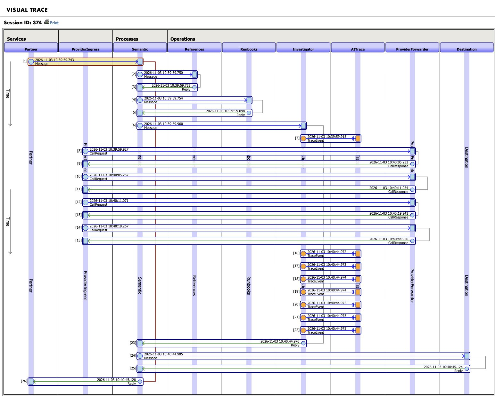
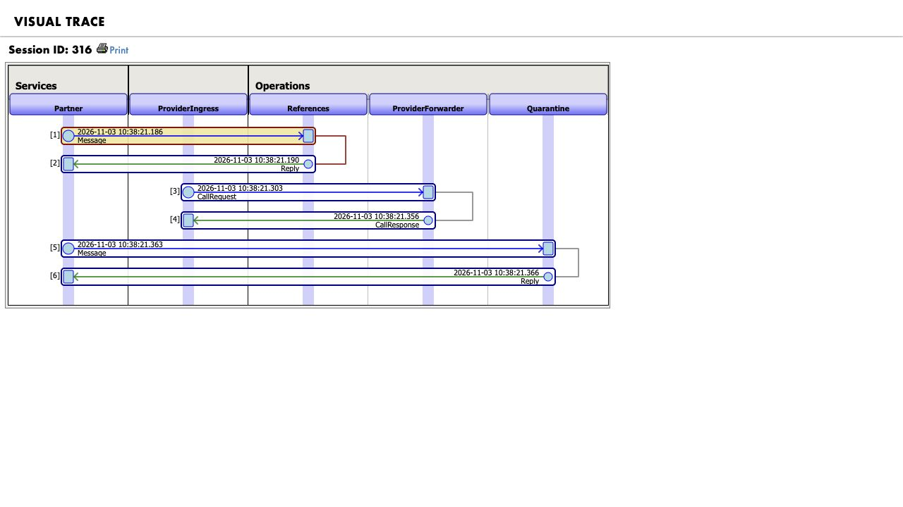

# Native agent and provider-call traceability

SilentShift records native AI Hub investigations, evidence-tool spans, and individual provider HTTP requests and responses in the transaction's **original IRIS interoperability session**. This is an application-specific response to [Community Opportunity DPI-I-689](https://ideas.intersystems.com/ideas/DPI-I-689). Organizer acceptance and the Open Exchange idea-link record remain separate.

## Observed on build 154U

The November 3 local run `5bdbcc9c-2eb8-4d05-9a72-2f38299a4cc8` passed **5/5 end-to-end scenarios** with `qwen3-silentshift:4b-instruct`. Each investigation returned after four gateway requests and actual reads of all three evidence tools. Expected policy/routing, duplicate protection, and the critical reviewer-release veto passed. This is a synthetic fixed-clock evaluation on local Ollama, not production traffic or external-provider evidence.

| Scenario | Case ID | Native session | Provider requests | Route / simulator deliveries |
| --- | --- | ---: | ---: | --- |
| Quantity mismatch | `B6CECB92-D772-11F1-82EF-EED820A70F55` | 322 | 4 | QUARANTINED / 0 |
| Currency scaling | `D6F59DAC-D772-11F1-82EF-EED820A70F55` | 348 | 4 | QUARANTINED / 0 |
| Approved amendment | `EB3307BB-D772-11F1-82EF-EED820A70F55` | 374 | 4 | DELIVERED / 1 |
| Conflicting references | `064A9441-D773-11F1-82EF-EED820A70F55` | 400 | 4 | REVIEW / 0 |
| Unsafe agent output | `246410FA-D773-11F1-82EF-EED820A70F55` | 428 | 4 | QUARANTINED / 0 |

Persisted-message readback passed for **all five cases**: each has four actual `ProviderIngress → ProviderForwarder` requests and four corresponding native responses in its original session. The approved-amendment example uses headers **381–388**, all in session **374**, with HTTP 200 outcomes. Its first three responses request `GetCurrentMessage`, `GetApprovedContracts`, and `GetRelatedRecords`; the fourth contains the final answer. Provider tool-call metadata alone does not prove execution: separate tool audits establish the actual reads.

An isolated SDK failure diagnostic, case `B073F1D4-D772-11F1-82EF-EED820A70F55`, uses session **316**. Actual headers **318 ↔ 319** preserve the local endpoint's **HTTP 400**, `UPSTREAM_HTTP_ERROR`, and a 51 ms forwarding-operation duration. It remained quarantined with zero deliveries. This deliberately invalid-format diagnostic is outside the five evaluation cases and makes no model-quality claim.

Private receipts are `evidence/native/step1-provider-five.json`, `step1-provider-success.json`, and `step1-provider-failure.json`. The [redacted provider-call export](evidence/provider-calls.json) contains **42 real metadata messages**: 40 across the five investigations and the failure diagnostic's request/response pair. It includes paired native headers and bounded typed metadata; raw requests, responses, prompts, function arguments, and credentials are excluded.

## How calls become native messages

Build 154's installed `%AI.Agent.Chat` passes the provider's native token into the bundled runtime. It does not call an overridable ObjectScript `Provider.ChatComplete` method for each round. Renderer callbacks also lack complete per-round transport metadata. SilentShift preserves the native agent and uses the supported `base_url` setting for a genuine local HTTP hop:

```text
native %AI.Agent → internal provider HTTP API
  → ProviderIngress → ProviderForwarder → local Ollama
  ← actual response ← native response message ←
```

[`Lease`](../src/SilentShift/Provider/Lease.cls) issues a short-lived opaque bearer bound to the server-known case, session, invocation span, model, and expiry. The native provider receives this bearer as its API key; its fixed base URL contains no secret. Authentication precedes reading the body. Neither the prompt nor client-supplied association fields choose the case/session or upstream destination.

The fresh [`Ingress`](../src/SilentShift/Provider/Ingress.cls) service sets `%PreserveSession=1` and its server-bound `%SessionId`, then calls `SendRequestSync` on the separately pooled [`Forwarder`](../src/SilentShift/Provider/Forwarder.cls). IRIS creates both headers through its normal queue machinery. They are not reconstructed after `Chat` or reassigned to a session afterward. A typed response represents upstream HTTP failure with an OK interoperability status, preventing automatic Business Operation retries. The relay returns the bounded original upstream body/status when available; metadata parsing does not repair the answer.

## Provider metadata field map

Persisted bodies are [`CallRequest`](../src/SilentShift/Provider/CallRequest.cls) and [`CallResponse`](../src/SilentShift/Provider/CallResponse.cls), schema `silentshift-provider-call/1`, granularity `provider_http_call`.

| Fields | Meaning and limit |
| --- | --- |
| `call_id`, `case_id`, `production_session_id`, `invocation_span_id` | Server-bound pair and parent-investigation correlation. The verifier separately reads native header sessions and `CorrespondingMessageId`. |
| `round` | Monotonic admitted gateway-request number, capped at eight; not an SDK iteration ID or classified retry count. |
| `model`, `prompt_version` | Local model and instruction contract, currently `silentshift-investigator/1.2.0`; not a prompt-content hash. The failure probe uses `provider-protocol-probe/1`. |
| Request `started_at`, `request_bytes`, `tool_names` | Admission timestamp, original request-byte count, and advertised tool catalog; not executed tools. |
| Response `started_at`, `finished_at`, `duration_ms` | Forwarding-operation timing, including validation, HTTP I/O, metadata extraction, and cleanup. Queueing begins earlier; this is not pure network latency. |
| `http_status`, `upstream_http_status`, `error_code`, `response_bytes` | Relay outcome, actual upstream status when received, a fixed safe failure code, and response bytes. A gateway/transport failure can lack upstream status. |
| `tool_calls`, `finish_reason` | Bounded provider-returned tool IDs and allowlisted names with `arguments_omitted=true`, plus a recognized finish reason. Arguments, content, and reasoning are omitted. |
| `response_usage`, `usage_scope` | Numeric usage from this actual HTTP response, or null; scope is `actual_http_response_only`. This differs from the case's final SDK `response_usage`. |
| `application_retry_count`, `provider_retry_count`, `fallback_used` | Zero application retries, unknown SDK/provider retry classification, and no fallback. Admitted repeated requests traverse the gateway again and receive their own pairs. |
| `billing_cost` | Null. No billing or token-derived price is invented, and response usage is not claimed as SDK session totals. |
| `content_retained`, `payload_storage` | No raw content in these persistent provider bodies. Temporary storage is `IRISTEMP_nonjournaled_until_relay_completion`; business evidence and the final proposal remain separately stored in case records. |

The case's `agent.provider_transport` identifies this layer; `provider_request_count` records admitted calls before lease closure. Existing `agent.trace` still describes invocation/tool telemetry. Earlier receipts may contain `provider_round_metadata_available=false`; new source separates `sdk_provider_round_metadata_available=false` from `provider_http_trace_available=true`. SDK callback limitations do not negate the separately verified HTTP messages.

## Bounds, retention, and failure limits

Only the configured local Ollama host on port 11434 and exact model `qwen3-silentshift:4b-instruct` are accepted. The gateway rejects streaming, unknown top-level options, extra tools, multiple choices, and missing/excessive token budgets. Limits are six agent iterations, 700 output tokens per request, eight admitted HTTP calls, and 262,144 bytes per request/response. The investigation wait is 10–120 seconds; lease expiry adds five seconds to that wait, and each forwarder's HTTP timeout uses the remaining lease time. A contained case cannot publish a late result.

Raw data crosses CSP/operation jobs through opaque call keys under `^CacheTemp.SilentShift.Provider`, verified to resolve to nonjournaled IRISTEMP. The outbound legacy stream has an explicit location there. The bounded response stream rejects excess bytes before allocation on the supported identity-encoding path. RAW modes preserve UTF-8 bytes, redirects and gzip requests are disabled, and native HTTP logging must remain below level 3. The forwarder requests identity encoding and checks both content encoding and response-stream identity before relay.

Normal completion/error cleanup removes per-call storage; late completion cannot recreate a removed call node. Observed success/failure receipts verify zero remaining transient call entries. After a process crash or interrupted cleanup, expired entries are swept by the next lease `Open`, inspecting at most 64 entries per kind. There is no background TTL worker or removal guarantee exactly at expiry while idle. IRISTEMP is temporary database storage, not memory-only storage.

The native HTTP client can stage an unexpected gzip response in a temporary file **before** the later encoding check rejects it. The identity-response stream cap therefore does not establish a cap or absence of native temporary files for an endpoint that violates the identity contract. The fixed local Ollama route and metadata-only persistent provider messages are the supported scope; arbitrary upstreams and crash recovery remain unverified.

Invocation/tool telemetry remains complementary: [`Investigation`](../src/SilentShift/Operation/Investigation.cls) emits a start before `Chat`, while tool callbacks buffer bounded metadata until `Chat` exits. Their enqueue time can follow their measured execution time, marked `buffered_until_chat_exit`. A crash can lose buffered tool events. Dispatch/persistence faults, expiry races, cancellation, network loss, and broader retry/fallback behavior need separate fault-injection evidence. Traces never authorize delivery.

## Inspect and reproduce locally

After [native setup](../README.md#native-build-154-setup), this explicit command creates **five new local investigations** and verifies the business journey:

```sh
uv run --env-file .env python scripts/verify_native.py --allow-model-calls \
  --output evidence/native/provider-five-rerun.json
```

For existing cases, the following verifier performs no inference or compilation. It runs a synthetic no-network temporary-stream contract check and reads persisted native messages. Its test class must already be compiled:

```sh
uv run python scripts/verify_native_provider.py --env-file .env \
  --inspect-case EB3307BB-D772-11F1-82EF-EED820A70F55 \
  --output evidence/native/provider-success-readback.json

uv run python scripts/verify_native_provider.py --env-file .env \
  --inspect-case B073F1D4-D772-11F1-82EF-EED820A70F55 --require-failure \
  --output evidence/native/provider-failure-readback.json
```

To create a new isolated failure diagnostic, this command compiles the probe and makes a **real local SDK/provider request** with invalid `response_format=42`. It creates a synthetic diagnostic case and native messages, then contains the case; it adds no evaluation result and attempts no business delivery:

```sh
docker --context colima-silentshift exec -i silentshift-clean-iris-1 \
  iris session IRIS -U SILENTSHIFT <<'IRIS'
set sc=$SYSTEM.OBJ.Load("/opt/silentshift/tests/iris/ProviderProbe.cls","ck")
if $SYSTEM.Status.IsError(sc) { write "PROBE_COMPILE_FAILED",! halt }
set sc=##class(SilentShift.Test.ProviderProbe).Run("failure",.id,.summary)
write "PROBE_STATUS=",sc,!
if sc=1 { write "PROBE_SUMMARY=",summary,! }
halt
IRIS
```

Use the returned case ID with `verify_native_provider.py --require-failure`. Adapt the documented local context/container names to the already-configured target.

## Native Visual Trace

These screenshots were captured from the **authenticated native IRIS Visual Trace page**. Session 374 shows four provider request/response pairs within the successful transaction; session 316 shows the real failure pair followed by quarantine. The HTTP 400 value comes from the persisted typed response in the metadata export; the screenshot shows its native routing relationship.





[`Setup`](../src/SilentShift/Setup.cls) adds `SSNativeTrace` only while an existing `SSReviewer` uses `/csp/silentshift`, through `MatchRoles="SSReviewer:SSNativeTrace"`. It grants `%Ens_MessageTrace:USE`, `%Ens_Portal:USE`, and `%DB_SILENTSHIFT:READ`. It adds no permanent user database role, database write, resend, or production-control permission. Contents and resend remain separately gated.

For a private offline artifact, the installed vendor renderer also exports existing sessions without inference, compilation, security changes, or a new endpoint:

```sh
uv run python scripts/render_native_trace.py --session 374 \
  --output work/native-trace-provider-success.svg \
  --baseline evidence/native/step1-provider-five.json

uv run python scripts/render_native_trace.py --session 316 \
  --output work/native-trace-provider-failure.svg
```

Local receipts verify valid SVG, native header groups matching a direct session read, and credential-pattern absence. The success export also checks the matching baseline payload is absent. The script invokes `EnsPortal.SVG.VisualTrace.%DrawSVGPage` with a unique nosave context and cleans its temporary portal cache. Keep runtime-derived SVG/scripts private. These files remain **native vendor-rendered exports**, distinct from the authenticated portal captures above.

The printable portal path is `/csp/silentshift/EnsPortal.VisualTrace.zen?SESSIONID=374&PRINTABLE=1&PAGE=1`; use `SESSIONID=316` for the diagnostic. The web application also requires `SSView:USE`; IRISTEMP RW is already public on the observed target. Existing application viewer permission alone does not grant native portal access.

## Historical invocation-only evidence

The earlier November 3 [traceability export](evidence/traceability.json) passed **46/46 assertions** across two investigations and one pre-model evidence-limit boundary: approved amendment/session 52, quantity mismatch/session 68, and evidence limit/session 84. It verifies invocation/tool metadata and containment. Those records predate the HTTP gateway and **do not prove per-provider-call coverage**. `verify_native_trace.py` remains the verifier for that complementary layer.

## Scope compared with Langfuse

[Langfuse documents](https://langfuse.com/docs/observability/overview) LLM tracing with inputs/outputs, tools, usage, latency and relationships, together with cost analysis, scores, prompt management, experiments, and dashboards. SilentShift's specific benefit is that its metadata shares IRIS's actual operational session with evidence lookup, deterministic policy, and destination/hold messages. It adds no external telemetry service.

| Need | SilentShift's observed scope |
| --- | --- |
| Follow an AI proposal through a business transaction | Native session links reference lookup, investigation, provider pairs, policy consequence, and route. |
| Inspect individual completion calls | Per-call timing, HTTP outcome, model/instruction version, advertised/requested tools, and response usage. |
| Connect requested tools to actual reads | Provider metadata plus separate execution audits for three case-bound evidence tools. |
| Retain prompts, responses, arguments, or reasoning in provider traces | Deliberately omitted; case records separately retain business evidence and the bounded final proposal. |
| General LLM operations, managed prompts, experiments, cost dashboards | Not implemented; no Langfuse feature-parity or superiority claim. |

Session totals, billing cost, SDK retry classification, streaming token timing, and provider cancellation remain unverified or unavailable as described above.
