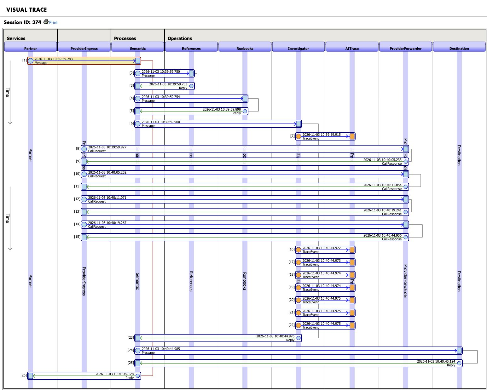
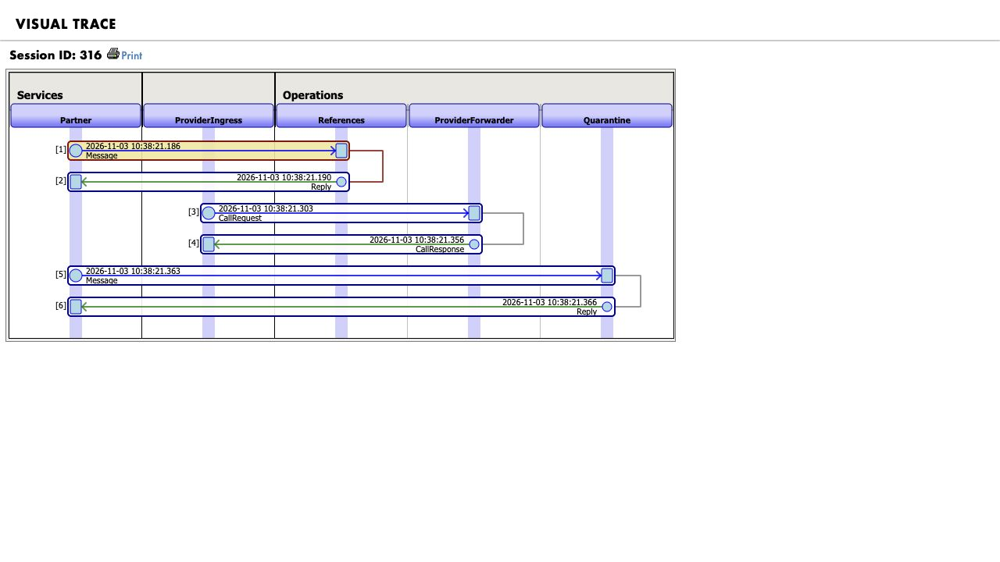
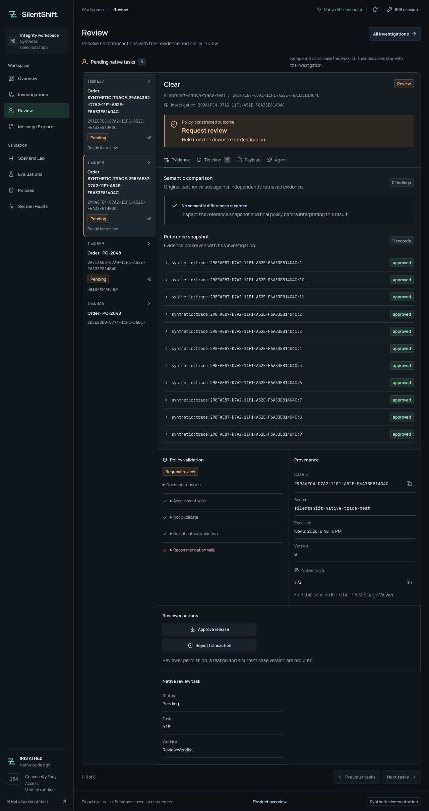
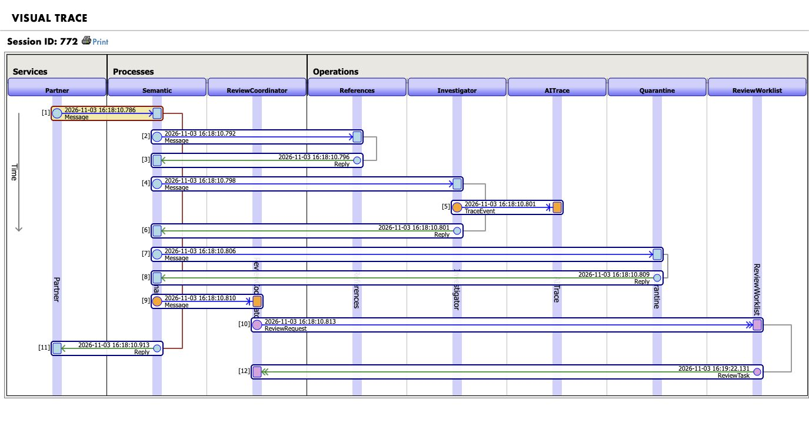
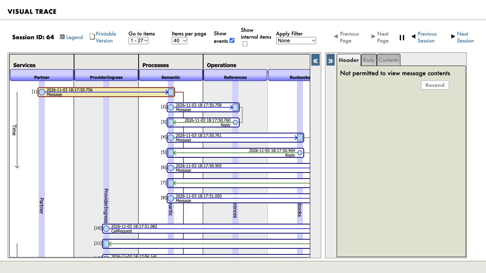

# Sponsor technology evidence

SilentShift holds a technically valid order or payment when its business meaning conflicts with approved records. Sponsor technology must help the operator understand or safely resolve that hold. These are **local execution results, not awarded points**. Only synthetic messages and the IRIS destination simulator are used.

Current boundary: local Ollama `qwen3-silentshift:4b-instruct`, local `all-minilm:22m` embeddings, build 154 ARM64. The user authorized publishing the verified source to GitHub `main` on November 4. Hosting, article/registry publication and form submissions remain outside scope. The earlier questionnaire receipt is a separate historical fact.

| Requested extension | Potential points | Verified behavior / remaining gate |
|---|---:|---|
| DPI-I-689 provider traceability |4 | Every provider HTTP call has native typed request/response messages in the original session. Five actual cases each made four calls; all 40 persisted provider messages passed correlation checks. Actual Ollama 400 failure has its own pair. Authenticated native Visual Trace screenshots below. Organizer acceptance unconfirmed. |
| Native Workflow Engine |2 | VERIFIED: pending native tasks appear in the reviewer-only API and Review view. 54 native queue/concurrency checks and actual workbench approve/reject passed; full native5/5 retained. Award unconfirmed. |
| IRIS Vector Search precedents |2 | VERIFIED: actual resolved cases and an approved amendment embedded locally into 384-dimensional IRIS VECTOR rows. Top 3 case-scoped cosine results, fourth native tool, UI and misleading-precedent veto executed. 5/5 native retained; award unconfirmed. |
| Custom inbound adapter |2 | VERIFIED: two files traversed the real adapter/service and four-tool investigation to DELIVERED / QUARANTINED. All 82 adapter assertions and full native 5/5 passed; authenticated Visual Trace captured. Award unconfirmed. |
| IPM package |2 | Clean local IPM `install` passed on fresh build 154 with no source mount; installed production repeated native 5/5. Public-registry publication/install remain unverified and user-managed; this bonus is not claimed earned. |

## 1. Each LLM call belongs to its business case

A whole investigation span hides which model exchange failed. `ProviderIngress` now sends one `SilentShift.Provider.CallRequest` to `ProviderForwarder` per SDK HTTP call; the typed `CallResponse` is paired by native `Ens.MessageHeader.CorrespondingMessageId`. Both carry the original case session and invocation span. The gateway forwards only to the configured local Ollama route. The deterministic policy still decides delivery.

Executed full native run `5bdbcc9c-2eb8-4d05-9a72-2f38299a4cc8` passed **5/5**, with zero unsafe deliveries. Read-only inspection of all five cases verified all 20 request/response pairs. After the final transport guards, run `00d3f243-3532-4166-ab31-0ac05d3f1f39` again passed 5/5; ten transport checks,164 pytest tests, TypeScript/build, 30 disconnected and 12 native browser checks passed ([gate](evidence/step1-gate.json)). Reproduction:

```sh
uv run --env-file .env python scripts/verify_native.py --allow-model-calls --output evidence/native/step1-provider-five.json
uv run python scripts/verify_native_provider.py --inspect-case EB3307BB-D772-11F1-82EF-EED820A70F55 --output evidence/native/step1-provider-success.json
uv run python scripts/verify_native_provider.py --inspect-case B073F1D4-D772-11F1-82EF-EED820A70F55 --require-failure --output evidence/native/step1-provider-failure.json
python3 scripts/render_native_trace.py --session 374 --output evidence/local/provider-success.svg
```

Case IDs refer to this retained local namespace. On a new install, use IDs returned by a new native run. The exact failure-generation command is in [NATIVE_AI_HUB.md](NATIVE_AI_HUB.md); it invokes the real SDK with an intentionally invalid format, causing local Ollama to return 400 before inference. It is an explicit synthetic transport diagnostic, separate from the frozen five scenarios.

| Observation | Case / session / native headers | Final state |
|---|---|---|
| Approved amendment |`EB3307BB-D772-11F1-82EF-EED820A70F55` /374 /381↔382,383↔384,385↔386,387↔388 | Four actual HTTP 200 exchanges; DELIVERED, one simulator receipt |
| Protocol failure |`B073F1D4-D772-11F1-82EF-EED820A70F55` /316 /318↔319 | Actual HTTP 400, failure caught; QUARANTINED, zero receipts |





These PNGs were captured from authenticated `EnsPortal.VisualTrace.zen` in the live namespace. The SVG export is separately identified as the installed vendor renderer, not a portal screenshot. Reviewer portal access is scoped to trace reads; resend and production control are not granted.

Messages retain metadata, tool names/IDs, model, prompt version, timing, HTTP outcomes and explicit retry/fallback fields. Prompts, arguments, raw provider bodies and capabilities are not persisted in those messages. Actual HTTP response usage is recorded only when present; unknown usage, provider retries and billing cost are null. See the [field map and Langfuse comparison](NATIVE_AI_HUB.md). Interrupted raw transport nodes live in nonjournaled IRISTEMP and are swept on a later lease opening; unconditional physical cleanup latency is not proven. A nonidentity upstream encoding is rejected after native HTTP reading, which can use a native temporary file before rejection.

## 2. A human hold becomes a native task

The operator opens **Review**, selects a native task, reads the case evidence and records a reason. New review and quarantine holds travel through `ReviewCoordinator` to the real `EnsLib.Workflow.Operation` host `ReviewWorklist`. Native role membership is restricted to the configured reviewer; every action also requires the IRIS `SSReview` resource. Critical contradiction tasks offer rejection, while approval remains vetoed by server policy. Historical holds are preserved and require a new investigation before a new decision.

```sh
uv run --env-file .env python scripts/bootstrap.py
uv run python scripts/verify_native_review_queue.py --allow-new-synthetic-cases --output evidence/native/step2-review-queue.json
uv run --env-file .env python scripts/verify_native.py --allow-model-calls --output evidence/native/step2-five.json
SILENTSHIFT_NATIVE_E2E=1 uv run --env-file .env npm --prefix web run test:e2e:native
```

[Native queue receipt](evidence/review-queue.json): **54 checks passed**. Two simultaneous identical approvals returned200 and produced exactly one `ReviewAction`, one native deferred completion response and one simulator delivery. Rejection produced one review receipt/response and zero deliveries. Blank reasons, stale versions, viewer actions and changed content under the same idempotency key were rejected. Completed tasks left the pending queue. These isolated cases skip LLM inference; existing procedural retrieval can use local embeddings.

| Actual workbench action | Case / native task / original session | Observed result |
|---|---|---|
| Approve |`299A6FC4-D7A2-11F1-A52E-F6A33E81404C` /628 /772 | Native task completed; one review receipt, one native response, one delivery |
| Reject |`29AE87CC-D7A2-11F1-A52E-F6A33E81404C` /637 /783 | Native task completed; one review receipt, one native response, zero deliveries |

[UI receipt](evidence/review-ui.json) · [approval capture](assets/review-approved-delivery.png) · [rejection capture](assets/review-rejected.png).





The post-feature run `b5bc69f5-4823-47fe-8e44-f7af579f8f50` passed 5/5; all four held cases have real native tasks. Python 164, TypeScript/build,32 disconnected/landing and 14 native browser checks passed. [Gate summary](evidence/step2-gate.json). The earlier controlled503 recovery remains separate historical evidence; general network-loss/crash recovery is not claimed.

## 3. Similar history stays separate from current authority

An operator can open **Similar precedents** beside the current reference snapshot, inspect actual source IDs, outcomes and cosine scores, and follow a resolved-case link. The production's `Precedents` operation performs the local embedding and native SQL search; `find_similar_precedents` reads the bound snapshot. Neither can alter policy, references or a delivery receipt.

```sh
uv run python scripts/verify_native_precedents.py --seed --allow-local-embedding-calls
uv run --env-file .env python scripts/verify_native.py --allow-model-calls --output evidence/native/step3-serial-five.json
uv run python scripts/verify_native_precedents.py --inspect-case B8440121-D7AB-11F1-9980-CA5720F48492
```

The initial seed wrote 16 actual vectors (15 resolved cases, one approved amendment). Native metadata proves `%Library.Vector`,384dimensions,DOUBLE; native self-cosines and source bindings passed. Automatic production indexing raised the retained corpus to 18 rows after new completed cases. [Source/vector proof](evidence/precedent-corpus.json).

The full run `fc12cbcf-c9fc-4813-8614-8ac944d6e8fd` passed 5/5 with all four native reads. Each case made two actual provider exchanges; each exchange has a native request/response pair. Case `B8440121-D7AB-11F1-9980-CA5720F48492`, session1266, retrieved three previous deliveries and stayed quarantined with zero receipts. A separate native read-only test constructed a valid ALLOW with current citations and zero uncertainty; the critical policy veto remained. [Veto proof](evidence/precedent-veto.json) · [retrieval/tool/header proof](evidence/precedents.json).


[Mobile capture](assets/precedent-evidence-mobile.png) · [walkthrough and commands](PRECEDENTS.md) · [full gate](evidence/step3-gate.json).

Python 172, TypeScript/build,32 disconnected/landing and16 native browser checks passed. The successful native repeat used a warmed local model and serialized execution. Two earlier trials failed native completion gates under load; one concurrent browser run also missed a 12-second navigation assertion, then passed standalone and in the full serialized suite. These failures remain retained; there is no cold-start, broad relevance or production-capacity claim. Payment search currently returns no precedent, correctly shown as empty rather than invented history.

## 4. A partner file reaches the same safety decision

`SilentShift.Adapter.PartnerJSON` extends `Ens.InboundAdapter` and runs on the production's `PartnerFiles` Business Service beside REST intake. Its fixed trusted inbox accepts atomic ready-file drops. Original bytes, bounded processing, dispatch markers and immutable outcome acknowledgements keep retries from creating another delivery.

```sh
uv run python scripts/verify_native_adapter.py --allow-local-model-calls --output evidence/native/step4-adapter-repeat.json
uv run python scripts/verify_native_adapter.py --inspect-file adapter-a0a5ad658f154bb0badf7ff97ae9bf3d-allow
uv run --env-file .env python scripts/verify_native.py --allow-model-calls --output evidence/native/step4-five.json
```

The [82-check receipt](evidence/adapter.json) proves case `D23769A0-D7B0-11F1-9980-CA5720F48492`, session 1610, delivered once; `E10A0F45-D7B0-11F1-9980-CA5720F48492`, session 1636, stayed quarantined with zero receipts. Both made all four native reads. Ack-write recovery, different-name event replay, same-name redrop, exact retained bytes/hashes, malformed/oversized/internal-envelope rejection and symlink refusal passed.


[Same session at Destination](assets/adapter-destination-visual-trace.png) · [operator walkthrough and limits](PARTNER_INBOX.md). An earlier trial needed native review before delivery; its held acknowledgement correctly remained an earlier snapshot. Verifier comparison failures are retained separately from the passing independent repeat.

Full native run `a96c814e-0606-41a1-b469-10f1f94885a9` passed **5/5**. Python 172, TypeScript/build, 32 disconnected/landing and 16 native browser checks passed. [Gate summary](evidence/step4-gate.json). No external partner filesystem or destination is claimed.

## 5. Install the backend without a source checkout

The module declares `<SystemRequirements Version=">=2026.3" Interoperability="enabled" IPMVersion=">=0.9.0"/>`. The actual IPM 0.10.10 archive contains 43 classes, nine runtime assets and its manifest: 53 files, 75,003 bytes. The [clean-install receipt](evidence/ipm-clean-install.json) records its SHA-256 and the actual command:

```objectscript
zpm "repo -name LocalArchive -fs -depth 2 -path /home/irisowner/silentshift-ipm-release/repository/"
zpm "install LocalArchive/silentshift 0.1.0 -synchronous"
```

The official ARM64 154U container began without the namespace/application or a source mount. Four installed Python origins resolved below the manager directory; five deterministic cases, ten invalid-path checks and all ten empty application/workflow tables passed. Activation left production stopped. Separate explicit setup started the production, indexed one approved amendment with one local embedding request and ran one separately labeled SDK warmup diagnostic. The subsequent native run `07131314-9713-44ee-b2e1-72d36f777678` passed **5/5 final outcomes**, **4/5 expected model proposals**, all four tools and persisted evaluation. Policy retained the correct review route despite the model's concern.



Approved-amendment case `E13308D8-D7B2-11F1-8CC1-0B0AF26491C5`, session 64, delivered once. [Same session at Destination](assets/ipm-clean-destination-visual-trace.png) · [install commands and driver](IPM.md) · [final gate](evidence/step5-gate.json).

Two driver handoff errors were repaired in the same retained fresh container: CPF staging on tmpfs and transition from Docker's exclusive `none` network. Installation and the five-case evaluation each ran once. The isolated containers are now stopped; the original production remains healthy. Python 172 (including 29 packaging tests), TypeScript/build, 32 disconnected/landing and 16 native browser checks passed. No runtime binary, image or registry package was published. The organizer's IPM publication requirement remains manual.

## Other eligible technology and manual work

Embedded Python (3 potential points) and Docker (2) are already part of the verified core. The five frozen scenarios are demonstrations, not a general accuracy benchmark; deterministic rules also score5/5 on them. The agent adds inspectable investigation, not a measured accuracy uplift.

| Manual/external item | State |
|---|---|
| YouTube demonstration (3) | Verified [2:30, 1080p H.264/AAC captioned MP4](../evidence/video/silentshift-demo.mp4), 3,561,558 bytes; full decode and caption round-trip passed. [Upload copy](YOUTUBE_UPLOAD.md) ready. No YouTube upload performed. |
| Developer Community articles (2+1) | Local [overview](articles/overview.md) and [engineering story](articles/engineering.md) drafts; no publication. |
| Questionnaire (1) | Submitted earlier with the user's answers; [actual confirmation](assets/questionnaire-submitted.png). No new response is needed unless the user chooses to amend it. Award unconfirmed. |
| IPM publication (2) | Clean local install and native execution verified; user must publish and verify the public-registry install. No registry publication performed. |
| Open Exchange / contest | Earlier saved draft, not sent for approval or confirmed registered. Finished [local application copy](OPEN_EXCHANGE_COPY.md) is ready for the user. |
| Online demo (2) | Not hosted; explicitly outside the current authorization. |
| PEX / vendor bug bonuses | No required Java/.NET boundary or verified vendor defect; no claim. |

Criteria are from the [official bonus announcement](https://community.intersystems.com/post/technology-bonuses-intersystems-programming-contest-ai-agents-interoperability-workflows) and [DPI-I-689](https://ideas.intersystems.com/ideas/DPI-I-689). Organizer awards, eligibility and saved contest state remain separate from engineering evidence. [JUDGE_GUIDE.md](JUDGE_GUIDE.md) describes the product journey; [BUILD_STATUS.md](BUILD_STATUS.md) retains detailed history.
