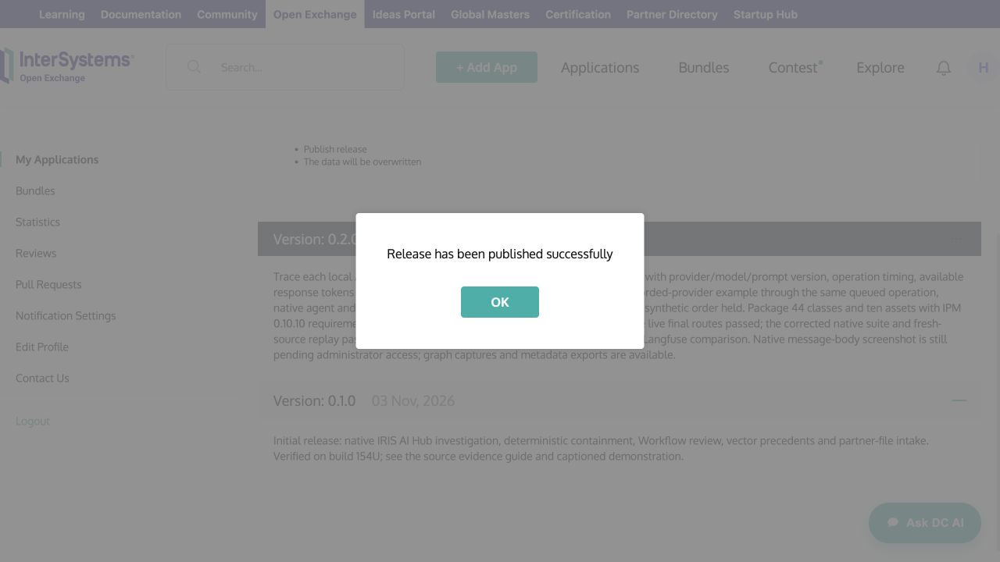
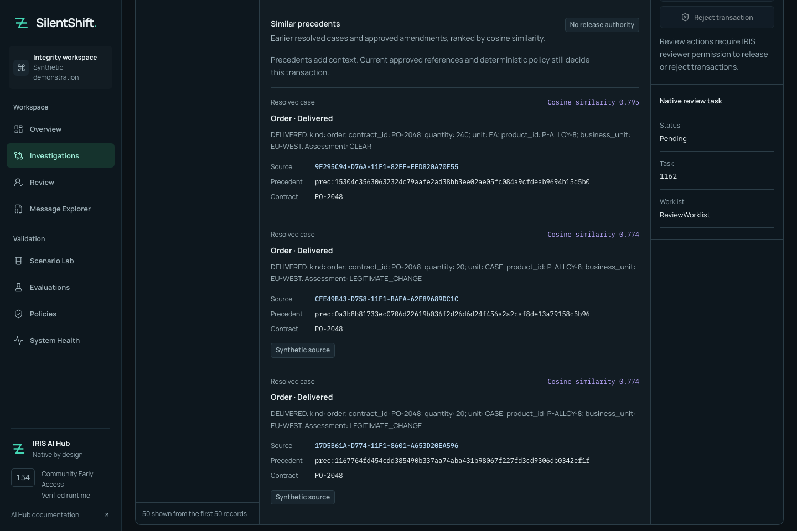

# Published native 0.3.3 — November 12, 2026 (IST)

## November 12 hosted replay verification

[The guided demo](https://34.239.152.223.sslip.io/demo/) now runs the supported recorded quantity-mismatch proposal through native IRIS policy and Java PEX export. [Outside-host checks and actual reboot receipt](evidence/demo-nov12/summary.json) passed; [the signed receipt verifies independently](evidence/demo-nov12/after-reboot-pex-receipt-verification.json). This is hosted replay, not fresh inference or a new evaluation. The online-demo claim is pending submission/organizer review; no points are added to the published total. [Expiry, operating limits and the restricted trace-page warning](ONLINE_DEMO.md). Older dated trial checkpoints below are historical.

## Current bonus review - November 12, 2026 (IST)

The [official table](https://community.intersystems.com/post/technology-bonus-results-intersystems-programming-contest-ai-agents-interoperability-workflows) credits SilentShift with **29 technology-bonus points**, including **Java PEX (3)** and **Community Idea (4)**. This is separate from overall contest placement, prizes and vendor bug resolution. Embedded Python reports [#35](https://github.com/intersystems-community/python-bugreports/issues/35) and [#36](https://github.com/intersystems-community/python-bugreports/issues/36) are filed, with retained standalone reproductions in [the preparation folder](launch/bonus-nov12/findings.md); their additional credit remains unconfirmed. No second AI Hub defect was established. The [hosted recorded replay](ONLINE_DEMO.md) is now verified with outside-host and reboot evidence; its claim remains pending submission/organizer review, and no extra credit is assumed. Native IPM stays **0.3.3**, React **0.2.1**, with no native-package or routing change.

GitHub tag/release, the anonymous OEX release and public registry manifest identify **0.3.3**. A [fresh public registry install](evidence/public-033-nov12/summary.json) passed explicit startup, **8 native classes / 28 methods** and **two 12/12 keyless replays**, with release-matched assertions from a fresh `v0.3.3` clone. [Publication readback](evidence/public-033-nov12/publication.json) · [commands](evidence/public-033-nov12/commands.txt) · [test-driver correction and limits](JUDGE_VERIFICATION.md).

Native runtime, agent, deterministic policy and frozen inputs are unchanged from 0.3.2; React remains **0.2.1**. No bonus status or organizer qualification changes from this installation check. Static evidence pages remain recorded material, not an online native demo. OEX's saved description still contains 0.3.2 wording; a separate correction is prepared, not saved.

## Earlier dated checkpoints

# Published native 0.3.2 — November 11, 2026 (IST)

**Checked November 11, 2026 (IST).** GitHub release [v0.3.2](https://github.com/himanshu748/silentshift/releases/tag/v0.3.2), OEX and the public IPM archive now identify native **0.3.2**; React remains **0.2.1**. [Anonymous publication/manifest/source readback](evidence/ipm-032-publication-nov11/publication.json). The archive includes Java PEX and the saved receipt-mode fix. Main release source is `cfc4c279853886a72772a92ad70c2e2c5eae3819`; [main CI passed](https://github.com/himanshu748/silentshift/actions/runs/42985826498).

A [fresh offline archive installation from that tag](evidence/ipm-032-final-nov11/summary.json) passed with the application empty and stopped. This used a separately generated native archive, not the downloaded public registry artifact. The [receipt-mode regression](evidence/receipt-mode-nov11/summary.json) and [earlier live citation checks](evidence/citation-fix-nov11/summary.json) retain their exact snapshots. The subsequent [fresh public 0.3.2 gate](evidence/voting-nov11-judge/summary.json) separately passed startup, the native suite and both recorded replays. No new live model run, hosted demo or organizer qualification is implied. The saved listing body still says 0.3.0; [a description-only correction is prepared](OPEN_EXCHANGE_COPY.md), not saved. The Java PEX follow-up is drafted, not posted.

## Historical verification and claim checkpoints

The dated passages below describe their original state. Current publication status is above; the current bonus table retains each qualification limit. Do not repeat historical release or questionnaire actions.

## Historical citation checkpoint — November 11, 2026 (IST)

At this earlier checkpoint, the missing-citation failure was fixed in the then-unpublished **0.3.2** source candidate. The policy, assessment bridge, routing store/process and frozen inputs remain byte-identical. Three predeclared sets passed **15/15**, followed by a final **5/5** after message-storage checks. All **20** signed receipts verified independently. Native **8 classes / 26 methods**, **394 pytest**, TypeScript/build and **54** browser checks passed. The regenerated archive installed in a pristine offline container; application tables stayed empty and production stopped. Live checks are a retained-instance upgrade, not a fresh archive model run. Hosted branch CI had not yet run at that checkpoint.

**Java PEX is Claimed in the source README at the owner’s request; qualification remains pending.** The Java-specific public follow-up is deferred until its evidence links are public; this source declaration is not a posted claim or an awarded bonus.

[Fix and limitations](CITATION_COMPLETENESS.md) · [new receipt](evidence/citation-fix-nov11/summary.json). **At that checkpoint, 0.3.2 was unpublished and public 0.3.1 was unchanged.** The earlier failed run below remains history and is not rewritten as passing.

## Earlier checkpoint

# Java PEX source-candidate verification — November 11, 2026 (IST)

**Java PEX: claim prepared (3 points), not submitted or awarded.** Native **0.3.2** is prepared but unpublished; public native IPM/OEX remain **0.3.1**, which lacks this operation. React remains **0.2.1**.

The real [`SilentShift.PEX.ReceiptExporter`](../java/src/main/java/SilentShift/PEX/ReceiptExporter.java) extends `com.intersystems.enslib.pex.BusinessOperation`. [`Production`](../src/SilentShift/Production.cls) hosts it through `EnsLib.PEX.BusinessOperation` and the native managed `%Java Server`. Destination and Quarantine call it after their existing store methods commit; errors preserve the original route. The [new receipt](evidence/bonus-claims-nov11/java-pex.json) separates fresh local Compose playback, clean source-loaded IPM/live cases, Java/native tests and archive verification. [Authenticated Visual Trace](evidence/bonus-claims-nov11/java-pex-trace.png) · [signed sample](evidence/bonus-claims-nov11/java-pex-receipt.json) · [five native cases](evidence/bonus-claims-nov11/java-pex-frozen-cases.json) · [independent signature checks](evidence/bonus-claims-nov11/java-pex-signatures.json).

The tested environment remains **2026.3.0AI.154.0 / 154U ARM64**. Fixtures, assessment/policy bytes and safety vetoes are unchanged. The export is an integrity record with operator-held keys, not externally certified identity, guaranteed export or tamper-proof storage. [Detailed limits and reproduction](JAVA_PEX.md). No hosted demo, .NET implementation, new bug or organizer qualification is claimed. No public action was taken.

**Historical release-gate failure, superseded by the citation follow-up:** the API five-case run passed 5/5, but an explicit ObjectScript repeat passed 4/5. The approved-amendment model output omitted required citations; the unchanged `EVIDENCE_COMPLETE` gate held it for review. All ten cases produced valid Java receipt responses. The failing assertion is retained, not weakened. No further model retry or policy/prompt change was made; the second fresh archive install and hosted branch CI remain unverified. [Failure](evidence/bonus-claims-nov11/java-pex-objectscript-repeat.json).

## Earlier bonus review

# Bonus-claim update — 2026-11-11 10:01:00 IST

**Embedded Python: Claimed for organizer review (3 points), not awarded.** [`SilentShift.Bridge.Assess` and `.Policy`](../src/SilentShift/Bridge.cls) are `[Language = python]` methods. The native [`Semantic` process](../src/SilentShift/Process/Semantic.cls) calls them for assessment and routing. Their hashes, and the Python engine hash, match the [earlier source/live identity receipt](evidence/voting-finish-nov10/candidate-031-source-identity.json); the [live native receipt](evidence/voting-finish-nov10/fresh-live-five.json) records executed cases. [Current source audit](evidence/bonus-claims-nov11/embedded-python.json). This is evidence review, not a new native run.

The November 5 Not claimed decision was an explicit owner scope restriction. No technical disqualification was found. The owner's November 11 instruction supersedes that restriction for **usage only**. The [signal-11 candidate](bug-reports/callback-signal11-candidate.md) remains unisolated, unfiled and **Not claimed**; using Embedded Python and finding a reproducible vendor bug are separate criteria.

The [current README table](../README.md#contest-bonuses) and [checklist](SUBMISSION_CHECKLIST.md#every-bonus) request review of Docker, IPM, Workflow, PartnerJSON, Vector Search, Embedded Python, DPI-I-689, AI Hub issue #17, both articles, video and the already-submitted questionnaire. Public IPM/OEX are **0.3.1** and React is **0.2.1**; [anonymous readback](evidence/bonus-claims-nov11/public.json). Dedicated idea visibility is resolved, but idea/bug qualification and all awards remain unconfirmed.

The unchanged video downloads anonymously with a matching local hash; [current full-file/media check](evidence/bonus-claims-nov11/video.json). Release-asset upload and the DC comment are prepared and **not sent**. At this earlier checkpoint Java/.NET PEX, online demo and the Embedded Python bug bonus stayed **Not claimed**; the newer Java source-candidate result above supersedes the Java status only. [Exact draft and gated action order](agent-runs/bonus-claims-nov11.md).

## Historical verification checkpoints

The dated sections below retain their original publication, scope and claim states; the current update above supersedes historical Not claimed wording for Embedded Python usage only.

> **November 10 voting-week finish:** fresh GitHub candidate `7b3d5ef` is native **0.3.1, prepared but unpublished**. Native **7 classes / 22 methods**, both **12/12** replays, a separate clean archive install, **5/5** live source routes, **16/16** connected browser checks, **393 pytest** and hosted CI pass. The source Compose workbench passes **12/12** and real browser login. **40 Ruff findings remain individually explained**, not suppressed. [Scoped receipts](JUDGE_VERIFICATION.md#voting-week-finish--fresh-github-clones). Public native IPM/OEX stay **0.3.0**, React **0.2.1**; bonus statuses are unchanged.

> **November 10 source-branch readback:** new [native held-case Body/Event Log captures](evidence/backend-polish-nov10/11-native-ui.json) are explicitly recorded replay on 154U ARM64, with temporary read permissions [restored exactly](evidence/backend-polish-nov10/11-permissions-restored.json). They add inspectable evidence, not bonus qualification or a new public package. The [current maintenance gate](JUDGE_VERIFICATION.md#current-local-branch-repeat) retains its incomplete delivered-case/connected-data checks. All bonus statuses below remain unchanged.

# Sponsor technology evidence

**Public native IPM 0.3.0 is published and clean-install verified on November 8, 2026 UTC.** Open Exchange release **0.3.0** is visible in a live signed-out browser; the React workbench remains **0.2.1** and runs separately from source. [Publication/readback](evidence/ship-030-publication.json) · [fresh registry install](evidence/ship-030-registry.json). The new description was sent for approval; its older 0.2.0 wording remains public until moderation completes. Dedicated public DPI-I-689 visibility, idea qualification, bug confirmation and all organizer awards remain unconfirmed.

The public 0.3.0 native suite and two recorded replays passed. [Native output](evidence/ship-030-native-tests.txt) · [repeat replay](evidence/ship-030-repeat.json). Candidate live, Workflow, vector, adapter and CSV-browser evidence below retains its original scope; publication does not establish an organizer award. All Not claimed statuses remain unchanged.

**Historical release-preparation status, November 8, 2026:** native **0.3.0 candidate passed** the [fresh-source native/browser gate](evidence/candidate-030.json): native suite, live scenarios, two recorded replays, Workflow review and CSV import. It remains **unpublished**. Public native IPM is last verified at **0.2.0**; OEX/frontend remains **0.2.1**. [Source identity and full scope](JUDGE_VERIFICATION.md#final-release-candidate-source-freeze-november-8-2026-utc). The earlier Linux-only checks below retain their separate scope. **No bonus status or organizer award changed.** [Owner publication steps](IPM.md#owner-only-030-publication-runbook).

## Final local repeat — November 8, 2026

The [final pass](JUDGE_VERIFICATION.md#final-source-pass--november-8-2026-utc) repeated normal source bootstrap, native unit tests and the five scenarios after repairing installation scope. It also repeated [human-review approval/rejection and concurrency](evidence/final-pass-nov8-review.json), [live file intake and recovery](evidence/final-pass-nov8-adapter.json), [CSV browser intake](evidence/final-pass-nov8.json), [provider-message inspection](evidence/final-pass-nov8-provider.json) and [native-vector evidence inspection](evidence/final-pass-nov8-precedents.json). These are local behavior/artifact confirmations, not organizer awards. The historical adapter receipt has no defined aggregate counting rule, so its former numeric label has been replaced with a behavior label; its recorded data is unchanged.

At the time of the earlier **same-instance 154U pass**, public native IPM was **0.2.0**; the [download](evidence/final-pass-nov8-ipm-artifact.json) matched that archive. Preparing a local 0.3.0 manifest did not publish it. The anonymous [listing/contest/article check](evidence/final-pass-nov8-public.json) passed; dedicated idea visibility and vendor/organizer qualification remain unconfirmed. The existing video file remains downloadable. No OEX edit, registry publication, forum/support message, article edit or questionnaire resubmission occurred. Existing Not claimed statuses remain in force.


SilentShift holds a technically valid order or payment when its business meaning conflicts with approved records. Sponsor technology must help the operator understand or safely resolve that hold. These are **local execution results, not awarded points**. Only synthetic messages and the IRIS destination simulator are used.

**OEX/native IPM release: 0.3.0. Separate React workbench: 0.2.1. Verified runtime: 2026.3.0AI.154.0 Community, ARM64 (154U).** Live evidence uses local `qwen3-silentshift:4b-instruct` and local `all-minilm:22m` embeddings; recorded replay performs no new inference. No newer IRIS build is claimed. **Every organizer award remains unconfirmed**, including rows whose implementation or publication is Verified. At that historical checkpoint the Embedded Python usage bonus was Not claimed under the owner’s November 5 instruction; the current claim update above supersedes it. Its native execution evidence remains valid. The [submission checklist](SUBMISSION_CHECKLIST.md) is the current status index; dated experiments below retain their original version and results. The November 5 OEX description edit was submitted after the user authorized it; DC articles were unchanged.

| Requested extension | Potential points | Verified behavior / remaining gate |
| --- | ---: | --- |
| DPI-I-689 provider traceability | 4 | Pending: admitted provider calls have typed request/response messages in the case session. The 0.2.0 live gate verified ten pairs across five cases; replay verified five pairs and four executed tools. Native Body screenshots and Langfuse comparison are public. Dedicated OEX association remains owner-visible / publicly absent at last check; organizer acceptance unconfirmed. |
| Native Workflow Engine | 2 | VERIFIED: pending native tasks appear in the reviewer-only API and Review view. 54 native queue/concurrency checks and actual workbench approve/reject passed; full native 5/5 retained. Award unconfirmed. |
| IRIS Vector Search precedents | 2 | VERIFIED: actual resolved cases and an approved amendment embedded locally into 384-dimensional IRIS VECTOR rows. Top 3 case-scoped cosine results, fourth native tool, UI and misleading-precedent veto executed. 5/5 native retained; award unconfirmed. |
| Custom inbound adapter | 2 | VERIFIED: two files traversed the real adapter/service and four-tool investigation to DELIVERED / QUARANTINED. All 82 adapter assertions and full native 5/5 passed; authenticated Visual Trace captured. Award unconfirmed. |
| IPM package | 2 | Verified: public native **0.3.0** installs with `zpm "install silentshift"` in a fresh build-154 container without source mounts. Explicit startup, full native suite and both recorded replays passed. [Registry receipt](evidence/ship-030-registry.json). Live five-case evidence is the separate source-candidate run. Award unconfirmed. |

## Historical November 5 freeze-pass check

The November 5 **fresh-clone README path passed** on declared build **154U**: public native **0.2.0** installation, explicit production startup, authenticated health, **5 native test classes / 12 methods**, and two **12/12** API replays. Sessions **24** and **58** each contain five provider pairs, four native tool reads and zero deliveries. No provider key, inference or embedding request was used. [Exact commands and output](JUDGE_VERIFICATION.md) · [receipt and message metadata](evidence/judge-clean-clone.json). Earlier disk and mount failures remain in the history; this new result closes that gate without changing runtime code.

The November 5 OEX update was saved and sent for approval, with contest/IPM checked and the dedicated DPI-I-689 link, video and both article URLs verified after reload. The owner view shows the new product description and **Awaiting Review**. The later November 5 signed-out browser check shows the submitted description and idea link, but no dedicated Ideas to the app section; Awaiting Review remains visible. [Current readback](ENTRY_REVIEW.md). [Submission receipt](evidence/oex-submitted-nov5.json). The AI Hub defect was [filed as #17](https://github.com/intersystems-community/ai-hub-eap-bugreports/issues/17), with exact reproduction and compiler evidence; vendor and organizer confirmation remain pending. [Filing receipt](evidence/ai-hub-bug-filed.json). SilentShift remains in contest 49; all awards remain unconfirmed.

## Earlier public-install verification — November 4

Two additional pristine official build-154 containers installed public native package **0.2.0** with the literal `install silentshift`, with no source mounts. Both passed the entire native suite (five classes / 12 methods) and explicitly started the production. Recorded replay passed **12/12**, session **24**, four executed tools, five recorded provider exchanges and zero deliveries. The separate live local-Ollama run passed **5/5** final routes with four tools each, sessions **30, 58, 86, 113, 141**. Its one SDK warmup and one amendment embedding are disclosed separately. [Replay receipt](evidence/final-public-replay.json) · [live receipt](evidence/final-public-live.json) · [commands and output](FINAL_PASS_REPORT.md).

At the November 4 public check, OEX release **0.2.1** and the refreshed README were visible in anonymous retrieval. The owner portal retains the dedicated idea association, checked IPM/contest options and an Awaiting Review badge. A fresh signed-out Safari window and anonymous extraction omitted the dedicated idea association; runtime verification alone does not establish that every organizer requirement is publicly visible. Both articles are now public. Online hosting is **Not claimed** because of the displayed EAP licence. One AI Hub bug is a reproduced, unfiled draft; the historical crash candidate is not a confirmed Embedded Python defect. [Current bonus states](SUBMISSION_CHECKLIST.md).

## Native package 0.2.0 verification — November 4 (app release is 0.2.1)

The existing live transport already recorded model, prompt version, response tokens and operation duration. Version 0.2.0 adds physical provider/mode/replay/retry/fallback/cost-status properties and an explicitly labeled no-key replay through the same queued forwarder. It keeps deterministic release policy unchanged. The build remains **2026.3.0AI.154.0**, with exact observed `$ZVERSION` **IRIS for UNIX (Ubuntu Server LTS for ARM64 Containers) 2026.3.0AI (Build 154U) Thu Sep 24 2026 10:05:18 EDT**. No build-109 result is claimed.

### Requested LLM-call metadata audit

| Requested field | Actual persisted message property / boundary |
| --- | --- |
| Prompt / version | `PromptVersion=silentshift-investigator/1.3.1`; raw prompt and content hash are not recorded |
| Model and provider | `Model`, new `Provider`; local `qwen3-silentshift:4b-instruct` / `ollama/openai-compatible`, separately labeled recorded provider in replay |
| Input/output tokens | Response `PromptTokens`, `CompletionTokens`, `TotalTokens` only when supplied; zero preserved, missing counts null in JSON; replay usage null |
| Latency | Response `StartedAt`, `FinishedAt`, `DurationMS`; validation + I/O + parsing/cleanup, not pure inference latency |
| Tool calls | Request `ToolNamesJSON`; response `ToolCallsJSON` with IDs/names and omitted arguments; separate `AITrace` events prove actual execution |
| Cost | `BillingCost` unset/null; `CostStatus=unavailable`; no inferred price or zero-cost claim |
| Errors | `HTTPStatus`, nullable `UpstreamHTTPStatus`, safe `ErrorCode`; no exception/provider-body dump |
| Session | `ProductionSessionId`, `CaseId`, `InvocationSpanId`, `CallId`, `Round`; actual `Ens.MessageHeader` pair IDs checked |
| Retries / fallback | Physical `ApplicationRetryCount=0`, `ProviderRetryCount` unset/null, `FallbackUsed=false`; no automatic model retry or fallback |
| Replay provenance | `ExecutionMode=recorded-replay`, `ReplayRecordId`; historical original usage stays in fixture provenance only |

The [README](../README.md#community-idea-dpi-i-689-llm-tracing-with-interoperability) contains the idea link, exact no-key recipe and fair Langfuse comparison. The dedicated Open Exchange idea field was read back with the same URL, alongside checked contest and IPM fields. Organizer qualification remains unconfirmed.

**Live regression:** `uv run --env-file .env python scripts/verify_native.py --allow-model-calls --output evidence/native/bonus-020-live-five.json` passed **5/5 final outcomes**, with four actual native tools per case. Sessions **1667, 1695, 1723, 1750, 1778** each contain two real local provider exchanges. Read-only `verify_native_provider.py` checked all ten pairs / 20 metadata bodies and transient cleanup. [Live receipt with field values and header IDs](evidence/bonus-020-live.json).

**Current failure diagnostic:** the documented `ProviderProbe.Run("failure",...)` made one actual local SDK/provider request with invalid format. Case `36DC88F3-D824-11F1-A71B-4A5ECD1428BB`, session **1807**, recorded upstream HTTP **400**, safe `UPSTREAM_HTTP_ERROR`, remained QUARANTINED and produced zero deliveries. [Failure metadata and actual headers](evidence/bonus-020-live-failure.json). No model-quality or inference-success claim is made.

**First fresh-source proof:** `verify_bonus_release.py --source load --container silentshift-bonus-load-20261104 --api-port 52793 --execute` installed 0.2.0 with no mounts. Its first native test attempt failed two new test expressions; ObjectScript underscore-property access in assertion macros was corrected to `%Get`. The full suite then passed all **five classes / 12 methods**. The runner's success return was initially mistaken for assertion success; the driver now rejects explicit failed assertions and requires each test-class pass line. This failure remains disclosed and is not counted as a passing attempt.

The actual API replay returned session **24**, five request/response pairs, all four native tool reads, QUARANTINED and zero deliveries; **12/12 checks** passed. [Replay receipt](evidence/idea-replay-load.json). The CLI uses the separately compiled native verification helper, loaded by the documented driver. A second container load succeeded, but activation paused at the disk floor and a post-restart readiness check failed; that attempt was stopped after two failures. Its proposed inspector refinement was removed, and source hashes were compared with the first successfully verified load.

**Native Body screenshots completed:** [successful call, session 1667](assets/provider-success-body-safari.png) and [protocol failure, session 1807](assets/provider-failure-body-safari.png) now show the physical `SilentShift.Provider.CallResponse` properties in Visual Trace. Header **1677** / body **1391** records HTTP 200, **37,125 ms**, **877** prompt tokens and **70** completion tokens. Header **1810** / body **1506** records HTTP 400, `UPSTREAM_HTTP_ERROR`, **160 ms** and unknown usage. Both cases remain quarantined with zero deliveries. The selected metadata was read back from persisted native messages; both inspections passed. [Commands, image hashes and restoration receipt](evidence/provider-body-captures.json).

The earlier content-only permission attempt could enable the tab but could not read `Ens.MessageHeader`; the in-app browser also failed to render the later attempt. With the user's approval, the successful Safari capture temporarily added `%Ens_MessageContent:USE` and SQL `SELECT` on that single table to the portal-scoped `SSNativeTrace` role. Both grants were removed immediately afterward and independently checked: original resources restored, header SELECT **0**, header write **0**. No password or permanent role change was made. The historical graph-only images below remain valid separate artifacts.

### Publication state

Anonymous public 0.1.0 metadata and manifest returned HTTP 200 on November 4; its public archive is distinct from the historical local archive. Open Exchange's developer portal shows **Published** and the public contest page lists **SilentShift**. **Release 0.2.0 was published**, and anonymous metadata/manifest returned HTTP 200. A fresh `install PublicCommunity/silentshift 0.2.0 -synchronous` then passed production startup, all five native test classes / 12 methods and replay **12/12**, session **24**, on port **52813**. All 55 runtime/package files from the actual registry cache match the released source. [Complete public-install receipt](evidence/bonus-020-registry-install.json). The description refresh was sent separately for approval; the app still appears on contest 49. A successful local `load` is never counted as a public `install`.



[Description sent for approval](assets/oex-020-description-sent.jpg) · [contest listing after release](assets/oex-contest-49-silentshift.jpg).

## 1. Each LLM call belongs to its business case

A whole investigation span hides which model exchange failed. `ProviderIngress` now sends one `SilentShift.Provider.CallRequest` to `ProviderForwarder` per SDK HTTP call; the typed `CallResponse` is paired by native `Ens.MessageHeader.CorrespondingMessageId`. Both carry the original case session and invocation span. The gateway forwards only to the configured local Ollama route. The deterministic policy still decides delivery.

Executed full native run `5bdbcc9c-2eb8-4d05-9a72-2f38299a4cc8` passed **5/5**, with zero unsafe deliveries. Read-only inspection of all five cases verified all 20 request/response pairs. After the final transport guards, run `00d3f243-3532-4166-ab31-0ac05d3f1f39` again passed 5/5; ten transport checks, 164 pytest tests, TypeScript/build, 30 disconnected and 12 native browser checks passed ([gate](evidence/step1-gate.json)). Reproduction:

```sh
uv run --env-file .env python scripts/verify_native.py --allow-model-calls --output evidence/native/step1-provider-five.json
uv run python scripts/verify_native_provider.py --inspect-case EB3307BB-D772-11F1-82EF-EED820A70F55 --output evidence/native/step1-provider-success.json
uv run python scripts/verify_native_provider.py --inspect-case B073F1D4-D772-11F1-82EF-EED820A70F55 --require-failure --output evidence/native/step1-provider-failure.json
python3 scripts/render_native_trace.py --session 374 --output evidence/local/provider-success.svg
```

Case IDs refer to this retained local namespace. On a new install, use IDs returned by a new native run. The exact failure-generation command is in [NATIVE_AI_HUB.md](NATIVE_AI_HUB.md); it invokes the real SDK with an intentionally invalid format, causing local Ollama to return 400 before inference. It is an explicit synthetic transport diagnostic, separate from the frozen five scenarios.

| Observation | Case / session / native headers | Final state |
| --- | --- | --- |
| Approved amendment | `EB3307BB-D772-11F1-82EF-EED820A70F55` / 374 / 381↔382, 383↔384, 385↔386, 387↔388 | Four actual HTTP 200 exchanges; DELIVERED, one simulator receipt |
| Protocol failure | `B073F1D4-D772-11F1-82EF-EED820A70F55` / 316 / 318↔319 | Actual HTTP 400, failure caught; QUARANTINED, zero receipts |


These PNGs were captured from authenticated `EnsPortal.VisualTrace.zen` in the live namespace. The SVG export is separately identified as the installed vendor renderer, not a portal screenshot. Reviewer portal access is scoped to trace reads; resend and production control are not granted.

Messages retain metadata, tool names/IDs, model, prompt version, timing, HTTP outcomes and explicit retry/fallback fields. Prompts, arguments, raw provider bodies and capabilities are not persisted in those messages. Actual HTTP response usage is recorded only when present; unknown usage, provider retries and billing cost are null. See the [field map and Langfuse comparison](NATIVE_AI_HUB.md). Interrupted raw transport nodes live in nonjournaled IRISTEMP and are swept on a later lease opening; unconditional physical cleanup latency is not proven. A nonidentity upstream encoding is rejected after native HTTP reading, which can use a native temporary file before rejection.

## 2. A human hold becomes a native task

The operator opens **Review**, selects a native task, reads the case evidence and records a reason. New review and quarantine holds travel through `ReviewCoordinator` to the real `EnsLib.Workflow.Operation` host `ReviewWorklist`. Native role membership is restricted to the configured reviewer; every action also requires the IRIS `SSReview` resource. Critical contradiction tasks offer rejection, while approval remains vetoed by server policy. Historical holds are preserved and require a new investigation before a new decision.

```sh
uv run --env-file .env python scripts/bootstrap.py
uv run python scripts/verify_native_review_queue.py --allow-new-synthetic-cases --output evidence/native/step2-review-queue.json
uv run --env-file .env python scripts/verify_native.py --allow-model-calls --output evidence/native/step2-five.json
SILENTSHIFT_NATIVE_E2E=1 uv run --env-file .env npm --prefix web run test:e2e:native
```

[Native queue receipt](evidence/review-queue.json): **54 checks passed**. Two simultaneous identical approvals returned 200 and produced exactly one `ReviewAction`, one native deferred completion response and one simulator delivery. Rejection produced one review receipt/response and zero deliveries. Blank reasons, stale versions, viewer actions and changed content under the same idempotency key were rejected. Completed tasks left the pending queue. These isolated cases skip LLM inference; existing procedural retrieval can use local embeddings.

| Actual workbench action | Case / native task / original session | Observed result |
| --- | --- | --- |
| Approve | `299A6FC4-D7A2-11F1-A52E-F6A33E81404C` /628 /772 | Native task completed; one review receipt, one native response, one delivery |
| Reject | `29AE87CC-D7A2-11F1-A52E-F6A33E81404C` /637 /783 | Native task completed; one review receipt, one native response, zero deliveries |

[UI receipt](evidence/review-ui.json) · [approval capture](assets/review-approved-delivery.png) · [rejection capture](assets/review-rejected.png).


The post-feature run `b5bc69f5-4823-47fe-8e44-f7af579f8f50` passed 5/5; all four held cases have real native tasks. Python 164, TypeScript/build, 32 disconnected/landing and 14 native browser checks passed. [Gate summary](evidence/step2-gate.json). The earlier controlled 503 recovery remains separate historical evidence; general network-loss/crash recovery is not claimed.

## 3. Similar history stays separate from current authority

An operator can open **Similar precedents** beside the current reference snapshot, inspect actual source IDs, outcomes and cosine scores, and follow a resolved-case link. The production's `Precedents` operation performs the local embedding and native SQL search; `find_similar_precedents` reads the bound snapshot. Neither can alter policy, references or a delivery receipt.

```sh
uv run python scripts/verify_native_precedents.py --seed --allow-local-embedding-calls
uv run --env-file .env python scripts/verify_native.py --allow-model-calls --output evidence/native/step3-serial-five.json
uv run python scripts/verify_native_precedents.py --inspect-case B8440121-D7AB-11F1-9980-CA5720F48492
```

The initial seed wrote 16 actual vectors (15 resolved cases, one approved amendment). Native metadata proves `%Library.Vector`, 384 dimensions, DOUBLE; native self-cosines and source bindings passed. Automatic production indexing raised the retained corpus to 18 rows after new completed cases. [Source/vector proof](evidence/precedent-corpus.json).

The full run `fc12cbcf-c9fc-4813-8614-8ac944d6e8fd` passed 5/5 with all four native reads. Each case made two actual provider exchanges; each exchange has a native request/response pair. Case `B8440121-D7AB-11F1-9980-CA5720F48492`, session 1266, retrieved three previous deliveries and stayed quarantined with zero receipts. A separate native read-only test constructed a valid ALLOW with current citations and zero uncertainty; the critical policy veto remained. [Veto proof](evidence/precedent-veto.json) · [retrieval/tool/header proof](evidence/precedents.json).



[Mobile capture](assets/precedent-evidence-mobile.png) · [walkthrough and commands](PRECEDENTS.md) · [full gate](evidence/step3-gate.json).

Python 172, TypeScript/build, 32 disconnected/landing and 16 native browser checks passed. The successful native repeat used a warmed local model and serialized execution. Two earlier trials failed native completion gates under load; one concurrent browser run also missed a 12-second navigation assertion, then passed standalone and in the full serialized suite. These failures remain retained; there is no cold-start, broad relevance or production-capacity claim. Payment search currently returns no precedent, correctly shown as empty rather than invented history.

## 4. A partner file reaches the same safety decision

`SilentShift.Adapter.PartnerJSON` extends `Ens.InboundAdapter` and runs on the production's `PartnerFiles` Business Service beside REST intake. Its fixed trusted inbox accepts atomic ready-file drops. Original bytes, bounded processing, dispatch markers and immutable outcome acknowledgements keep retries from creating another delivery.

```sh
uv run python scripts/verify_native_adapter.py --allow-local-model-calls --output evidence/native/step4-adapter-repeat.json
uv run python scripts/verify_native_adapter.py --inspect-file adapter-a0a5ad658f154bb0badf7ff97ae9bf3d-allow
uv run --env-file .env python scripts/verify_native.py --allow-model-calls --output evidence/native/step4-five.json
```

The [Native file-intake/recovery receipt](evidence/adapter.json) proves case `D23769A0-D7B0-11F1-9980-CA5720F48492`, session 1610, delivered once; `E10A0F45-D7B0-11F1-9980-CA5720F48492`, session 1636, stayed quarantined with zero receipts. Both made all four native reads. Ack-write recovery, different-name event replay, same-name redrop, exact retained bytes/hashes, malformed/oversized/internal-envelope rejection and symlink refusal passed.


[Same session at Destination](assets/adapter-destination-visual-trace.png) · [operator walkthrough and limits](PARTNER_INBOX.md). An earlier trial needed native review before delivery; its held acknowledgement correctly remained an earlier snapshot. Verifier comparison failures are retained separately from the passing independent repeat.

Full native run `a96c814e-0606-41a1-b469-10f1f94885a9` passed **5/5**. Python 172, TypeScript/build, 32 disconnected/landing and 16 native browser checks passed. [Gate summary](evidence/step4-gate.json). No external partner filesystem or destination is claimed.

## 5. Install the backend without a source checkout

The historical 0.1.0 module declared `<SystemRequirements Version=">=2026.3" Interoperability="enabled" IPMVersion=">=0.9.0"/>`. Its actual IPM 0.10.10 archive contains 43 classes, nine runtime assets and its manifest: 53 files, 75,003 bytes. The [clean-install receipt](evidence/ipm-clean-install.json) records its SHA-256 and the actual command:

```objectscript
zpm "repo -name LocalArchive -fs -depth 2 -path /home/irisowner/silentshift-ipm-release/repository/"
zpm "install LocalArchive/silentshift 0.1.0 -synchronous"
```

The official ARM64 154U container began without the namespace/application or a source mount. Four installed Python origins resolved below the manager directory; five deterministic cases, ten invalid-path checks and all ten empty application/workflow tables passed. Activation left production stopped. Separate explicit setup started the production, indexed one approved amendment with one local embedding request and ran one separately labeled SDK warmup diagnostic. The subsequent native run `07131314-9713-44ee-b2e1-72d36f777678` passed **5/5 final outcomes**, **4/5 expected model proposals**, all four tools and persisted evaluation. Policy retained the correct review route despite the model's concern.


Approved-amendment case `E13308D8-D7B2-11F1-8CC1-0B0AF26491C5`, session 64, delivered once. [Same session at Destination](assets/ipm-clean-destination-visual-trace.png) · [install commands and driver](IPM.md) · [final gate](evidence/step5-gate.json).

Two driver handoff errors were repaired in the same retained fresh container: CPF staging on tmpfs and transition from Docker's exclusive `none` network. Installation and the five-case evaluation each ran once. The isolated containers are now stopped; the original production remains healthy. Python 172 (including 29 packaging tests), TypeScript/build, 32 disconnected/landing and 16 native browser checks passed. No runtime binary or image was published. At this historical 0.1.0 checkpoint, public registry availability was unverified. The later public 0.2.0 install, startup and replay receipts above supersede that gate.

## Other eligible technology and manual work

Embedded Python (3 potential points) and Docker (2) are already part of the verified core. The five frozen scenarios are demonstrations, not a general accuracy benchmark; deterministic rules also score 5/5 on them. The agent adds inspectable investigation, not a measured accuracy uplift.

| Manual/external item | State |
| --- | --- |
| YouTube demonstration (3) | [Public video](https://youtu.be/a4dOcqu89EA), 2:30, 1080p H.264/AAC with English captions. Anonymous oEmbed HTTP 200; actual player 1080p HD and English captions observed. Organizer acceptance unconfirmed. |
| Developer Community articles (2+1) | [Semantic validation](https://community.intersystems.com/post/catching-semantic-failures-iris-interoperability-production) and [recoverable Workflow review](https://community.intersystems.com/post/recoverable-human-review-iris-approval-one-delivery) submitted, then rewritten and updated in place. Both are now publicly readable and each links the Open Exchange application; organizer bonus awards remain unconfirmed. |
| Questionnaire (1) | Submitted earlier with the user's answers; [actual confirmation](assets/questionnaire-submitted.png). No new response is needed unless the user chooses to amend it. Award unconfirmed. |
| IPM publication (2) | Verified: public native 0.2.0 install, production startup, full native suite and replay passed. App/OEX release is 0.2.1. Award unconfirmed. |
| Open Exchange / contest | [App release 0.2.1](https://openexchange.intersystems.com/package/SilentShift) and contest registration remain public. November 5 description edits were saved/sent for approval; status **Awaiting Review**, dedicated idea visibility pending. [Receipt](evidence/oex-submitted-nov5.json). |
| Online demo (2) | **Hosted replay verified; claim pending, not credited.** [Running native replay](https://34.239.152.223.sslip.io/demo/), [outside/reboot evidence](evidence/demo-nov12/summary.json), [written contest-demo permission](HOSTING_REVIEW.md). One supported recorded proposal; no fresh inference. |
| AI Hub bug (2 for first, +1 for second) | Pending: [minimal quoted-tool defect and exact log](bug-reports/ai-hub-quoted-tool-name.md) reproduced on 154U and filed as [#17](https://github.com/intersystems-community/ai-hub-eap-bugreports/issues/17). Vendor and organizer confirmation are unconfirmed. |
| PEX / Embedded Python bug | Not claimed: no Java/.NET PEX implementation; historical callback crash has no isolated, attributed vendor repro. |

Criteria are from the [official bonus announcement](https://community.intersystems.com/post/technology-bonuses-intersystems-programming-contest-ai-agents-interoperability-workflows) and [DPI-I-689](https://ideas.intersystems.com/ideas/DPI-I-689). Organizer awards, eligibility and saved contest state remain separate from engineering evidence. [JUDGE_GUIDE.md](JUDGE_GUIDE.md) describes the product journey; [BUILD_STATUS.md](BUILD_STATUS.md) retains detailed history.
