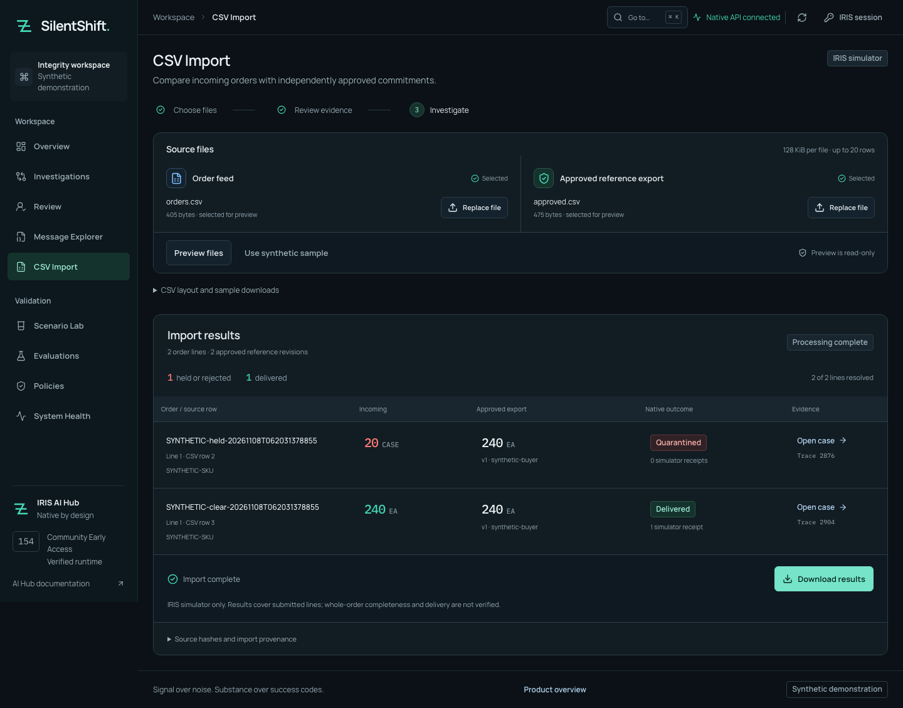

# Import an order feed from the workbench

Use **CSV Import** when you have an incoming order feed and a separate, independently approved reference export. SilentShift previews the two files, imports approved reference revisions under an authorized account, and investigates each order line through the native IRIS production.

This source feature runs on the verified ARM64 **2026.3.0AI.154.0 / 154U** instance. Public IPM **0.2.0** does not include it. The destination is the IRIS simulator; a per-line result is not an atomic whole-order release. Supplied samples are synthetic.



[Mobile layout](assets/csv-import-refined-mobile.png) · [Processing display](assets/csv-import-refined-progress.png).

## Before the first import

Complete [INSTALL.md](../INSTALL.md) from the current source checkout, including the local Ollama model. After updating an existing source installation, run its normal bootstrap again so the compiled classes and Python assets match:

```sh
uv run --env-file .env python scripts/bootstrap.py
```

Preview requires the normal viewer permission. Adding approved references requires the separate **SSImporter** role. A reviewer does not receive it automatically. An administrator can explicitly authorize the configured reviewer account in the local instance:

```sh
docker --context colima-silentshift ps --format '{{.Names}}'
# Replace this value with the IRIS container shown above.
csv_iris_container="silentshift-clean-iris-1"
docker --context colima-silentshift exec -i "$csv_iris_container" \
  iris session IRIS -U SILENTSHIFT <<'EOF'
set sc=##class(SilentShift.Setup).EnableCSVImport($SYSTEM.Util.GetEnviron("SILENTSHIFT_IRIS_USERNAME"))
write "CSV_IMPORTER=",$system.Status.IsOK(sc),!
halt
EOF
```

Require `CSV_IMPORTER=1`. This preserves existing roles and grants no permanent database or Embedded Python permission. Only authorize someone who can vouch for the approved export. Connect again in the workbench to refresh the account's permissions. The verification instance's configured reviewer has already been explicitly enabled.

## Run an import

1. Open **CSV Import** in the workbench. Choose **Order feed** and **Approved reference export**, or select **Use synthetic sample** for the two demonstrated cases.
2. Select **Preview files**. Check the source rows, product, incoming quantities and independently approved quantities. Preview makes no reference writes, case submissions or model calls.
3. Enter an **Approved source note**, identifying where the reference was approved and who owns it. Confirm that you are authorized to import that export.
4. Select **Import references and investigate** once. References are imported in one transaction; the native production investigates lines serially. Keep this tab open. You can switch between workspace views without losing progress.
5. Inspect each result, its simulator receipt count and native trace ID. **Open case** shows the full investigation. **Download results** saves the source hashes, import receipt and per-line outcomes. IRIS retains the original uploaded CSV text with the import, including BOM/line endings, for authorized operator inspection.

The synthetic sample holds `20 CASE` against `240 EA` with zero deliveries. Its matching `240 EA` line delivers once when the native investigation and policy permit it. A failed agent remains visible beside the route; a safe hold alone does not prove successful model execution.

## File layouts

Use UTF-8, comma delimiters and standard CSV quoting. Each file is limited to **128 KiB and 20 rows**. Column order may vary; names must match exactly. The screen also provides matching synthetic CSV downloads.

Order feed:

```text
partner,event_id,order_id,line_id,occurred_at,product_id,quantity,unit,business_unit
```

Approved export:

```text
partner,order_id,line_id,revision,effective_from,effective_to,approved_by,approved_at,product_id,quantity,unit,business_unit
```

Only `effective_to` may be empty. Use positive plain decimal quantities and timestamps with explicit timezone offsets. There is no inferred pack conversion. Duplicate identities, malformed rows, control characters and extra columns are rejected. A named approver in a CSV is provenance supplied by the importer, not an authenticated approval from that person.

## If something stops

- **Permission required:** preview is available, but the account needs explicit SSImporter authorization before it can add references. SSReview alone cannot do that.
- **Invalid preview:** check headers, quantities, timestamps and approval fields. Replacing either file invalidates the old preview and confirmation.
- **Network failure or pending case:** inspect any returned case first. Then select **Preview persisted state again** with the same files. The server reads existing event identities before resuming. No later rows are automatically submitted after an uncertain outcome; do not mint new event IDs as a retry strategy.
- **Reference conflict:** the same revision cannot be overwritten. The complete reference batch rolls back. Use a genuinely approved new revision when terms change; do not edit a revision just to force acceptance. Reuse requires the same reference content and source provenance.
- **Agent failure:** inspect the held case. Reopening the same input recovers its existing result; it does not silently rerun the model or release the case.

The tab holds file contents and progress in memory, without browser storage. Reloading or closing it loses the local view. Reselecting the exact files recovers persisted cases and the original reference-import receipt. Reference import is atomic; investigations and simulator effects are per line. Feed completeness, whole-order delivery, external ERP integration, X12 support and real partner-data validation remain outside this feature.

## Reproduce the browser verification

With the native app and workbench running, and the configured reviewer explicitly authorized for imports:

```sh
node scripts/verify_csv_ui.mjs --execute \
  --output-directory .local/my-csv-ui-check
```

Use a new directory. This generates synthetic files and runs two actual local-model investigations through the browser. It also tests viewer restrictions, invalid files, deliberately injected browser offline failure, recovery, duplicate prevention, case navigation, result download, mobile layout and reduced motion. Credentials come from private `.env`; automatic traces, videos and login screenshots are disabled. Detailed [execution results](evidence/csv-ui-nov7.json) distinguish the initial live run from the later existing-case readback.

For the CLI workflow, see [the pilot guide](../pilot/README.md).

## Latest verification boundary

The final normal-bootstrap pass completed fresh CSV uploads, native invalid-input rejection, a held mismatch, one matching-line simulator delivery and repeat imports without redispatch. [Complete final receipt](evidence/final-pass-nov8.json) · [first import](evidence/final-pass-nov8-csv-first.json) · [repeat](evidence/final-pass-nov8-csv-repeat.json).

An earlier isolated-source run provides the [desktop](assets/csv-isolated-nov8-desktop.png) and [mobile](assets/csv-isolated-nov8-mobile.png) captures. The earlier retained-instance reload failure is preserved in [its receipt](evidence/csv-current-nov8.json); the source-installer scope fix now resolves it without deleting the diagnostic class. [Bootstrap regression](evidence/bootstrap-scope-fix-nov8.json). Public IPM remains the earlier package; source CSV and the installer fix were not published.
