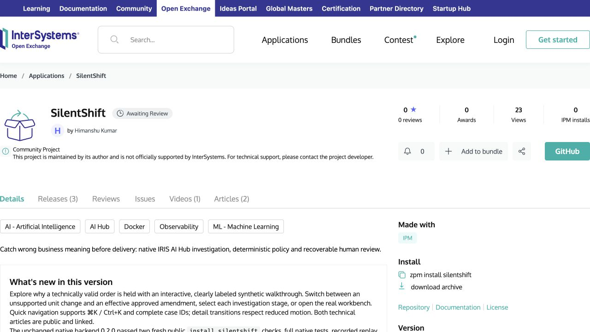

# Judge-facing entry review — November 5, 2026

**App 0.2.1 · native IPM 0.2.0 · tested IRIS 2026.3.0AI.154.0 / 154U ARM64.** [Readback receipt](evidence/entry-readback-nov5.json) · [current-main clean-clone proof](JUDGE_VERIFICATION.md).

## Public listing and remaining moderation gates

Signed out of Open Exchange, reloaded [SilentShift](https://openexchange.intersystems.com/package/SilentShift), and confirmed the Login control, new product description, filed issue #17 link, IPM command, video and both article links. The listing still shows **Awaiting Review**. The idea URL appears in the description, but the dedicated **Ideas to the app** section does not appear. Public visibility of the description is not confirmation that moderation or idea qualification has completed.

No OEX edit, release, approval cancellation or article change was made. The existing November 4 **What's new** note still says “Bug reports are drafts, not filed or accepted.” That historical text conflicts with today's filing status, although the current description correctly links the filed report. If the owner approves a future listing correction, replace that sentence with:

> AI Hub issue #17 is filed with a build-154U reproduction; vendor confirmation and organizer qualification remain pending.

Keep release **0.2.1**, native IPM **0.2.0**, the contest/IPM selections, the dedicated idea URL and existing video/articles. Do not cancel approval. If the idea section remains absent after approval, request OEX support to inspect the saved association; no support message has been sent.

## Consistency and video

The README and submitted OEX description distinguish app and package versions. Both public articles link the same repository, OEX app and [video](https://youtu.be/a4dOcqu89EA), and reference build-154 setup. They do not independently declare app/package version numbers or claim build 109. Their four read-only tools, deterministic policy veto, simulator boundary, native Workflow and recovery behavior agree with the implementation and evidence. Article one distinguishes four expected model proposals from five expected final routes in its dated live run; this is separate from keyless replay.

- [Semantic-validation article](https://community.intersystems.com/post/catching-semantic-failures-iris-interoperability-production)
- [Recoverable-review article](https://community.intersystems.com/post/recoverable-human-review-iris-approval-one-delivery)

Reviewed all 11 video caption cues and checked every original capture hash against the committed manifest. The 150-second video explicitly presents separate historical native cases: hold, amendment, precedents, trace, Workflow and file adapter. Later interactive landing controls, expanded message properties and keyless replay are not demonstrated; the film does not claim otherwise. Its demonstrated journey remains accurate, so no new recording, Cardboard edit or upload is needed for this pass. Corrected outdated local notes that still called the existing video unpublished. Public playback was not reverified: the web fetch hit a Google anti-bot response; prior 1080p/caption evidence remains historical.

## Bug and claim boundaries

[AI Hub issue #17](https://github.com/intersystems-community/ai-hub-eap-bugreports/issues/17) has no comments at this check. A six-hour watch is configured to report new vendor/organizer feedback or material status changes, without posting replies or changing the listing. It runs through the local Codex automation environment; it is not an always-on cloud service.

No online demo, Java/.NET PEX, Embedded Python bonus, Embedded Python bug bonus or award is claimed. Embedded Python remains an implemented and tested part of the product; the owner's latest instruction controls the bonus claim. All other potential bonuses remain organizer-unconfirmed, even where implementation/publication evidence is verified.
