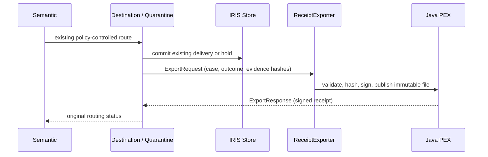

# Signed outcome receipts through Java PEX

The **0.3.2 source candidate** adds `ReceiptExporter`, a real `EnsLib.PEX.BusinessOperation` backed by [`SilentShift.PEX.ReceiptExporter`](../java/src/main/java/SilentShift/PEX/ReceiptExporter.java). **Public IPM/OEX remain 0.3.1; that package does not include this Java operation.** Merge, tag/release and package publication require separate owner approvals.

Destination and Quarantine call it **after** their existing store method commits a routing outcome. The Java operation receives a native [`ExportRequest`](../src/SilentShift/PEX/ExportRequest.cls) and returns a native [`ExportResponse`](../src/SilentShift/PEX/ExportResponse.cls) in the same case session. No Java code decides, releases, repairs or reroutes a transaction.



**Release gate blocked:** the API five-case run passed 5/5, but an explicit ObjectScript repeat passed 4/5. The approved-amendment model output omitted required citations; the unchanged `EVIDENCE_COMPLETE` gate held it for review. All ten cases produced valid Java receipt responses. The failing assertion is retained, not weakened. No further model retry or policy/prompt change was made; the second fresh archive install and hosted branch CI remain unverified. [Failure](evidence/bonus-claims-nov11/java-pex-objectscript-repeat.json).

## What is signed

[`ReceiptStore`](../java/src/main/java/SilentShift/PEX/ReceiptStore.java) canonicalizes the case ID, persisted decision, sorted SHA-256 evidence hashes, execution mode and the case's synthetic-data flag. Evidence hashes cover the current message, assessment, policy and retrieved reference snapshot. The native [`Support.Request`](../src/SilentShift/PEX/Support.cls) constructs these values from the persisted case, not partner-supplied receipt metadata.

The receipt includes that payload's SHA-256, a schema identifier and creation timestamp, signed with **RSA-2048 / SHA256withRSA**. The public key is included; the private key stays in the instance's manager directory with mode 600. Directory access is mode 700. Neither key material nor vendor SDK binaries are package assets.

A signature establishes integrity under that signing key, **not business correctness or an externally certified identity**. An operator verifying receipts independently must retain/pin the expected public key. A machine administrator can modify files or replace keys; this is application-level append-only storage, not WORM storage or a tamper-proof host.

## Idempotency and failure boundaries

- Each case/outcome/evidence fingerprint has one immutable JSON file. A completed file is published atomically without replacement. Retries verify and return its original timestamp/signature. A corrupt or mismatched existing receipt is rejected rather than overwritten.
- A later human-review outcome appends another decision receipt. It does not rewrite the earlier hold. `REVIEW` and `REJECTED` remain distinct from `QUARANTINED` and `DELIVERED`.
- Each routing operation waits at most five seconds for export and preserves its original routing status on failure. A warning and the failed interoperability request remain observable. An export outage can leave an audit gap; there is no claim of guaranteed export, automatic recovery or changed delivery safety.
- Receipts and keys persist in `/usr/irissys/mgr/silentshift-pex/receipts`. They are not exposed through the public API. Retention, backup and key continuity are operator responsibilities; this feature deletes no receipts.

## Installation and runtime

Only **IRIS Community AI Hub 2026.3.0AI.154.0 / 154U ARM64** is qualified here. That image supplies Java 11, the PEX SDK and JDBC library. The native managed `%Java Server` launches the Java External Language Server; an extra cloud service or Java gateway container is unnecessary. [`Production`](../src/SilentShift/Production.cls) binds the operation to that server and remote Java class. `Support.Configure` supplies its classpath and receipt directory.

From this candidate checkout, follow [INSTALL.md](../INSTALL.md). The one-command keyless path remains:

```sh
./scripts/judge-compose.sh
```

Compose builds a **local-only** derivative of the already-loaded vendor image, compiling the owned Java sources into a JAR. Never push that derivative to a registry. The application source remains read-only; database, Java build output and signing state use the instance's writable manager directory. Explicit native setup also compiles the installed Java source against the image SDK, so IPM does not need to redistribute vendor JARs. Package activation alone still starts no production, gateway, account setup or model call.

The prepared IPM manifest is **0.3.2**. It includes the Java sources/build script and native request/response/setup classes. It excludes the SDK, signing keys, generated JARs, tests and frontend. The separate React workbench stays **0.2.1**. A registry install remains the old 0.3.1 until the owner publishes 0.3.2.

## Tests and evidence

- [`PEXChecks`](../tests/iris/PEXChecks.cls): real gateway round trip, identical retry response and stopped-exporter routing isolation. `RunFrozen(1,.report)` explicitly submits all five frozen envelopes through the Partner service with local-model opt-in. It failed the retained release assertion described above. `CheckFrozen` inspects the actual five live scenario case IDs, native responses and canonical hashes; it never manufactures a route or recommendation.
- [`ReceiptStoreTest`](../java/src/test/java/SilentShift/PEX/ReceiptStoreTest.java): a standard hash vector, signature/tamper checks, retries/restart, later decisions, invalid inputs, concurrency and corrupt-file preservation.
- With JDK 11 or later: `python3 scripts/test_java_core.py`. CI downloads only checksum-pinned public test dependencies; it does not download the restricted IRIS SDK. Native adapter compatibility is tested separately inside the operator-owned image.
- [Execution receipt](evidence/bonus-claims-nov11/java-pex.json), [signed sample](evidence/bonus-claims-nov11/java-pex-receipt.json), [native Visual Trace](evidence/bonus-claims-nov11/java-pex-trace.png), [commands and output](evidence/bonus-claims-nov11/java-pex-output.txt).

This is an unsubmitted source-candidate bonus claim draft, never an awarded-point claim. The release gate is blocked by the repeat failure above. The trace screenshot is authenticated recorded replay; the execution receipt separates that run from live inference and clean package checks.

## Prepared publication sequence — not executed

1. Approve pushing this branch and opening its PR. Review hosted CI, including the added public-dependency Java tests. Then separately approve a merge commit.
2. Inspect the actual merged SHA and source identity. Prepare `v0.3.2` at that SHA and the GitHub release titled **SilentShift 0.3.2**, using the changelog. Do not reuse a version tag at another commit. Tag/release requires its own approval.
3. In OEX, prepare **New release → 0.3.2** against that GitHub release; preserve every existing contest, IPM, idea, video, logo and article field. Show the version field before requesting approval. Do not send as 1.0.0 or cancel pending moderation.
4. After approval/publication, independently download the registry archive and inspect its manifest, then run a fresh registry install. A local archive check below is not proof of public publication.
5. Only after the evidence URLs are public, prepare the short follow-up to the existing bonus comment. Posting requires another approval.
