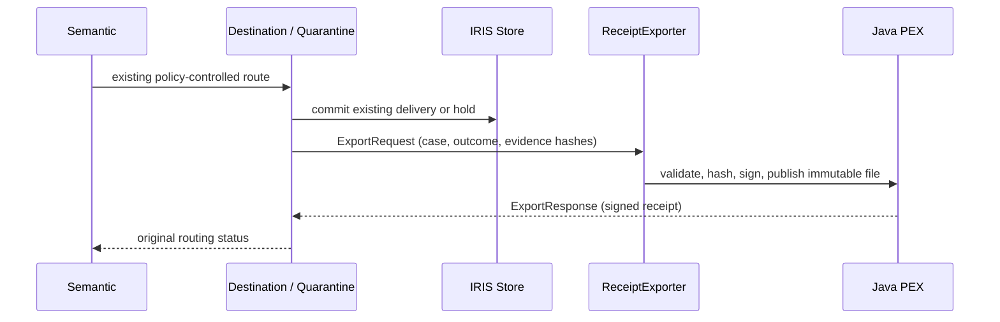

# Signed outcome receipts through Java PEX

**Published native 0.3.2** adds `ReceiptExporter`, a real `EnsLib.PEX.BusinessOperation` backed by [`SilentShift.PEX.ReceiptExporter`](../java/src/main/java/SilentShift/PEX/ReceiptExporter.java). The [v0.3.2 release](https://github.com/himanshu748/silentshift/releases/tag/v0.3.2) targets merged source `cfc4c279853886a72772a92ad70c2e2c5eae3819`. [Anonymous publication readback](evidence/ipm-032-publication-nov11/publication.json) confirms the registry archive and saved receipt-mode fix. The readback itself is not an install test; the subsequent [fresh public gate](evidence/voting-nov11-judge/summary.json) provides that separate proof.

Destination and Quarantine call it **after** their existing store method commits a routing outcome. The Java operation receives a native [`ExportRequest`](../src/SilentShift/PEX/ExportRequest.cls) and returns a native [`ExportResponse`](../src/SilentShift/PEX/ExportResponse.cls) in the same case session. No Java code decides, releases, repairs or reroutes a transaction.



**Historical release-gate failure, superseded by the citation follow-up:** the API five-case run passed 5/5, but an explicit ObjectScript repeat passed 4/5. The approved-amendment model output omitted required citations; the unchanged `EVIDENCE_COMPLETE` gate held it for review. All ten cases produced valid Java receipt responses. The failing assertion is retained, not weakened. No further model retry or policy/prompt change was made; the second fresh archive install and hosted branch CI remain unverified. [Failure](evidence/bonus-claims-nov11/java-pex-objectscript-repeat.json).

## Citation follow-up

The [new verification](CITATION_COMPLETENESS.md) supersedes the historical blocked status above: three predeclared sets passed 15/15, then a final source set passed 5/5. The regenerated 0.3.2 archive installed successfully in a pristine offline instance, left empty/stopped. [Citation checkpoint receipt](evidence/citation-fix-nov11/summary.json). The later receipt-mode fix has [its own native regression](evidence/receipt-mode-nov11/summary.json); a [fresh archive install from the final release tag](evidence/ipm-032-final-nov11/summary.json) includes that fix. These are distinct checks, not new live model runs.

## What is signed

[`ReceiptStore`](../java/src/main/java/SilentShift/PEX/ReceiptStore.java) canonicalizes the case ID, persisted decision, sorted SHA-256 evidence hashes, execution mode and the case's synthetic-data flag. Evidence hashes cover the current message, assessment, policy and retrieved reference snapshot. The native [`Support.Request`](../src/SilentShift/PEX/Support.cls) constructs these values from the persisted case, not partner-supplied receipt metadata.

The receipt includes that payload's SHA-256, a schema identifier and creation timestamp, signed with **RSA-2048 / SHA256withRSA**. The public key is included; the private key stays in the instance's manager directory with mode 600. Directory access is mode 700. Neither key material nor vendor SDK binaries are package assets.

A signature establishes integrity under that signing key, **not business correctness or an externally certified identity**. An operator verifying receipts independently must retain/pin the expected public key. A machine administrator can modify files or replace keys; this is application-level append-only storage, not WORM storage or a tamper-proof host.

## Idempotency and failure boundaries

- Execution mode comes from the saved investigation's `agent.execution_mode`, never the current server environment. Older cases without that field use their recognized saved `agent.mode`; missing or invalid provenance declines export while routing keeps its committed result. [Mode-switch regression and exact scope](evidence/receipt-mode-nov11/summary.json): separate replay/live IRIS sessions returned identical signed bytes and one file for the same synthetic persisted case. This is not a full container-restart test.
- Each case/outcome/evidence fingerprint has one immutable JSON file. A completed file is published atomically without replacement. Retries verify and return its original timestamp/signature. A corrupt or mismatched existing receipt is rejected rather than overwritten.
- A later human-review outcome appends another decision receipt. It does not rewrite the earlier hold. `REVIEW` and `REJECTED` remain distinct from `QUARANTINED` and `DELIVERED`.
- Each routing operation waits at most five seconds for export and preserves its original routing status on failure. A warning and the failed interoperability request remain observable. An export outage can leave an audit gap; there is no claim of guaranteed export, automatic recovery or changed delivery safety.
- Receipts and keys persist in `/usr/irissys/mgr/silentshift-pex/receipts`. They are not exposed through the public API. Retention, backup and key continuity are operator responsibilities; this feature deletes no receipts.

## Installation and runtime

Only **IRIS Community AI Hub 2026.3.0AI.154.0 / 154U ARM64** is qualified here. That image supplies Java 11, the PEX SDK and JDBC library. The native managed `%Java Server` launches the Java External Language Server; an extra cloud service or Java gateway container is unnecessary. [`Production`](../src/SilentShift/Production.cls) binds the operation to that server and remote Java class. `Support.Configure` supplies its classpath and receipt directory.

From this checkout, follow [INSTALL.md](../INSTALL.md). The one-command keyless path remains:

```sh
./scripts/judge-compose.sh
```

Compose builds a **local-only** derivative of the already-loaded vendor image, compiling the owned Java sources into a JAR. Never push that derivative to a registry. The application source remains read-only; database, Java build output and signing state use the instance's writable manager directory. Explicit native setup also compiles the installed Java source against the image SDK, so IPM does not need to redistribute vendor JARs. Package activation alone still starts no production, gateway, account setup or model call.

The published IPM manifest is **0.3.2**. It includes the Java sources/build script and native request/response/setup classes. It excludes the SDK, signing keys, generated JARs, tests and frontend. The separate React workbench stays **0.2.1**. Public IPM now serves 0.3.2. Its archive manifest/source were checked; a [fresh public-registry gate](evidence/voting-nov11-judge/summary.json) subsequently installed it, started production and passed native tests and both recorded replays.

## Tests and evidence

- [`PEXChecks`](../tests/iris/PEXChecks.cls): real gateway round trip, identical retry response and stopped-exporter routing isolation. `RunFrozen(1,.report)` explicitly submits all five frozen envelopes through the Partner service with local-model opt-in. Its earlier failed run is retained; the fixed driver passed the predeclared follow-up. `CheckFrozen` inspects the actual five live scenario case IDs, native responses and canonical hashes; it never manufactures a route or recommendation.
- [`ReceiptStoreTest`](../java/src/test/java/SilentShift/PEX/ReceiptStoreTest.java): a standard hash vector, signature/tamper checks, retries/restart, later decisions, invalid inputs, concurrency and corrupt-file preservation.
- With JDK 11 or later: `python3 scripts/test_java_core.py`. CI downloads only checksum-pinned public test dependencies; it does not download the restricted IRIS SDK. Native adapter compatibility is tested separately inside the operator-owned image.
- [Execution receipt](evidence/bonus-claims-nov11/java-pex.json), [signed sample](evidence/bonus-claims-nov11/java-pex-receipt.json), [native Visual Trace](evidence/bonus-claims-nov11/java-pex-trace.png), [commands and output](evidence/bonus-claims-nov11/java-pex-output.txt).

The Java PEX claim is **prepared for organizer review, not awarded**. The authenticated [live Visual Trace](evidence/bonus-claims-nov11/java-pex-live-trace.png) shows the operation in a live case session; the earlier recorded trace and live/clean-install receipts keep their separate scopes. [Main CI](https://github.com/himanshu748/silentshift/actions/runs/42985826498) passed on the merged release source.

## Publication state and next gate

The owner-approved PR merge, v0.3.2 tag/release and OEX/IPM publication are complete. Do not repeat them. [Publication receipt](evidence/ipm-032-publication-nov11/publication.json) · [fresh offline install](evidence/ipm-032-final-nov11/summary.json). The saved OEX body still needs its separately gated description-only correction.

The remaining public action is the [prepared Java PEX follow-up](agent-runs/java-pex-comment-draft.md), after the README consistency update is public. Posting requires another exact **submit**.
