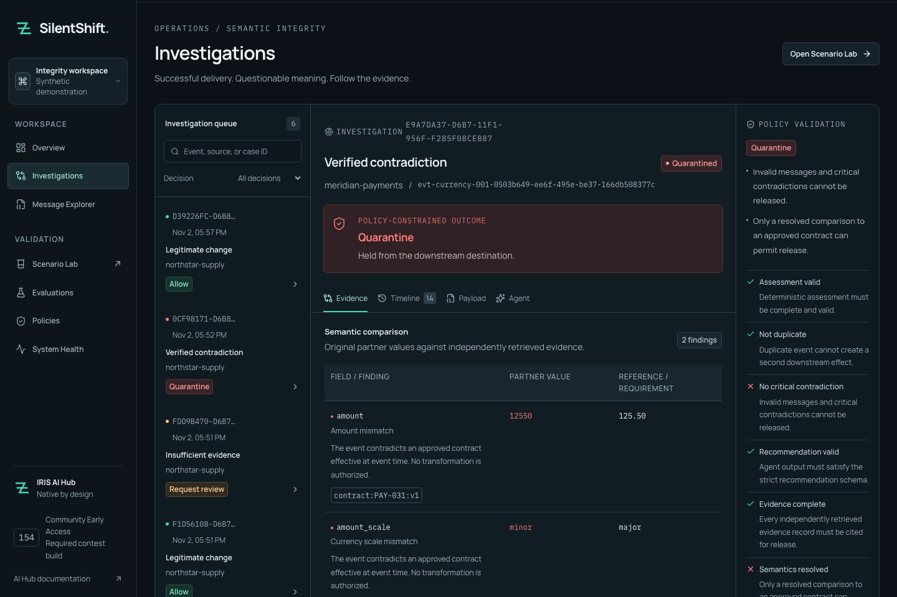

# Try SilentShift

For the DPI-I-689 example without an external API key or fresh inference, follow [See it in Visual Trace](../README.md#see-it-in-visual-trace). It runs the frozen unsupported-unit order through native AI Hub and all four tools using explicitly recorded provider responses, then prints its actual session URL. Recorded playback is labeled separately from the [current five live investigations](evidence/bonus-020-live.json).


An order arrives as `20 CASE`; its approved contract requires `240 EA`. Transport and JSON checks can succeed while the business commitment has changed. SilentShift gives the integration operator the evidence to hold that order before the included destination simulator accepts it.

Start with two investigations: **Quantity mismatch** holds that unsupported change; **Approved amendment** allows the same incoming value because an approved amendment is effective at event time. Compare the authority behind the decisions, then inspect the actual simulator receipt.

The decision stays inside InterSystems IRIS: Business Service → Business Process → native AI Hub agent and scoped tools → Embedded Python policy → routing Operations. The agent proposes; deterministic server policy owns the route. All supplied messages and references are synthetic.

## See the operator's decision

These screenshots show persisted records from local Community AI Hub 154U and Qwen3 4B inference. They are captures of the working application, not live hosted access.




The second screenshot is case `D39226FC-D6B8-11F1-956F-F285F08CEB87`, native trace 42. It was injected through Scenario Lab after the fresh-volume benchmark. Delivery is to the IRIS simulator, not an external ERP or bank.

The payment example checks a declared interface contract: `12550` minor units versus `125.50` major units. Numeric equivalence does not authorize a transformation. The hold does not establish a 100× monetary loss.

## Reproduce the complete journey

1. Follow the [README setup](../README.md#native-build-154-setup), including the separately licensed EAP image and local model. Bootstrap never invokes a model or seeds operational cases.
2. Start the workbench, connect with the local configured account, and open **Scenario Lab**.
3. Choose **Quantity mismatch**. Inspect `20 CASE` against the independent `240 EA` contract, then click **Inject into IRIS** once. Keep the displayed run ID. A critical contradiction must be held with zero simulator deliveries. The agent cannot infer a CASE→EA conversion.
4. Choose **Approved amendment** and inject once. Inspect both the earlier contract and effective amendment, the native agent's actual reads, the release checks and the delivered case. Retrying the same injection must reuse its case and receipt.
5. Run the conflict example. Without sufficient approved authority, its final route must be **Review**. A model concern alone is not proof of a critical contradiction.
6. Inspect **Timeline**, **Payload**, **Agent** and the recorded native trace ID. The investigation preserves the original message, selected reference snapshot, actual evidence reads, policy checks and route. Visual Trace requires a portal account with the appropriate interoperability permissions; application viewer rights do not grant administrative access.

To capture all five scenarios plus replay and critical-release checks, use local inference and run:

```sh
uv run --env-file .env python scripts/verify_native.py --allow-model-calls
```

This performs real model work. Scenario E deliberately injects a labeled hostile validator proposal after a native answer; the original model response remains separate. It demonstrates containment of unsafe input to policy, not a claim that the model spontaneously produced that attack.

## Resolve a review without losing the decision

New review and quarantine holds create native IRIS Workflow tasks. Open **Review** as the configured reviewer to see the actual pending worklist. An authorized reviewer supplies a reason, the current case version and an idempotency key. A critical contradiction cannot be approved through this path.

If native task completion fails after the decision is recorded, the case remains held with `completion_pending`. **Resume recorded review** carries the saved reason, original version and key; it does not create a replacement decision. The [engineering walkthrough](articles/engineering.md) explains the controlled failure and actual UI recovery that completed one task and produced exactly one simulator delivery.

The pending-worklist verification creates two isolated synthetic boundary cases without LLM inference (procedural retrieval may use local embeddings):

```sh
uv run python scripts/verify_native_review_queue.py --allow-new-synthetic-cases
```

The [54-check receipt](evidence/review-queue.json) includes native task listing, rejection with zero deliveries and two simultaneous identical approvals producing one review receipt, one native completion response and one simulator delivery. The [actual workbench actions](evidence/review-ui.json) independently completed approve/reject. The earlier [43-check receipt](evidence/workflow.json) retains the controlled postcommit 503 recovery. This does not prove every outage or crash path.

## Compare a past outcome with current authority

In the current quantity or unsafe-output case, open **Similar precedents** below the reference snapshot. Inspect the three actual source IDs and cosine scores, then follow a source-case link. Prior deliveries are context; the current critical contradiction stays held. The [native vector walkthrough](PRECEDENTS.md) includes source validation, fourth-tool reads and a valid ALLOW proposal that policy vetoed. The current five-case run passed 5/5 with four actual tools; payment history is empty and shown honestly.

## Accept the same order from a partner file

A partner that cannot call REST can drop a ready file into the trusted inbox. The custom native adapter sends it through the same production and deterministic policy. The [file walkthrough](PARTNER_INBOX.md) shows an actual delivery and critical quarantine in Visual Trace, plus retries and acknowledgement recovery without a second receipt. Both cases used all four evidence tools; the full native gate retained 5/5.

## Install the backend as a package

The [IPM path](IPM.md) installs the backend into a fresh interoperability namespace without mounting the source checkout. A real local `zpm install` on build 154 passed manager-origin and empty-state checks; after explicit setup its API repeated all five final routes with four native tools. [Installation/native receipt](evidence/ipm-clean-install.json). Public-registry installation and publication remain unverified.

## What to assess against the rubric

| Official criterion | Inspect |
| --- | --- |
| Complexity | A complete native production, scoped tool retrieval, versioned independent references, native human-task completion and transaction-protected simulator effects. |
| Clarity of Instructions | Exact runtime/provider, load/start/check commands, five-case verifier and this walkthrough. |
| Developer Experience | Local inference, source-only distribution, empty-volume installation evidence, typed API and separate host/native/browser checks. |
| Applicability | Pre-delivery contradictions in orders/payments, effective amendments and conflicting authority; all supplied data is synthetic. |
| Usability | Evidence comparison, distinct quarantine/review/delivered states, explicit reviewer gates, desktop/mobile and keyboard behavior. |

This maps observable evidence to the [official criteria](https://openexchange.intersystems.com/contest/49); it does not predict a judge's score. Optional adapter intake, procedural vector guidance and IPM setup are documented in the [README](../README.md#optional-local-intake-and-procedural-guidance). Their evidence gates remain separate from the core journey and any organizer award.

## Evidence appendix

The [machine-readable public summary](evidence/native-summary.json) includes all four retained trials and hashes of their full local exports. Raw local evidence and runtime images remain outside Git.

| Native trial | Model proposals | Final outcomes | Unsafe simulator releases |
| --- | ---: | ---: | ---: |
| Initial 1.7B trial | Incomplete; one empty answer | Benchmark rejected | No deliveries observed |
| First 4B trial, policy 1.0 | 2/5 | 3/5 | 0/4 |
| 4B, policy 1.1 | 4/5 | 5/5 | 0/4 |
| Fresh-volume 4B repeat, policy 1.1 | 5/5 | 5/5 | 0/4 |

These are historical trials of five frozen synthetic cases each. The deterministic baseline also solves all five; no AI accuracy uplift is demonstrated. The agent provides an inspectable, evidence-bound recommendation and can veto release; deterministic policy constrains what may happen afterward. Session-wide token totals and billing cost are unavailable; the final response's token usage is a narrower measurement. The clean repeat's mean agent time was 24,664.2 ms, with p95 of 37,431 ms across five cases. These measurements do not describe current optional-feature latency or throughput.

The fresh installation began with zero cases and evaluations. Its trace IDs were 2, 10, 18, 26 and 34, with one delivery for the approved amendment and zero for the other four cases. Separate native checks exercised permission denials, malformed/blank reviews, optimistic versions, concurrent idempotent approval, human rejection, restart persistence and oversized evidence containment. See [build status](BUILD_STATUS.md) for their exact scopes.

The [46-check trace receipt](evidence/traceability.json) covers whole native `Chat` invocations and actual evidence-tool spans, including a pre-model failure. It does not establish capture of every provider request/response or per-provider-round statistics. Public deployment, provider-side cancellation, broad repeated-trial performance and real external delivery remain outside the verified boundary.
