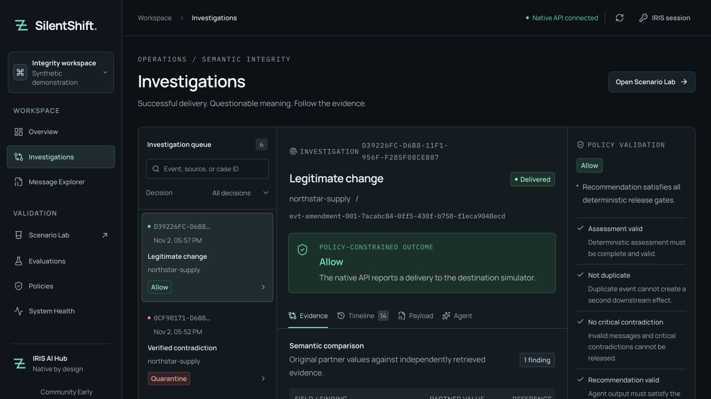
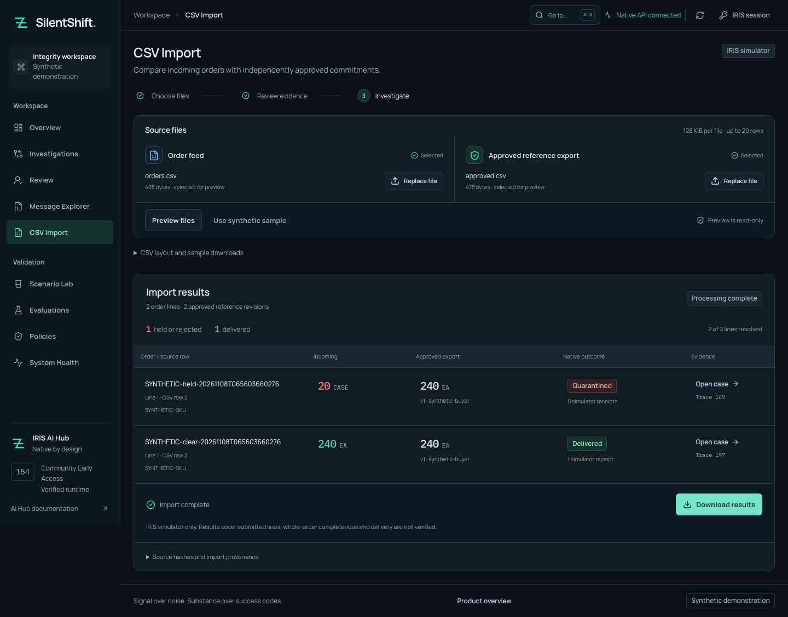

# Judge walkthrough: the same order, two different decisions

**Package version at this documentation freeze:** public native IPM last verified **0.2.0**; current `module.xml` prepares **0.3.0**, not yet published or clean-IRIS-verified. The separate frontend release stays **0.2.1**. For judges after an owner publication, confirm the actual installed package version rather than assuming the prepared version is live. [Published-versus-main ledger](SUBMISSION_CHECKLIST.md#published-vs-main).

An order arrives as `20 CASE`; its approved contract requires `240 EA`. Transport and JSON checks can succeed while the business commitment has changed. SilentShift helps the integration operator answer the next question: **is there approved evidence that makes this change legitimate?**

Start with **Quantity mismatch**, which holds the unsupported change. Then inspect **Approved amendment**, which allows the same incoming value because an approved amendment is effective at event time. The difference is the authority behind the order. Follow that evidence to the policy decision and the simulator receipt.

## Choose your path

| What you want to assess | Start here | What it establishes |
| --- | --- | --- |
| Understand the operator's task without installing anything | [Captioned demo](https://youtu.be/a4dOcqu89EA) or [download MP4](https://raw.githubusercontent.com/himanshu748/silentshift/main/evidence/video/silentshift-demo.mp4), then the screenshots below | Recorded synthetic cases in the working local application; no hosted access |
| Reproduce native execution without a model or API key | [Exact fresh-clone recipe](../INSTALL.md#optional-check-without-a-model) | Public IPM install, production startup, native tests and a held order with real trace messages and tool reads |
| Exercise fresh local inference and human review | [Live setup](../INSTALL.md), then [the complete journey](#reproduce-the-complete-journey) | New local-model investigations, evidence inspection and eligible review decisions |

The runnable paths require a separately obtained, licensed **2026.3.0AI.154.0 / 154U ARM64** image. The keyless reference recipe also requires the documented Colima/Docker environment; it does not download a model. If that runtime is unavailable, the [retained commands and outputs](JUDGE_VERIFICATION.md) let you inspect what was executed, but do not replace a new run.

## What to look for

1. **Authority changes the outcome.** The unsupported `20 CASE` order stays held with zero deliveries. An effective approved amendment permits the legitimate change. No CASE-to-EA conversion is guessed.
2. **The explanation has a trace.** Each admitted provider exchange has its own native request/response pair. Inspect the actual [message properties](../README.md#native-provider-metadata), then connect them to the case's evidence and route.
3. **Human review preserves the safety boundary.** Eligible holds can be resolved with a reason and current version. Critical contradictions cannot be approved; concurrent identical approvals produce one simulator receipt in the verified test.

The decision stays inside InterSystems IRIS: Business Service → Business Process → native AI Hub agent and scoped tools → Embedded Python policy → routing Operations. The agent proposes; deterministic server policy owns the route. All supplied messages and references are synthetic. The [five-case baseline](#evidence-appendix) also solves the frozen cases; no AI accuracy improvement is claimed. The agent's demonstrated contribution is an inspectable investigation, with its tool reads and recommendation retained alongside the business decision.

## Where the agent makes a decision

The native agent returns a recommendation: `ALLOW`, `QUARANTINE` or `REQUEST_REVIEW`, with evidence IDs, an explanation and uncertainty. Its tools expose only the current case's evidence. The production validates that answer before routing; the model cannot change a contract, manufacture an amendment or invoke delivery.

| Situation | Effect of the recommendation |
| --- | --- |
| An authoritative critical contradiction exists | Even a well-formed `ALLOW` cannot release the order; policy quarantines it |
| Approved evidence resolves the comparison | Automatic delivery additionally needs a valid `ALLOW`, complete evidence citations and uncertainty no greater than `0.35` |
| The comparison is otherwise eligible, but the agent raises a concern | The production requests human review; model concern alone does not establish a critical contradiction |
| The answer is missing, malformed or cites unknown evidence | Automatic delivery is refused; critical cases remain quarantined and other cases require review |

This is the implemented [release contract](../python/silentshift/engine.py), exercised through the [native live run](evidence/bonus-020-live.json) and separate boundary checks below. The agent participates in the decision, but never supplies its own authority to act. The recorded five-case result does not establish that adding AI improves accuracy, speed or operator productivity; those would require a larger, independently assessed evaluation.

## See the operator's decision

These screenshots show persisted records from local Community AI Hub 154U and Qwen3 4B inference. They are captures of the working application, not live hosted access.

[Inspect the held-order capture](assets/demo-unit-quarantine.jpg): the original quantity and unit disagree with the approved contract, policy quarantines the order, and the reviewer cannot approve release.



The amendment screenshot is case `D39226FC-D6B8-11F1-956F-F285F08CEB87`, native trace 42. It was injected through Scenario Lab after the fresh-volume benchmark. Delivery is to the IRIS simulator, not an external ERP or bank.

For the separate [payment capture](assets/native-currency-quarantine.png), the declared interface contract requires `125.50` major units while the message supplies `12550` minor units. Numeric equivalence does not authorize a transformation. The hold does not establish a 100× monetary loss.

## Reproduce the complete journey

For a no-key technical check, follow [the optional replay steps in INSTALL.md](../INSTALL.md#optional-check-without-a-model). Installation commands are kept there so you do not have to combine this walkthrough with another setup recipe.

Expected result: **12/12 replay checks**, five provider request/response pairs, four native evidence tools, **QUARANTINED** and zero deliveries. The command prints the session ID and Visual Trace URL. This runs the native agent and tools with a recorded provider answer, without fresh inference. [Latest public-package receipt](evidence/judge-current-nov8.json). Replay covers the held order; the live amendment comparison below requires the normal local-model installation.

For the live local-model comparison in the workbench:

1. Follow the [README setup](../INSTALL.md), including the separately licensed EAP image and local model. Bootstrap never invokes a model or seeds operational cases.
2. Start the workbench, connect with the local configured account, and open **Scenario Lab**.
3. Choose **Quantity mismatch**. Inspect `20 CASE` against the independent `240 EA` contract, then click **Inject into IRIS** once. Keep the displayed run ID. A critical contradiction must be held with zero simulator deliveries. The agent cannot infer a CASE→EA conversion.
4. Choose **Approved amendment** and inject once. Inspect both the earlier contract and effective amendment, the native agent's actual reads, the release checks and the delivered case. Retrying the same injection must reuse its case and receipt.
5. Run the conflict example. Without sufficient approved authority, its final route must be **Review**. A model concern alone is not proof of a critical contradiction.
6. Inspect **Timeline**, **Payload**, **Agent** and the recorded native trace ID. The investigation preserves the original message, selected reference snapshot, actual evidence reads, policy checks and route. Visual Trace requires a portal account with the appropriate interoperability permissions; application viewer rights do not grant administrative access.

To capture all five scenarios plus replay and critical-release checks, use local inference and run:

```sh
uv run --env-file .env python scripts/verify_native.py --allow-model-calls
```

This performs real model work. Scenario E deliberately injects a labeled hostile validator proposal after a native answer; the original model response remains separate. It demonstrates containment of unsafe input to policy, not a claim that the model spontaneously produced that attack.

## Resolve a review without losing the decision

New review and quarantine holds create native IRIS Workflow tasks. Open **Review** as the configured reviewer to see the actual pending worklist. An authorized reviewer supplies a reason, the current case version and an idempotency key. A critical contradiction cannot be approved through this path.

If native task completion fails after the decision is recorded, the case remains held with `completion_pending`. **Resume recorded review** carries the saved reason, original version and key; it does not create a replacement decision. The [engineering walkthrough](articles/engineering.md) explains the controlled failure and actual UI recovery that completed one task and produced exactly one simulator delivery.

The pending-worklist verification creates two isolated synthetic boundary cases without LLM inference (procedural retrieval may use local embeddings):

```sh
uv run python scripts/verify_native_review_queue.py --allow-new-synthetic-cases
```

The [54-check receipt](evidence/review-queue.json) includes native task listing, rejection with zero deliveries and two simultaneous identical approvals producing one review receipt, one native completion response and one simulator delivery. The [actual workbench actions](evidence/review-ui.json) independently completed approve/reject. The earlier [43-check receipt](evidence/workflow.json) retains the controlled postcommit 503 recovery. This does not prove every outage or crash path.

## Compare a past outcome with current authority

In the current quantity or unsafe-output case, open **Similar precedents** below the reference snapshot. Inspect the three actual source IDs and cosine scores, then follow a source-case link. Prior deliveries are context; the current critical contradiction stays held. The [native vector walkthrough](PRECEDENTS.md) includes source validation, fourth-tool reads and a valid ALLOW proposal that policy vetoed. The current five-case run passed 5/5 with four actual tools; payment history is empty and shown honestly.

## Accept the same order from a partner file

A partner that cannot call REST can drop a ready file into the trusted inbox. The custom native adapter sends it through the same production and deterministic policy. The [file walkthrough](PARTNER_INBOX.md) shows an actual delivery and critical quarantine in Visual Trace, plus retries and acknowledgement recovery without a second receipt. Both cases used all four evidence tools; the full native gate retained 5/5.

## Install the backend as a package

The [IPM path](IPM.md) installs public native backend **0.2.0** into a prepared interoperability namespace with `zpm "install silentshift"`. Two fresh build-154 containers installed from the community registry without source mounts, explicitly started production and passed all **five native test classes / 12 methods**. One passed the no-key replay above; the other passed **5/5 live local-model routes**, with four tools per case. [Public replay receipt](evidence/final-public-replay.json) · [public live receipt](evidence/final-public-live.json). The separately built frontend is **0.2.1**. Installation itself does not configure accounts or start production; the driver performs those explicit setup steps.

## Bring an order feed through the workbench

From the current source installation, open **CSV Import** with an incoming order feed and a separate, independently approved reference export. Preview the comparison first. An explicitly authorized importer can then record the approved source and investigate each line through the same native production. [CSV guide](CSV_IMPORT.md).

The fresh source instance held the unsupported `20 CASE` line with no delivery and delivered the matching `240 EA` line once. Repeating the import recovered the original cases and receipts. The [new native/UI receipt](evidence/csv-isolated-nov8.json) covers that journey, invalid inputs, source authority, interrupted-request recovery and compact layouts. The CSV source/backend is included in the **unpublished native 0.3.0 candidate**. The last verified **public 0.2.0** installation does not include it; even after the native package is published, the CSV web UI requires the separately built frontend. The examples are synthetic and delivery is per line to the simulator, without a whole-order completeness guarantee.



## What to assess against the rubric

| Official criterion | Inspect | What to verify |
| --- | --- | --- |
| Complexity | [Native architecture](../ARCHITECTURE.md), [provider message bodies](evidence/provider-body-captures.json), [Workflow receipt](evidence/review-queue.json) | Real production messages connect the investigation to routing; later review has persisted task/session links |
| Clarity of Instructions | [Fresh-clone recipe](../INSTALL.md#optional-check-without-a-model), [actual commands and output](JUDGE_VERIFICATION.md) | Exact build, prerequisites, expected hold and replay limitations are explicit |
| Developer Experience | [Public installation transcript](evidence/judge-main-install.txt), [clean-clone receipt](evidence/judge-current-nov8.json) | Native IPM 0.2.0 installs, production starts and all native tests pass without a provider key |
| Applicability | [Unsupported order](assets/demo-unit-quarantine.jpg), [authorized amendment](assets/native-approved-delivery.png) | Approved authority changes the outcome; the same incoming quantity is not inherently wrong |
| Usability | [Actual review actions](evidence/review-ui.json), [interface verification](UI_REVIEW.md) | The operator can inspect evidence, see the route and resolve an eligible hold; desktop/mobile, keyboard and reduced-motion checks have distinct scopes |

This maps observable evidence to the [official criteria](https://openexchange.intersystems.com/contest/49); it does not predict a judge's score. Optional adapter intake, procedural vector guidance and IPM setup are documented in the [README](FEATURES.md#optional-local-intake-and-procedural-guidance). Their evidence gates remain separate from the core journey and any organizer award.

## Check failure and recovery behavior

These are separately retained native checks on synthetic data. Open each receipt to inspect its inputs, assertions and outcome; no combined success rate is implied.

| Challenge | Observed result | Evidence and limit |
| --- | --- | --- |
| A similar historical case was delivered, so a proposal recommends `ALLOW` | The critical current case remains held with zero deliveries | [Precedent veto](evidence/precedent-veto.json); a deliberately constructed valid proposal, with no fresh model call |
| Two identical approvals arrive concurrently | One review receipt, one native completion response and one simulator delivery | [Review queue checks](evidence/review-queue.json); isolated eligible boundary cases, not an LLM accuracy test |
| Task completion fails after the review decision is recorded | The original decision can be resumed without replacing its reason, version or key | [Controlled recovery](evidence/workflow.json) and [workbench walkthrough](articles/engineering.md); does not establish recovery from every outage |
| A partner file is retried or its acknowledgement needs recovery | The retained outcome and receipt are reused without a second simulator delivery | [Adapter checks](evidence/adapter.json); two live local-model cases plus intake/recovery assertions |
| The provider returns an HTTP error | The failure is visible in a native response message and the case stays quarantined | [Failure capture](assets/provider-failure-body-safari.png), [metadata receipt](evidence/provider-body-captures.json); an intentional invalid-format diagnostic |

## Evidence appendix

The [machine-readable public summary](evidence/native-summary.json) includes all four retained trials and hashes of their full local exports. Raw local evidence and runtime images remain outside Git.

| Native trial | Model proposals | Final outcomes | Unsafe simulator releases |
| --- | ---: | ---: | ---: |
| Initial 1.7B trial | Incomplete; one empty answer | Benchmark rejected | No deliveries observed |
| First 4B trial, policy 1.0 | 2/5 | 3/5 | 0/4 |
| 4B, policy 1.1 | 4/5 | 5/5 | 0/4 |
| Fresh-volume 4B repeat, policy 1.1 | 5/5 | 5/5 | 0/4 |

These are historical trials of five frozen synthetic cases each. The deterministic baseline also solves all five; no AI accuracy uplift is demonstrated. The agent provides an inspectable, evidence-bound recommendation and can veto release; deterministic policy constrains what may happen afterward. Session-wide token totals and billing cost are unavailable; the final response's token usage is a narrower measurement. The clean repeat's mean agent time was 24,664.2 ms, with p95 of 37,431 ms across five cases. These measurements do not describe current optional-feature latency or throughput.

The fresh installation began with zero cases and evaluations. Its trace IDs were 2, 10, 18, 26 and 34, with one delivery for the approved amendment and zero for the other four cases. Separate native checks exercised permission denials, malformed/blank reviews, optimistic versions, concurrent idempotent approval, human rejection, restart persistence and oversized evidence containment. See [build status](BUILD_STATUS.md) for their exact scopes.

The historical [46-check trace receipt](evidence/traceability.json) covers whole native `Chat` invocations and tool spans, including a pre-model failure; it is not the evidence for per-call tracing. The later [provider-message export](evidence/bonus-020-live.json) and [native Body captures](evidence/provider-body-captures.json) separately verify actual provider request/response pairs and their metadata. See [session 1667](assets/provider-success-body-safari.png) for a successful provider call in a case that policy still quarantined, and [session 1807](assets/provider-failure-body-safari.png) for the HTTP-400 diagnostic. Public deployment, provider-side cancellation, broad repeated-trial performance and real external delivery remain outside the verified boundary.
