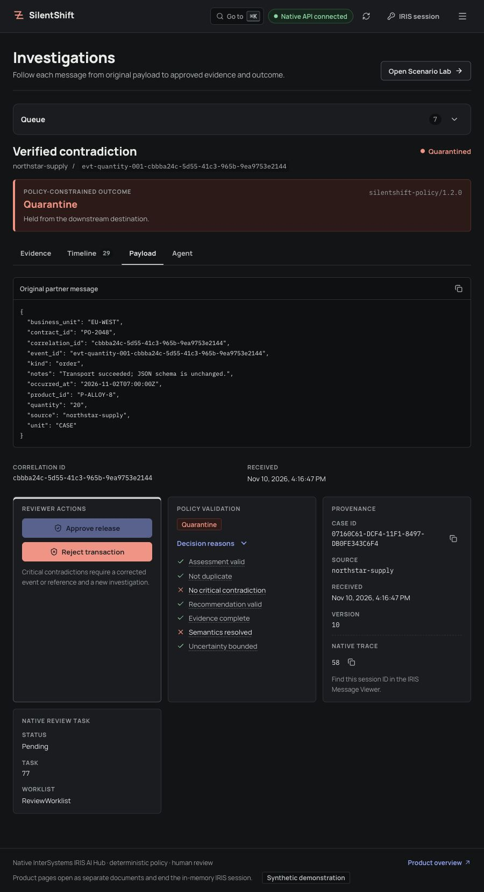
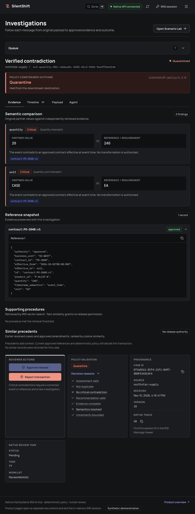
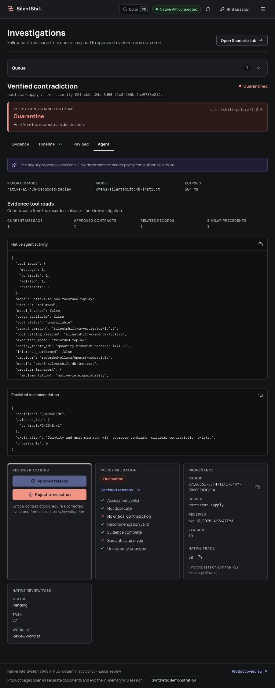
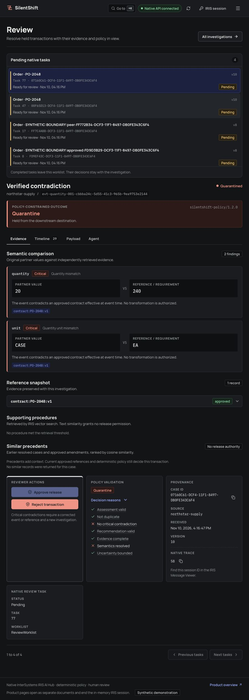
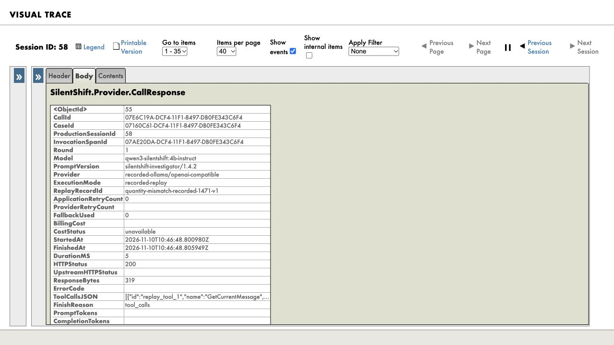

# Open Exchange — prepared real 0.3.3 release and description

**Draft only.** Public native IPM/OEX and the latest GitHub release remain **0.3.2** until the owner approves publication. `module.xml`, the Python project and lockfile now prepare **0.3.3**. This is a real versioned native package with **no native code changes**, not an OEX-only metadata version. React remains **0.2.1**. Never use the editor's default **1.0.0**.

PR #14 is merged and the new [agent-value page](https://himanshu748.github.io/silentshift/agent-value.html#HO-045), [tour](https://himanshu748.github.io/silentshift/evidence-tour.html) and [receipt inspector](https://himanshu748.github.io/silentshift/receipts.html) are live. Preserve the logo, DPI-I-689, IPM option/command, contest registration, Demo URL, video/MP4 and both articles. Never cancel or duplicate a pending approval.

## Release prerequisites — each publication action separately approved

1. Fresh-container installation of a locally built 0.3.3 package, native suite/replays and green CI on the candidate. Do not substitute a `zpm load` or the older 0.3.2 install receipt for the new install check.
2. Merge the reviewed candidate, then tag **v0.3.3** at that merge and publish the matching GitHub release. No tag/release has been created by this preparation.
3. In the existing OEX app, type **0.3.3** manually. The IPM publication must use the matching tagged source and 0.3.3 manifest. Review the version screenshot before final Send; never submit 1.0.0.
4. Verify the anonymous listing, registry archive manifest/tag identity and a fresh public `zpm "install silentshift"` before declaring publication verified.

## Release note

Documentation, recorded evidence and judge-tooling update. No native code changes. The keyless launcher now pins verified native 0.3.2 explicitly, so publishing a newer package cannot move its install target. The local candidate verifier supports an offline literal install and checks installed identity. The recorded held-out wrong-delivery/review trade-off and three source-linked prose examples are easier to inspect. Includes the recorded evidence tour and receipt inspector. Native package 0.3.3; separate React workbench 0.2.1. Agent, deterministic policy, runtime sources and frozen evaluation records are unchanged; no new evaluation was run.

## Description body — publish only with the matching 0.3.3 release

### An order can arrive successfully and still be wrong
On the existing **48 held-out synthetic orders**, wrong deliveries were **6/23 → 2–3/23**: rules-only counterfactual release choices versus agent + policy actual simulator receipts across three trials. Review rose **12.5% → 21.5%** (pooled agent trials). **No overall accuracy gain:** correct routes **33/48 → 33/48, 33/48 and 30/48**; unstructured exact routing stays **1/16** in each trial. [Full historical comparison](https://github.com/himanshu748/silentshift/blob/main/docs/EVAL_HELDOUT.md) · [original summary](https://github.com/himanshu748/silentshift/blob/main/evidence/heldout/summary.json). This presents existing observations, not a new evaluation of current-release candidate 0.3.3.

SilentShift is a validation workbench for integration operations teams running B2B order pipelines. It compares incoming business values with independently approved commitments, investigates discrepancies and gives the operator a reason, supporting records and a route for each case.
An order arrives as **20 CASE**. The approved contract says **240 EA**. The message is valid JSON, but there is no approved conversion. SilentShift holds it before the included destination simulator accepts it. An effective approved amendment authorizing **20 CASE** changes the outcome. The decisive difference is the governing evidence.
### Follow a case from intake to resolution
Open the investigation to compare the original message and selected reference, inspect the agent's actual evidence reads, and follow the final route. Eligible holds create native Workflow tasks. A reviewer supplies a reason and current version; recorded decisions can be resumed after a completion failure. A critical contradiction cannot be approved through the review screen.
The production accepts REST intake and ready JSON files through a custom inbound adapter. **Native IPM 0.3.3 includes bounded CSV intake and its parser.** Run the matching React workbench separately from repository source: preview an order feed against a separate approved-reference export, record the source under an explicitly authorized importer, then investigate each line. Repeating the same import recovers persisted cases and receipts. The frontend remains version 0.2.1 and is not installed by the native package. [CSV workflow and current captures](https://github.com/himanshu748/silentshift/blob/main/docs/CSV_IMPORT.md).
### The agent makes a recommendation inside the production
A native IRIS AI Hub agent reads four case-scoped evidence tools and recommends **ALLOW**, **QUARANTINE** or **REQUEST_REVIEW**, with citations and uncertainty. Automatic delivery needs a valid ALLOW recommendation, a resolved comparison and complete evidence. Deterministic policy owns the final route. Similar precedents inform the investigation; they do not replace current authority.
Each admitted provider exchange becomes a native request/response pair in the business case's Visual Trace. The messages expose model, provider, prompt version, timing, tool calls, outcome and available response usage. Unknown cost and provider retries remain null. [DPI-I-689](https://ideas.intersystems.com/ideas/DPI-I-689), the [reproducible example](https://github.com/himanshu748/silentshift#see-it-in-visual-trace) and [Langfuse comparison](https://github.com/himanshu748/silentshift#silentshift-iris-interoperability-vs-langfuse) explain the tracing design.
### Signed receipts after the routing decision
Native 0.3.3 retains the Java PEX business operation called after each committed routing outcome. It hashes the case, decision and evidence, then signs an immutable JSON receipt using an instance-held key. Retries reuse the original receipt and its saved investigation mode. An export failure is visible in the native trace and leaves the committed route unchanged. Signatures establish integrity under that key, not business correctness or a certified identity. [Java operation and limits](https://github.com/himanshu748/silentshift/blob/main/docs/JAVA_PEX.md) · [live case Visual Trace](https://github.com/himanshu748/silentshift/blob/main/docs/evidence/bonus-claims-nov11/java-pex-live-trace.png).
### What the agent saw that the rules missed
[Inspect three recorded prose cases](https://himanshu748.github.io/silentshift/agent-value.html#HO-045): an amended quantity, a cancelled order and a prohibited part. Each view links the original clause, rule result, cited AI recommendation, deterministic policy reason and pending native Workflow task. These are selected examples of reviewer assist: no simulator delivery, but REQUEST_REVIEW is still wrong against the frozen QUARANTINE label. No completed human resolution is claimed.

[Explore the evidence tour](https://himanshu748.github.io/silentshift/evidence-tour.html) · [verify a Java PEX receipt locally](https://himanshu748.github.io/silentshift/receipts.html) · [product landing](https://himanshu748.github.io/silentshift/). These static recorded tools perform no native investigation or public API writes; they are not a hosted native demo.

### Inspect the recorded source workbench

These November 10 local captures show synthetic recorded replay on 154U ARM64, not new inference or a hosted app. The React interface is built separately from source and is not installed by the native IPM package.

### Run it locally or inspect the recorded journey
[Install from one guide](https://github.com/himanshu748/silentshift/blob/main/INSTALL.md). Fresh investigations use local Ollama and local embeddings, without a paid provider key. The optional keyless replay runs the native production with recorded provider responses and performs no fresh inference. Both paths require a separately obtained licensed IRIS image.
[Watch the captioned demo](https://youtu.be/a4dOcqu89EA) · [Download the MP4 without signing in](https://raw.githubusercontent.com/himanshu748/silentshift/main/evidence/video/silentshift-demo.mp4). The video demonstrates the earlier synthetic core workflow and predates CSV.
Read the technical articles: [Catching semantic failures in an IRIS interoperability production](https://community.intersystems.com/post/catching-semantic-failures-iris-interoperability-production) and [Recoverable human review in IRIS: from approval to one delivery](https://community.intersystems.com/post/recoverable-human-review-iris-approval-one-delivery).
**Native IPM 0.3.3; source-built React workbench 0.2.1; locally qualified runtime 2026.3.0AI.154.0 Community / 154U ARM64.** In a prepared namespace with IPM, install using `zpm "install silentshift"`; account configuration and production startup are explicit setup steps. The earlier [fresh public native 0.3.2 install](https://github.com/himanshu748/silentshift/blob/main/docs/evidence/voting-nov11-judge/summary.json) passed production startup, the native suite and both keyless replays, with no new inference. [The verification guide](https://github.com/himanshu748/silentshift/blob/main/docs/JUDGE_VERIFICATION.md) separates current-install proof from historical model/evaluation evidence. No newer build is claimed tested. All supplied examples are synthetic and delivery is per line to an IRIS simulator. There is no hosted native demo, verified external ERP delivery, X12 support, whole-order completeness guarantee or production-readiness claim. Organizer bonus awards remain unconfirmed; [the checklist](https://github.com/himanshu748/silentshift/blob/main/docs/SUBMISSION_CHECKLIST.md) separates implementation evidence from qualification.
