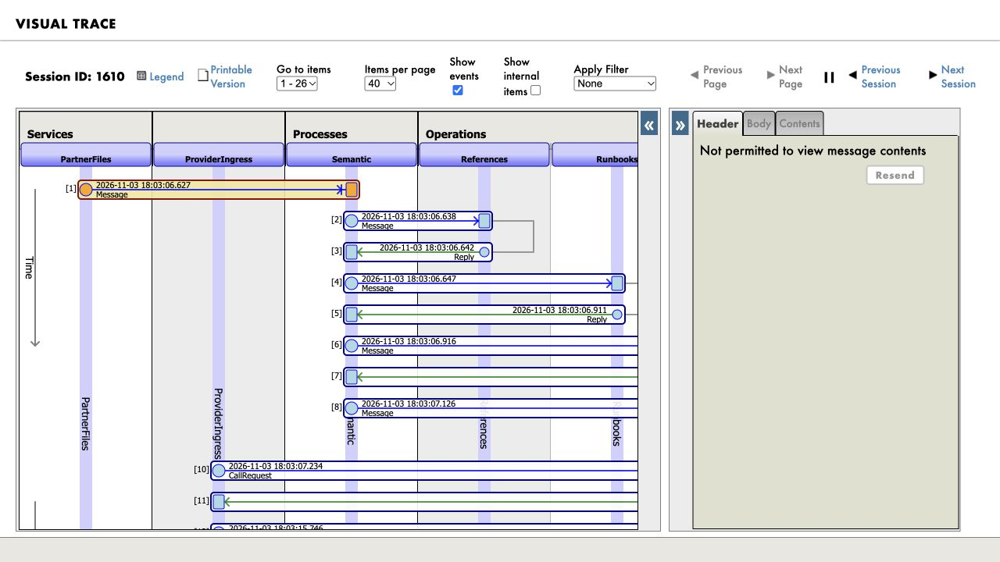
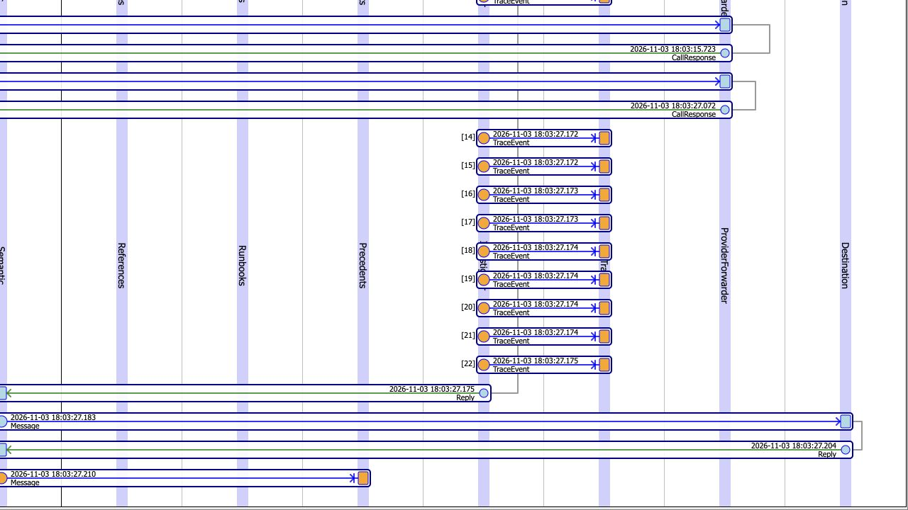

# Accept a partner order without a new REST integration

A partner can deliver a UTF-8 order file to a trusted local inbox. SilentShift's
custom `Ens.InboundAdapter`, `SilentShift.Adapter.PartnerJSON`, claims the file
and sends it through the production's `PartnerFiles` Business Service. It follows
the same reference, investigation and policy path as REST intake.

Enable `SILENTSHIFT_PARTNER_FILES_ENABLED=1` before bootstrap. The default is
disabled. The fixed inbox is `.local/partner-inbox`, mounted read/write at
`/var/opt/silentshift/partner-inbox`. It must be writable only by the trusted
operator and container account. Write `<name>.json.part`, close it, then atomically
rename it to `<name>.json.ready` on the same filesystem. Submit the message itself,
not a Scenario Lab envelope. The [driver](../scripts/verify_native_adapter.py)
documents names, byte limits, bounded batches and recovery.

## Observed in the production

```sh
uv run python scripts/verify_native_adapter.py --allow-local-model-calls --output evidence/native/adapter.json
uv run python scripts/verify_native_adapter.py --inspect-file adapter-a0a5ad658f154bb0badf7ff97ae9bf3d-allow
uv run --env-file .env python scripts/verify_native.py --allow-model-calls --output evidence/native/step4-five.json
```

The live run `a0a5ad658f154bb0badf7ff97ae9bf3d` passed all contract, iterator,
outcome, replay and invalid-input checks. Two actual model investigations ran:

| File outcome | Case / original native session | Result |
| --- | --- | --- |
| `240 EA` agrees with its approved contract | `D23769A0-D7B0-11F1-9980-CA5720F48492` / 1610 | DELIVERED; one simulator receipt |
| Unsupported `20 CASE` commitment | `E10A0F45-D7B0-11F1-9980-CA5720F48492` / 1636 | QUARANTINED; zero receipts |

Both used all four native evidence tools. The driver verified original bytes,
SHA-256 and byte counts, actual service/process/investigator headers and native
precedent retrieval. A deliberate acknowledgement-path obstruction exhausted
three write attempts; resuming that same file preserved its case, trace and one
receipt. Different-name duplicate events and same-name redrops caused no new
investigation or delivery. Malformed, oversized and internal-envelope inputs
created no case; a symlink was not followed.





[Full adapter receipt](evidence/adapter.json) · [five-scenario and web gate](evidence/step4-gate.json).
The post-integration native run passed **5/5**, Python **172**, TypeScript/build,
**32** disconnected and **16** native browser checks passed. Inference ran
serially on the warmed local model.

## Read the acknowledgement as a snapshot

The acknowledgement preserves the first observed outcome and its timestamp.
If that outcome is REVIEW, a later approval updates the case; it does not rewrite
the earlier held acknowledgement. Follow the case ID for current state. An earlier
trial exercised exactly this path: case `1055DC7F-D7AF-11F1-9980-CA5720F48492`,
session 1411, was held, then explicitly approved through its native task and
delivered once. The driver initially compared that earlier snapshot with the
later receipt incorrectly. Those failed verifier artifacts remain retained;
the independent final repeat passed without that comparison error.

Input files and archives remain retained. Uncertain enqueue outcomes never cause
automatic redispatch; inspect native headers before operator recovery. The inbox
is local trusted intake, with no recursive traversal or partner-selected paths.
This is proof against the included simulator, not an external partner filesystem
or an ERP delivery guarantee.
