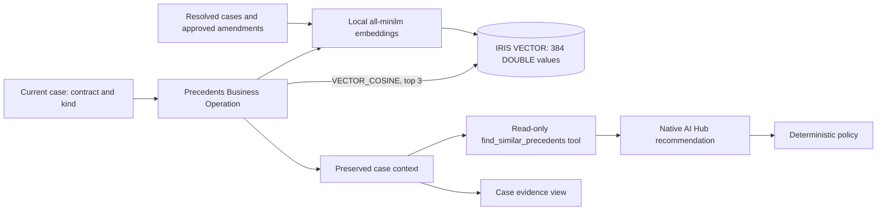
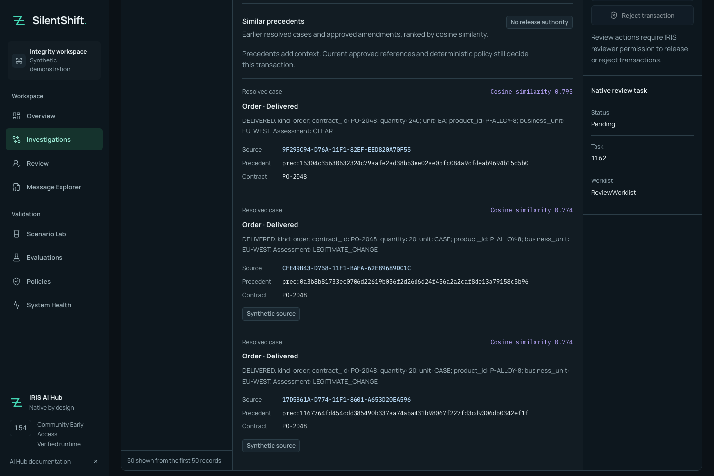

# A past delivery is a clue, not permission

An operator investigating `20 CASE` can now see earlier resolved orders and approved amendments beside the current contract. Each result carries its source ID, outcome and actual cosine similarity. A past delivery can help explain what to investigate; it cannot approve today's order.

SilentShift embeds structured business fields from actual persisted `DELIVERED` and `REJECTED` cases, plus approved amendments whose predecessor and dates validate against the reference catalog. It excludes partner notes, model answers and review prose. All current demonstrations are synthetic. It does not fabricate resolved history to populate the panel.

## Native data flow



`Semantic` calls the separate `Precedents` operation before invoking the agent. It alone saves the returned context, so a late retrieval response cannot race policy or overwrite a case. The fourth tool reads an immutable server-bound snapshot; its callback invokes no embedding service, Python or arbitrary SQL. It returns at most three source/precedent IDs, outcomes, real scores and short excerpts. The workbench retains fuller summaries and links to source cases.

Search is scoped to the current contract and transaction kind, excludes the current case, and admits resolved cases only when they predate its receipt. Precedents never enter the approved reference snapshot or the set of allowed citation IDs. New completed cases are indexed asynchronously through the production operation. Indexing cannot change a route or delivery receipt.

The small corpus uses exact native `VECTOR_COSINE`, not an unmeasured approximate index. Equal summaries can produce repeated-looking results with distinct real source IDs. Retrieval can return fewer than three results; the payment example currently has no resolved precedent. That absence grants no release authority.

## Reproduce locally

Install local `all-minilm:22m` and configure the IRIS-reachable local Ollama embedding URL. No remote provider is accepted. Explicitly index existing eligible records:

```sh
uv run python scripts/verify_native_precedents.py --seed --allow-local-embedding-calls
```

The first executed seed stored **16 vectors: 15 resolved cases and one approved amendment**, using two local embedding requests. Native compiled-property metadata confirmed `%Library.Vector`, `LEN=384`, `DATATYPE=DOUBLE`; native self-cosine and source bindings passed for every row. A fresh installation has no past resolved cases until the operator runs cases. Its approved amendment can be indexed immediately; do not substitute fictional history.

Run the native five-case journey, then inspect returned IDs:

```sh
uv run --env-file .env python scripts/verify_native.py --allow-model-calls
uv run python scripts/verify_native_precedents.py --inspect-case CASE_ID
```

Inspection is read-only and verifies the actual reciprocal `Semantic → Precedents` message headers, case association, retrieval-before-agent ordering, stored scores and fourth-tool audit. Seeding alone is not evidence of an agent using retrieval.

## What actually ran

Run `fc12cbcf-c9fc-4813-8614-8ac944d6e8fd` passed **5/5 native and final outcomes** with prompt `silentshift-investigator/1.3.1`. Each case read all four tools. On this run the SDK batched the four tool requests in one response, so each investigation made two actual provider HTTP calls; both calls have native request/response pairs. The five final routes were quarantine, quarantine, delivered once, review, quarantine. The deterministic baseline also solves these five examples; no accuracy uplift is claimed.

The current quantity case `B8440121-D7AB-11F1-9980-CA5720F48492`, native session 1266, retrieved three real prior deliveries and stayed quarantined with zero deliveries. A separate native read-only check presented a valid `ALLOW` with every current citation and zero uncertainty; policy vetoed it because the current contradiction is critical. A Python regression also tests a misleading delivered precedent with similarity 0.9999.

Synthetic fixture partitions deliberately share `PO-2048`; the precedent search can retrieve a completed case from a different partition as non-authoritative context. The current case's independent reference snapshot stays isolated. This supplies a concrete misleading-history demonstration, not measured operational relevance.



[Mobile capture](assets/precedent-evidence-mobile.png) · [case inspection](evidence/precedents.json) · [native source/vector proof](evidence/precedent-corpus.json) · [misleading-precedent veto](evidence/precedent-veto.json).

## Runtime boundary

The successful full run used a warmed local model and serialized model execution. Two earlier trials missed native completion gates under load, while policy continued to hold unsafe cases. A real response took 65.9 seconds; a further same-sized request appeared after about 60 seconds, consistent with an SDK timeout/retry. Provider retry classification remains null. Prompt 1.3.1 uses a 192-token ceiling and at most 24 words of final explanation; the full evidence remains in the workbench. The native wait remains 120 seconds, and provider cancellation is unverified.

For a controlled warm-up through the same native gateway:

```sh
docker --context colima-silentshift exec -i silentshift-clean-iris-1 iris session IRIS -U SILENTSHIFT <<'IRIS'
set sc=$SYSTEM.OBJ.Load("/opt/silentshift/tests/iris/ProviderProbe.cls","ck")
set sc=##class(SilentShift.Test.ProviderProbe).Run("basic",.id,.summary)
write "STATUS=",$SYSTEM.Status.IsOK(sc),!,summary,!
halt
IRIS
```

This creates an explicitly synthetic transport diagnostic outside the evaluation dataset and contains it with zero deliveries. Run model verification without simultaneous browser/test workloads on a constrained machine. Cold-start reliability, larger corpora, general relevance and production capacity remain unmeasured.
