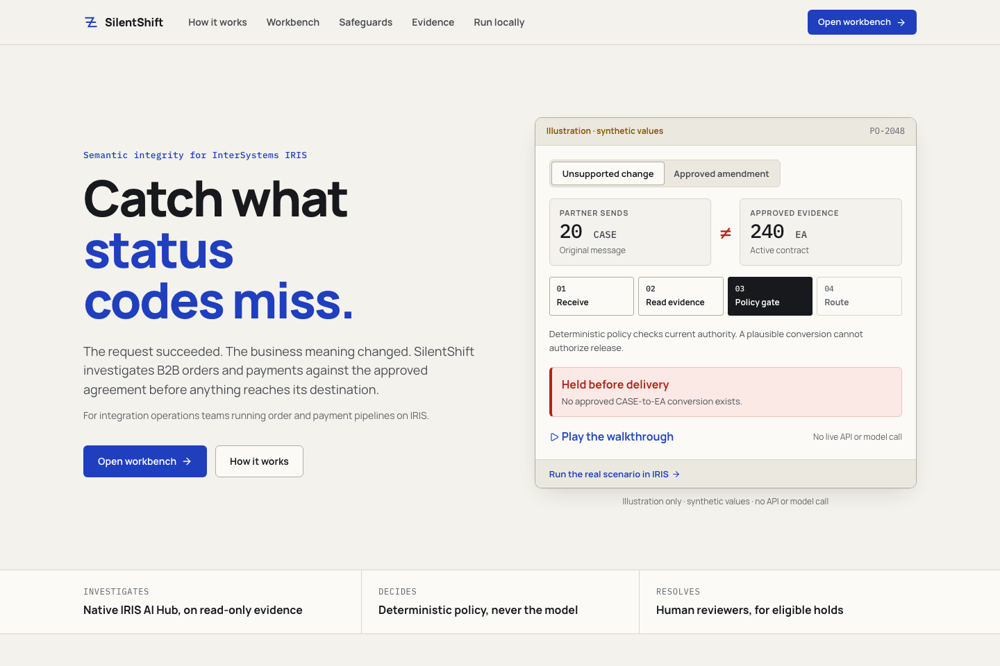

# Approved README opening — retained proposal

The owner approved this wording on November 9 and the root README now uses it. This file retains the reviewed proposal. It uses the frozen results without claiming an overall accuracy advantage. Publication and package versions remain unchanged. Links below resolve from this preview; adjust their relative paths if this copy is moved to the repository root.

---

# SilentShift

**Find the business contradiction behind a successful integration.**

SilentShift helps integration operations teams inspect B2B orders against independently approved commitments before delivery. An order says **20 CASE**; its contract says **240 EA**. The message passes technical validation, but no approved conversion authorizes the change. The operator sees the two values, their sources and a held order with no simulator delivery. An effective approved amendment authorizing **20 CASE** changes the outcome.

The investigation runs inside InterSystems IRIS Interoperability. Native AI Hub reads case-scoped evidence and recommends a route. Deterministic policy retains the final authority; eligible holds go to native Workflow review, while critical contradictions cannot be approved.

**[Install from one guide](../INSTALL.md)** · [Watch the captioned demo](https://youtu.be/a4dOcqu89EA) · [Open Exchange](https://openexchange.intersystems.com/package/SilentShift)

The app runs locally. There is no hosted demo. The video records the earlier core workflow and predates the new workbench and CSV importer.

## What the held-out comparison showed

- On **48 frozen synthetic orders**, rules-only produced **33/48** correct routes; agent + policy produced **33/48, 33/48 and 30/48** across three trials.
- Rules recommended releasing **6/23** release-ineligible orders. The shipped arm made **2/23, 3/23 and 3/23 actual wrong simulator deliveries**, with more false holds: **9/25, 9/25 and 12/25**, versus the baseline's **9/25**.
- **Agent + policy did not improve correct routing in the unstructured split: 1/16 for both in every trial.** Five failed agent attempts remain counted. This does not establish an overall AI accuracy improvement.

[Every result, failure, timing and rules win](EVAL_HELDOUT.md) · [Frozen labels and protocol](../fixtures/v2-heldout/FROZEN.md) · [Raw native observations](../evidence/heldout/summary.json). Baseline releases are counterfactual choices; only the shipped arm executed simulator deliveries. The same cases repeat across trials and are not independent production orders.

## The short judge path

Follow [INSTALL.md](../INSTALL.md), then connect with your configured local IRIS account. Fresh inference needs the local Ollama model and embeddings. The alternative keyless path uses recorded responses and does not prove fresh inference or the amendment case.

1. Open **Scenario Lab → Quantity mismatch** and inject once. Inspect `20 CASE`, the independently approved `240 EA` reference, the critical finding and **zero deliveries**. Local inference may take longer than a quick inspection.
2. Run **Approved amendment**. Follow the effective reference to the allowed route and its single simulator receipt. The change is approved authority, not a guessed conversion.
3. Open the case's native **Visual Trace**. Each admitted provider exchange is its own request/response pair in the business-case session. Inspect model, provider, prompt version, duration, tool calls and available response usage. Unknown cost and provider retries stay null.
4. Inspect **Review** and **CSV Import**. Review requires permission, a reason and the current case version. CSV preview uses a separate approved-reference export; commit requires explicit importer permission. Precedents add evidence and cannot override current authority.

[Full walkthrough](JUDGE_GUIDE.md) · [CSV guide](CSV_IMPORT.md) · [Verified source, commands and limits](BUILD_STATUS.md).

## What is technically interesting

- **AI Hub is inside the production.** A Business Service and Business Process coordinate native investigation, read-only evidence tools, policy and routing Operations.
- **LLM calls are business trace messages.** [DPI-I-689](https://ideas.intersystems.com/ideas/DPI-I-689) connects provider exchanges to the case's evidence, review and delivery/hold. [Reproduce it and compare with Langfuse](NATIVE_AI_HUB.md). The dedicated OEX association is publicly visible; organizer qualification remains unconfirmed.
- **Authority is explicit.** The model proposes; policy authorizes. Review versioning and idempotency preserve a recorded decision and a single simulator receipt in the verified workflow.

## Versions and limits

Only **2026.3.0AI.154.0 Community / 154U ARM64** is qualified locally. Obtain its separately licensed image from InterSystems; it is not bundled or publicly redistributed. Other builds and platforms are not claimed tested.

Public native IPM and OEX release remain **0.3.0**; the separate React package remains **0.2.1**. Provider configuration and the new multi-page workbench are changes on `push/top3`, not a newly published native package. Use the matching source checkout for those changes. External OpenAI, Gemini and OpenRouter service execution remains unverified; no paid provider is needed for the tested local path.

All supplied examples are synthetic. Delivery is per line to an IRIS simulator, not an external ERP or bank. There is no X12 parser, whole-order completeness guarantee, hosted demo or production-readiness claim. The held-out prose-authority failures are a real limitation of the shipped structured-authority policy.
