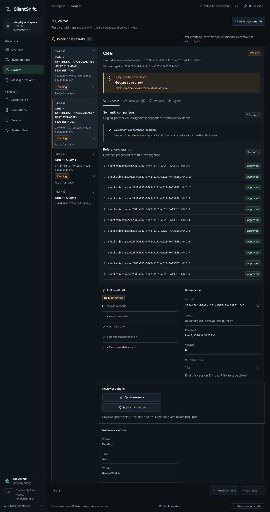

# Recoverable human review in IRIS: from approval to one delivery

An operator approves a held transaction. The server saves the decision, then native Workflow completion fails. The browser receives HTTP 503.

At that point, an ordinary “Try again” button asks the operator to guess what happened. Did the approval persist? Is another reason required? Would a second click create another delivery?

SilentShift treats this interruption as a recoverable state. The saved decision remains visible, the case stays held, and **Resume recorded review** continues the original request. In the controlled recovery test, that continuation completed the native task and produced one destination-simulator receipt.

This article explains the boundary between the decision, native task completion and delivery. All transactions are synthetic; the destination is an IRIS simulator.

## Put the human wait in native Workflow

SilentShift investigates changes in business meaning inside an IRIS interoperability production. Its AI Hub agent gathers evidence and proposes a route; Embedded Python policy determines whether the evidence permits release. The [first article](https://community.intersystems.com/post/catching-semantic-failures-iris-interoperability-production) explains the contract comparison and the agent's read-only tools.

A held investigation still needs an owner. SilentShift uses a separate durable [`Coordinator`](https://github.com/himanshu748/silentshift/blob/main/src/SilentShift/Workflow/Coordinator.cls) Business Process to send a `ReviewRequest` asynchronously to an `EnsLib.Workflow.Operation`. The task handler extends `EnsLib.Workflow.TaskResponse`.

The coordinator can wait for the native deferred response without keeping the original HTTP request or an operation job occupied while a human considers the case. The original investigation finishes in its held state; the native task owns the longer human wait.

The demo configures one reviewer in the native `ReviewWorklist` role. That membership is separate from the IRIS `SSReview` permission checked by the application. A new decision requires both the authorized application identity and the corresponding native reviewer/task association. Multi-user allocation and escalation are outside this implementation.

The workbench reads pending tasks from the native worklist through the API and opens their investigation evidence. A browser label cannot establish that a task is actionable: the server verifies its case, role, assignment and worklist association.



## Persist the decision before attempting completion

The review request carries four application fields. This illustrative body shows their shape; its version and key are examples:

```json
{
  "action": "approve",
  "reason": "The approved amendment covers this event.",
  "expected_version": 12,
  "idempotency_key": "review-example-001"
}
```

The server derives reviewer identity from the authenticated request. It checks a new decision against the current case version, requires a bounded reason, evaluates deterministic policy and claims the native task. Approval cannot override a critical contradiction, and the native task callback repeats the authorization check.

[`Store.Review`](https://github.com/himanshu748/silentshift/blob/main/src/SilentShift/Store.cls) then commits the case update, a `ReviewAction` receipt and the review event in one IRIS transaction. The receipt retains the action, reason, reviewer, original case version and idempotency key. The workflow status becomes `completion_pending`.

Only after that commit does the application synchronize native completion. The native ownership claim has its own persistence; no application transaction spans the Workflow engine's deferred-response enqueue path. Treating those operations as one indivisible transaction would conceal the interruption the product must recover from.

The resulting states are deliberately distinct:

| Observed state | Persisted review decision | Native completion confirmed | Simulator delivery |
|---|---|---|---|
| Awaiting a reviewer | No | No | None |
| `completion_pending` | Yes | Not yet | Held during synchronization failure |
| Completed approval and delivery | Yes | Yes | One receipt in the verified journey |
| Completed rejection | Yes | Yes | None |

A committed decision therefore does not make the UI claim that delivery succeeded. The native task and destination receipt provide the remaining evidence.

## Check the receipt before checking a retry's version

Versioning and idempotency solve different problems. `expected_version` prevents a new decision based on stale evidence. The idempotency key identifies a decision that may already have committed.

The distinction becomes visible after a failure. Saving the first decision advances the case version. Native workflow events can advance it again. A retry of the same decision still carries its original version; replacing that version would change the request the operator authorized.

The implementation checks for the receipt before applying the new-decision version check. Its control flow can be summarized as follows; this is explanatory pseudocode:

```text
lock case
receipt = lookup(case_id, idempotency_key)

if receipt exists:
    require identical authenticated reviewer and request fingerprint
    unlock case
    resume native completion
else:
    require current case version and an undecided native task
    require reviewer authority, reason and policy permission
    claim native task
    commit case + review receipt + review event
    unlock case
    synchronize native completion
```

The fingerprint includes the authenticated reviewer and canonical request body. Reusing the same key with a different reason, action or version is a conflict. Choosing a new key also cannot replace an already committed task decision. These checks give a retry a narrow meaning: continue the recorded decision.

The workbench reflects that rule. **Resume recorded review** reconstructs the original request from the server-side receipt and displays its locked reason. It does not silently turn a recovery attempt into a fresh approval.

## Serialize completion separately from decision persistence

The case lock protects the decision commit. [`SyncCompletion`](https://github.com/himanshu748/silentshift/blob/main/src/SilentShift/Workflow/Support.cls) uses a separate completion lock so concurrent exact-key retries cannot independently enqueue the same native response.

Before completing a task, the server verifies the task/case binding, reviewer assignment and matching committed receipt. For approval, it re-evaluates policy. The task's `OnAction` callback uses that same authorization boundary, so invoking a native Workflow action directly cannot bypass the application decision.

There is another failure window inside native completion: the worklist item can be removed before its deferred response is successfully enqueued. Recovery cannot rely exclusively on finding that item again. The completion code checks the persisted task and receipt, then resumes through the guarded task callback when needed. The pending-task API also includes receipt-backed held cases so this intermediate state remains discoverable.

At the final boundary, the simulator destination independently checks policy and persists a unique receipt. The concurrency test sent two simultaneous identical approvals. Both requests returned HTTP 200; the observed result was one review receipt, one native completion response and one delivery.

That is the demonstrated guarantee for this persisted simulator. A real shipment or payment endpoint would need its own effect and retry contract; these tests do not establish exactly-once behavior for arbitrary external systems.

## Inject the failure after the commit

The useful recovery test interrupts the gap between saving a decision and completing its effect. A validation error before persistence would exercise a different path.

For the controlled experiment, a synthetic case had an eleven-reference snapshot, exceeding the agent's evidence budget. Inference was skipped and the case entered review with its approved evidence preserved. The test temporarily made the native task's deferred-response destination invalid, then submitted an otherwise eligible approval.

The API returned HTTP 503 after the approval committed. Inspection showed `completion_pending`, routing `REVIEW` and zero deliveries. The original native token was restored immediately.

After reconnecting, the operator could see the saved reason and original version. **Resume recorded review** completed the native task and delivered once. Repeating the original request preserved the same decision and the same one delivery.

The [recovery receipt](https://github.com/himanshu748/silentshift/blob/main/docs/evidence/workflow.json) records that experiment. The separate [worklist receipt](https://github.com/himanshu748/silentshift/blob/main/docs/evidence/review-queue.json) covers concurrent identical approvals, rejection and pending-task reads. Viewer denial, stale-version rejection and direct native-action denial were also exercised. These are controlled tests of specific boundaries; they do not cover every crash, outage or external destination failure.

## Reproduce the boundary through the product

Start with the [native build-154 setup](https://github.com/himanshu748/silentshift#native-build-154-setup), using the official licensed AI Hub image and private local configuration. Bootstrap installs the coordinator and worklist without making a model call.

To create isolated synthetic review cases and exercise the queue, approval, rejection and concurrency paths without LLM inference, run:

```sh
uv run python scripts/verify_native_review_queue.py --allow-new-synthetic-cases
```

The separate controlled recovery verifier creates a no-model boundary case and makes one local-model conflict investigation:

```sh
uv run python scripts/verify_native_workflow.py --allow-one-local-model-call
```

Use the local inference configuration documented in the repository. Open **Review** as the configured reviewer and inspect the task's investigation. Compare the saved review receipt, native task state and simulator receipt before and after recovery. The [captioned demo](https://youtu.be/a4dOcqu89EA) shows the workbench and native components; the [reproduction guide](https://github.com/himanshu748/silentshift/blob/main/docs/JUDGE_GUIDE.md) supplies the shorter operator walkthrough.

[Open Exchange application](https://openexchange.intersystems.com/package/SilentShift) · [Source and installation](https://github.com/himanshu748/silentshift) · [Native Workflow implementation](https://github.com/himanshu748/silentshift/tree/main/src/SilentShift/Workflow)
