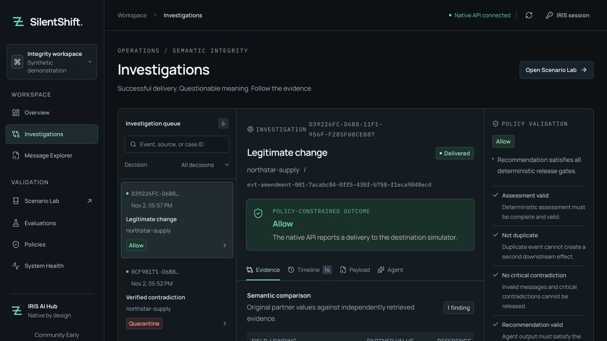

<!-- ARTICLE DRAFT — NOT PUBLISHED TO DEVELOPER COMMUNITY. Verified source and extensions are on public GitHub main; article publication requires separate authorization. -->

> Preparation note — exclude from the published article: replace `<OPEN_EXCHANGE_APP_URL>` and `<YOUTUBE_VIDEO_URL>` below with checked public URLs. The Open Exchange application is a saved draft and the video is not uploaded. The article body starts at the title.

# Check business meaning before delivering an IRIS transaction

A supplier sends `20 CASE` for an order whose approved contract specifies `240 EA`. The JSON is valid. The integration can accept and deliver it without a transport error. There is still no approved conversion between those units.

SilentShift investigates this gap inside an InterSystems IRIS interoperability production. The demonstration uses synthetic orders, payments and reference records. Its destination is a persisted IRIS simulator, so testing a containment decision cannot change a real shipment or payment.



## The same change can deserve a different decision

The [frozen scenarios](https://github.com/himanshu748/silentshift/blob/main/fixtures/v1/README.md) include a useful pair. Scenario A holds the supplier's unapproved quantity/unit change. Scenario C supplies an approved amendment authorizing `20 CASE`, effective before the event time; the earlier `240 EA` contract has expired. C should reach the destination.

The payment example compares `12550` minor EUR units with an interface contract requiring `125.50` major units. Numeric equivalence does not authorize an interface transformation: SilentShift checks the declared representation without inventing a conversion or a monetary-loss estimate.

The remaining scenarios cover conflicting peer references without release authority and a hostile recommendation. That last case explicitly injects a validator test proposal after a native agent reply and preserves the real reply separately. It tests the policy veto without pretending that an injected answer came from the model.

## Keep the decision inside the production

The implemented path is:

```text
Partner Business Service → Semantic Business Process
  → reference and native AI Hub Operations
  → Embedded Python policy → destination or quarantine Operation
```

The native agent reads the current message, approved contracts, related records and similar precedents through four server-bound tools. It proposes `ALLOW`, `QUARANTINE` or `REQUEST_REVIEW`, with evidence IDs, an explanation and uncertainty. It cannot select another case, execute arbitrary SQL, mutate a contract or deliver a transaction.

Local embeddings and IRIS `VECTOR_COSINE` retrieve procedural guidance and precedent evidence. The fourth tool reads up to three actual resolved cases or approved amendments, with source IDs and scores. The operator can follow the source from the evidence view. Prior delivery remains context: a native test retrieved past deliveries, and deterministic policy still vetoed a valid-looking ALLOW proposal for a current critical contradiction.

[Deterministic policy](https://github.com/himanshu748/silentshift/blob/main/python/silentshift/engine.py) independently checks the evidence and proposal. Critical contradictions stay quarantined. Missing evidence, malformed output and uncertain findings require a hold or review. The destination rechecks authorization before creating a unique receipt. Human release also requires reviewer permission, a reason, the current case version and an idempotency key.

Automatic delivery requires a valid native `ALLOW` proposal and independent release eligibility. The agent's bounded task is evidence investigation and a proposed decision. The five fixtures are also solvable by the rule-only baseline; they establish no AI accuracy improvement.

An unresolved case can become a native Workflow task. The operator sees its evidence, records an authorized decision and can resume a committed review if native completion fails. Critical contradictions retain their release veto. The [review-recovery walkthrough](https://github.com/himanshu748/silentshift/blob/main/docs/articles/engineering.md) explains that distinct journey.

## Run the native application

The recorded native environment uses Community AI Hub `2026.3.0AI.154.0` on ARM64 and local Qwen3 4B through an OpenAI-compatible Ollama endpoint. Load the official image locally first. Current kit availability and the organizer's newer-build exception are recorded in the [version notes](https://github.com/himanshu748/silentshift/blob/main/docs/CONTEST_COMPLIANCE.md); the measured core runs are for 154.

```sh
git clone https://github.com/himanshu748/silentshift silentshift
cd silentshift
cp .env.example .env
chmod 600 .env
uv sync --locked
```

Set the loaded image tag, unique viewer/reviewer/gateway credentials and model configuration in `.env`, following the [README](https://github.com/himanshu748/silentshift/blob/main/README.md). The process wait defaults to 60 seconds; the tested resource-constrained local 4B setup uses an explicit `SILENTSHIFT_AGENT_WAIT_SECONDS=120`, within its accepted 10–120 second range. A timeout holds the case and does not prove that the provider stopped working. Then start IRIS and the workbench:

```sh
uv run --env-file .env python scripts/doctor.py
uv run --env-file .env python scripts/bootstrap.py
npm --prefix web ci
npm --prefix web run dev -- --port 5173 --strictPort
```

Bootstrap seeds references without creating cases or calling a model. Open `http://127.0.0.1:5173`, connect an IRIS account and select a Scenario Lab experiment. To reproduce all five native investigations, use the configured local inference route:

```sh
uv run --env-file .env python scripts/verify_native.py --allow-model-calls
```

## Follow the recommendation through to its effect

The [clean IPM installation](https://github.com/himanshu748/silentshift/blob/main/docs/evidence/ipm-clean-install.json) began on an official build 154U instance without a source mount. After explicit setup, its five-case native run recorded **4/5 expected agent proposals and 5/5 expected final decisions**, with all four tools read. The approved amendment delivered once; the other four cases had zero deliveries. The conflicting-reference case shows why the distinction matters: the model proposed quarantine, while policy retained the required review route.

These are five frozen synthetic cases, also solved by the deterministic baseline. They establish the demonstrated workflow and containment checks, not an accuracy uplift or a general performance result. The [evidence guide](https://github.com/himanshu748/silentshift/blob/main/docs/BONUS_EVIDENCE.md) links separate native checks for provider tracing, Workflow decisions, precedent retrieval, partner-file intake and installation. Retained failures remain inspectable.

## What the native integration made visible

The native AI Hub integration keeps evidence reads inside the case's interoperability session. Typed provider request/response messages make each actual local HTTP exchange visible in Visual Trace. The verified failure probe recorded a real Ollama HTTP 400 and stayed held with zero simulator deliveries. This helps connect an operator's question—why did this transaction stop?—to the call that failed.

Local Qwen3 4B avoided a paid cloud-provider dependency for these runs. Its response time still depended on local resources: cold or loaded attempts timed out, while the recorded successful repeat used a warmed model and serialized execution. A bounded process wait keeps that uncertainty from authorizing delivery. It does not prove provider cancellation.

HTTP response usage is retained when present. Unknown provider retry counts, session totals and billing-derived cost remain unavailable rather than being inferred. Local hardware and energy costs were not measured. External delivery, broader model trials and production capacity remain unverified.

Start with A and C in the [judge walkthrough](https://github.com/himanshu748/silentshift/blob/main/docs/JUDGE_GUIDE.md). Compare their effective reference records, policy checks, native session IDs and delivery receipts.

**Source and installation:** [SilentShift on GitHub](https://github.com/himanshu748/silentshift)

**Open Exchange application:** [SilentShift on Open Exchange](<OPEN_EXCHANGE_APP_URL>)

**Demo video:** [Watch the walkthrough](<YOUTUBE_VIDEO_URL>)
